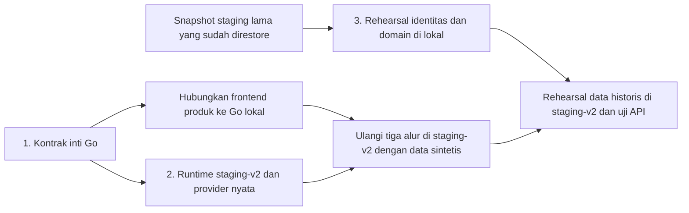

# Peta integrasi frontend LMS v3

**23 November 2026.** Pemilik proyek akan meneruskan frontend produk yang sudah ada dan memegang penerimaan UI. Backend menyediakan kontrak dan bukti QA yang bisa dipakai langsung oleh pemilik proyek. `/fe-test` tetap menjadi alat uji kontrak Go. Kode dan daftar layar frontend produk belum diperiksa dalam review ini.

Tujuan awalnya agar frontend produk bisa menjalankan tiga alur inti dengan backend Go sungguhan. Sesudah itu alur yang sama dibuktikan di `staging-v2`, lalu diulang pada data hasil migrasi. Go tetap memegang akun, sesi dan izin per Class. `staging-v2` adalah nama proyek Postgres tujuan yang direncanakan. Kesiapan proyek, host Go, domain, OAuth dan layanan email tujuan masih perlu dikonfirmasi.

Eksekusi dan acceptance per layar dicatat menggunakan [checklist integrasi](INTEGRATION_CHECKLIST.md). Hasil run yang sudah diterima dihimpun di [indeks QA](QA_EVIDENCE.md).

## Posisi yang sudah dikonfirmasi

| Bagian | Bukti sekarang | Pekerjaan tersisa |
|---|---|---|
| Browser `/fe-test` | **3/3 alur, 10 langkah** pada Chrome dan Go lokal. | Ulangi pada frontend produk dan lingkungan tujuan. [Bukti browser](LOCAL_PREVIEW.md#qa-browser-dari-prompt-preview) |
| Runtime dan identitas | **7/7** skenario API preview dan **5/5** checkpoint M04 lokal sintetis. Google diuji dengan provider sintetis. | Mode Go bersama, OAuth Google nyata, email undangan dan reset nyata. [Preview](LOCAL_PREVIEW.md) · [Autentikasi](AUTHENTICATION_V3.md) |
| Kontrak API | [Panduan API](../API-DOCS.MD) dan [OpenAPI inti](../api/openapi/lms-v3-core.json) mencakup identitas, undangan Class dan tugas hingga release nilai. [Kontrak CP11–CP12](api/cp11-cp12.openapi.json) dan [reporting](../api/openapi/reporting-v1.json) tetap tersedia untuk cakupan masing-masing. | Cocokkan layar frontend produk, terutama discovery ID submission dan item nilai oleh Teacher, lalu buktikan wiring browser ke Go lokal. |
| Historis | Restore snapshot staging lama di Postgres lokal terverifikasi pada **21 tabel, 7.843 record**. Importer Go lokal sudah lulus dry-run, rollback, import dan replay untuk inti, membentuk **17 Class draft, 132 akun historis dan 118 participation**. | Akun hasil impor belum punya kredensial aktif. Satu enrollment ditahan, **7.576 record sumber** menunggu mapping domain lanjutan. Akses via API pada database impor dan rehearsal `staging-v2` masih terbuka. [Restore](checkpoints/2026-11-19-local-legacy-restore-accepted.md) · [Impor inti](checkpoints/2026-11-22-go-core-import.md) |

Hitungan CP lokal berlaku pada cakupan dan versi sumber yang tercatat. Syarat seperti provider nyata, data historis dan acceptance lingkungan bersama punya bukti tersendiri. Review ini memakai bukti QA yang sudah ada. [Peta M00–M19](MODULE_CHECKPOINT_MAP.md)

## Urutan pengerjaan

Penyusunan mapping historis lokal bisa berjalan paralel dengan kontrak dan runtime. Untuk pengguna baru dan data sintetis, frontend bisa mulai tersambung di lokal segera setelah kontrak inti bisa dipakai. Uji data historis di lingkungan bersama mengikuti bukti rehearsal lokal dan verifikasi target.

### 1. Selesaikan kontrak API dan sambungkan frontend di lokal

**Modul** [M14](modules/M14.md), [M04](modules/M04.md), [M05](modules/M05.md), [M07](modules/M07.md), [M08](modules/M08.md) dan [M09](modules/M09.md).

- Gunakan [panduan API](../API-DOCS.MD) dan [OpenAPI inti](../api/openapi/lms-v3-core.json) untuk login, bootstrap sesi setelah reload, reset, logout, undangan/acceptance, daftar dan detail Class, konten/revisi tugas, submission, nilai dan release. Dokumen memuat izin per aktor, pagination, versi data dan idempotency. Pembuktian berikutnya dilakukan pada frontend produk.
- Dokumentasikan `__Host-lms-v3`, HTTPS, origin yang diperbolehkan dan `X-CSRF-Token` sesuai kontrak masing-masing aksi. `Gateway` saat ini memeriksa TLS dan membatasi origin untuk mutasi. `/fe-test` memakai request path relatif dan `credentials: 'same-origin'`. Rencana awal memakai satu origin publik dengan `/v3` menuju Go dan `/auth/google/callback` menuju halaman frontend. Jika menggunakan reverse proxy, uji jalur TLS dan header sesuai pemeriksaan `Gateway`. Jika frontend produk memerlukan origin terpisah, tetapkan kontraknya dulu dan uji cookie, CORS, CSRF serta callback sebelum wiring. [Pemeriksaan gateway](../internal/identity/http.go) · [Kontrak autentikasi](AUTHENTICATION_V3.md)
- Pemilik proyek mencocokkan daftar layar frontend produk dengan operasi dan coverage backend, kemudian mengganti client/mock pada tiga alur inti sambil mempertahankan desain yang sudah ada. Gunakan identitas dan file dummy dalam preview. Saat perlu uji manual, pemilik proyek menyalakan preview dari terminal. [Cara menjalankan preview](LOCAL_PREVIEW.md#menjalankan-preview-manual)

**Selesai jika** kontrak mencocokkan payload dan respons Go, serta browser frontend produk lulus tiga alur di bawah pada Go lokal. Cek juga status loading, sesi setelah reload, penolakan akses, konflik dan kegagalan API yang perlu ditampilkan UI.

### 2. Siapkan runtime `staging-v2` dan uji dengan data sintetis

**Modul** [M00](modules/M00.md), [M01](modules/M01.md), [M03](modules/M03.md), [M04](modules/M04.md), [M14](modules/M14.md) dan bagian persiapan [M16](modules/M16.md).

- Buat konfigurasi runtime bersama yang terpisah dari preview. `cmd/api` saat ini hanya menerima mode lokal, preview memeriksa identitas cluster/role sintetis, dan `cmd/migrate` membatasi mode ke lab sintetis. Reuse handler dan kebijakan akses. Tambahkan prosedur migrasi maju dengan role operator terpisah, backup target yang sudah dibuktikan bisa direstore, serta verifikasi skema/versi saat readiness. Saat smoke, buktikan setelan database dan lingkungan keliru ditolak. [Konfigurasi runtime](../internal/platform/config/config.go) · [Identitas preview](../internal/localpreview/preview.go) · [Entrypoint migrasi](../cmd/migrate/main.go)
- Konfirmasi host/proses Go dan origin aplikasi. Tempatkan DSN dan rahasia provider di runtime server. Verifikasi identitas proyek Postgres baru, TLS dan hak role runtime. Gunakan Postgres untuk Go serta batasi eksposur skema aplikasi lewat Data API. Pilih jenis koneksi Supabase setelah host Go, tooling migrasi dan penggunaan pool dikonfirmasi. [Koneksi Postgres Supabase](https://supabase.com/docs/guides/database/connecting-to-postgres) · [Eksposur dan hak akses Data API](https://supabase.com/docs/guides/api/securing-your-api)
- Pasang Google OAuth pada URI callback yang sesuai origin tujuan. Aktifkan jalur delivery undangan dan reset, uji dengan akun/email uji yang dikendalikan pengguna. Buktikan email + password dan Google bisa terhubung ke satu ID akun yang sudah diprovisikan admin, serta logout, sesi berakhir dan reset/revocation berperilaku sesuai dokumentasi. Smoke juga mencakup audit, readiness dan restart/rollback rilis aplikasi. Bila gelombang awal butuh upload atau akses berkas, uji adapter penyimpanan dan scanner nyata. Preview memakai file lokal dan scanner fixture. [Router preview](../internal/localpreview/http.go)

**Selesai jika** frontend produk lulus tiga alur dengan Go yang berjalan pada lingkungan tujuan dan Postgres `staging-v2` berisi data sintetis, plus OAuth Google nyata dan delivery email undangan/reset berhasil. Catat versi frontend/backend, target, migration receipt dan hasil Go/DB serta Playwright. Gunakan data uji yang tetap bisa dibedakan dari impor historis.

### 3. Rehearsal identitas dan data historis sebelum pemakaian bersama

**Modul** [M15](modules/M15.md), [M04](modules/M04.md), [M16](modules/M16.md) serta modul pemilik tiap domain. Mulai dari snapshot **staging legacy yang sudah dibekukan**.

1. **Identitas dan kepemilikan.** Review pemetaan legacy ID → ID internal Go yang deterministik. Pertahankan satu akun dan semua relasi per orang. Putuskan cara verifikasi email dan aktivasi untuk akun lama, penanganan konflik email dengan akun baru, dan perlakuan akun suspended. Tahan aktivasi saat identitas belum pasti dan catat untuk review. Simpan provenance dan uji bahwa retry serta penautan Google memakai ID yang sama. Verifikasi Class/role/participation, termasuk Class tanpa Teacher dan enrollment yang ditahan.
2. **Domain sesuai dependensi.** Petakan konten/revisi dan metadata/akses file R2 terlebih dahulu, lalu submission ke revisi yang sesuai, kemudian rubrik/grade dan status release, completion serta data logbook/attendance sesuai cakupan yang dipilih. Gunakan `preserved`, `transformed`, `held` atau `deferred` dalam laporan untuk menjelaskan nasib setiap record. Kehilangan file, chronology ambigu atau status nilai yang tidak diketahui masuk laporan. [Brief M06](modules/M06.md) · [Brief M08](modules/M08.md) · [Brief M11](modules/M11.md) · [Brief M12](modules/M12.md)
3. **Uji lokal dari salinan yang terisolasi.** Backup sebelum penulisan tiap tahap migrasi dan buktikan restore. Uji rollback/replay, cocokkan jumlah, ID, relasi per Class dan hasil baca lewat Go, termasuk akun historis yang baru diaktifkan. Pertahankan record sumber dan target. Gunakan transaksi, laporan hold dan pemulihan ke target terisolasi untuk penanganan kegagalan. Bedakan hak `Teacher` dari penugasan personal mentor dan nilai dari status completion. Efek luar seperti undangan ke alamat murid tetap dinonaktifkan selama rehearsal data historis.
4. **Ulangi di staging-v2 setelah target siap.** Pakai snapshot dan mapping yang sudah direview, preflight identitas dan backup target yang terverifikasi, lalu jalankan dry-run, import dan rekonsiliasi. Ulangi alur UI yang relevan sebagai aktor uji dan buktikan penerbitan Class, akses lampiran, nilai yang dirilis, serta larangan akses lintas Class. Catat disposition record yang tertunda. Rehearsal snapshot produksi terbaru, delta, pilot dan rollout tetap punya penerimaan sendiri di M16–M18. [M16](modules/M16.md) · [M17](modules/M17.md) · [M18](modules/M18.md)

**Selesai jika** setiap record dalam cakupan terhitung dan hasil transformasinya bisa ditelusuri, akun uji membaca Class dan histori yang tepat melalui Go, backup/restore dan replay teruji, serta setiap item hold/deferred punya keputusan yang tercatat. Impor inti yang sudah lulus menjadi baseline tahap ini.

## Tiga alur sebagai dasar penerimaan frontend

| Alur | Skenario dan hasil wajib | `/fe-test` sintetis | Frontend produk lokal | `staging-v2` |
|---|---|---|---|---|
| Admin, Class dan undangan | Login admin, buat Class, invite Mentor dan Mentee, akun menerima dan mendapat akses yang tepat. | PASS | Belum diuji | Belum diuji |
| Tugas hingga nilai | Teacher publish tugas, Student submit pada revisi yang benar. Student melihat nilai setelah release. | PASS | Belum diuji | Belum diuji |
| Peran kontekstual | Satu akun merupakan Teacher di Class A dan Student di Class B. Aksi Teacher berhasil di A dan ditolak di B. | PASS | Belum diuji | Belum diuji |

Tiga alur ini adalah cakupan integrasi awal yang diusulkan. Cocokkan layar produk sebelum mengunci gelombang pertama. Fitur seperti attachment/R2, progress/transkrip, presensi/izin, logbook, laporan, notifikasi, atau AI perlu kontrak dan bukti terpisah apabila dipakai oleh layar yang akan dibuka. Untuk setiap layar, catat aktor dan konteks Class, operasi yang sudah tersedia, fixture/tes, serta gap yang akan dikerjakan sebelum layar diaktifkan.
