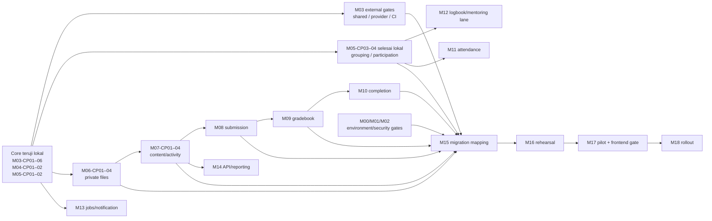

# Peta capaian M00–M19 dan checkpoint di dalam modul

> **Update 15 September — M12-CP02/CP03:** [entry/revision dan scoped mentor review](checkpoints/2026-09-15-m12-cp02-cp03.md) lulus 8/8 frozen cases setelah backup+restore per installment. M12 kini **3/4 slice lokal**, canonical **0/5**. M12-CP04 tetap linear berikutnya tetapi tertahan reviewed legacy mapping/authority; lane sintetis dependency-ready berikut dapat M13-CP01.

> **Update 14 September — M12-CP01:** [period-set Class](checkpoints/2026-09-14-m12-cp01.md) lulus 4/4 frozen cases pada fixture lokal; M12 kini **1/4 slice lokal**, canonical **0/5**. Jalur berikutnya M12-CP02; M11-CP02 tetap menunggu keputusan policy. Tabel/teks 13 September yang belum diperbarui adalah histori.

> Pembaruan 14 September: M15-CP05 dan M11-CP01 dikerjakan pada fixture lokal; baca [evidence final](checkpoints/2026-09-14-m15-cp05-m11-cp01.md). Posisi slice setelah QA final PASS: M15 **5/5 sintetis**, M11 **1/4 lokal**. Canonical tetap M15 0/6 dan M11 0/5. Tabel bertanggal 13 September di bawah adalah snapshot historis. M16 nyata masih tertahan input/otorisasi; urutan aman berikutnya M11-CP02 setelah policy attendance/permit disetujui, atau M12-CP01 sebagai lane independen.

Revisi **13 September 2026** setelah M15-CP03/CP04 synthetic slices. Backend tetap Go, frontend belakangan, target v3 tetap staging yang diproteksi, live tetap melayani sampai cutover yang disetujui. Peta ini mencatat hasil lokal; tidak mengotorisasi DB copy/shared migration/deploy atau commit/push.

## Cara membaca pekerjaan mulai sekarang

**M = capaian produk/platform yang ingin selesai. CP = bagian kerja untuk mencapai M. D = acceptance requirement yang membuktikan M memenuhi kontrak.** Gelombang B hanya pengelompokan beberapa M untuk satu instruksi; bukan denominator progress baru.

Contoh posisi saat ini: **M06 — 3/4, M07 — 3/4, M08 — 3/4 dengan CP04 parsial, M11/M12 — 1/4 lokal, dan M15 — 5/5 slice sintetis; full D semuanya masih 0/5 kecuali M15 0/6**. Berikutnya M12-CP02; M11-CP02 baru setelah attendance/permit policy disepakati. Real chronology tetap memerlukan reviewed source mapping, approval dan M00/M01/M02 gates. Full D yang masih nol tidak menghapus bukti slice lokal; syarat shared/consumer/QG/operasional lengkap memang belum seluruhnya tersedia.

- ID baru selalu `Mxx-CPnn`, misalnya `M03-CP03`; nomor CP diulang dalam setiap M dan tidak dipakai tanpa nama M.
- CP01–CP12 lama tidak dihapus/diubah nomor, dan case IDs/receipts/hash lama tetap utuh. Pemetaan di bawah menjadi alias dokumentasi.
- CP13–CP15 lama masih rencana, sekarang dibagi ke CP per M. **CP13 lama bukan M13**; sebagian besarnya pekerjaan M03. Demikian pula CP11 lama adalah identity, sedangkan M11 adalah attendance.
- Satu CP boleh membutuhkan evidence modul lain, tetapi mempunyai satu pemilik pekerjaan. Shared evidence direferensikan; kode/worker/migration tidak dibuat dua kali.
- CP berikutnya boleh memakai kontrak/slice dependency yang sudah diuji sambil full module dependency menunggu integration/ops gate. Jangan membuat siklus “semua M04 harus selesai sebelum mulai M05” padahal closure M04 memerlukan real Class M05.

## Posisi seluruh M

| Modul utama | Jumlah CP rencana | Bagian teruji lokal | Sisa bagian | Fokus berikutnya |
|---|---:|---:|---|---|
| [M00 — Environment & baseline](modules/M00.md) | 4 | 1/4 | 3 tertahan_input | M00-CP02 setelah referensi production/deployed SHA tersedia; M03-CP03 dapat berjalan lokal sambil menunggu. |
| [M01 — Backup & restore](modules/M01.md) | 4 | 1/4 | 1 parsial; 1 tertahan_input; 1 rencana | M01-CP02 dapat menyiapkan prosedur; pelaksanaan backup nyata menunggu M00. |
| [M02 — Containment legacy](modules/M02.md) | 4 | 0/4 | 1 parsial; 3 tertahan_input | Tuntaskan M02-CP01 lalu pilih hotfix legacy dengan otorisasi repo/deployment yang tepat; ini gate real identity M04. |
| [M03 — Platform Go & runtime](modules/M03.md) | 6 | 6/6 | 0 rencana lokal; external gates tersisa | Worker/robustness local closure selesai; canonical shared/container/remote gates masih blocked. |
| [M04 — Identity & capability](modules/M04.md) | 5 | 2/5 | 1 tertahan_input; 2 rencana | M04-CP03 memerlukan owner legacy yang hardened; jangan mengganti issuer sintetis dengan trust ke legacy yang belum aman. |
| [M05 — Class & participation](modules/M05.md) | 5 | 4/5 | 1 rencana | CP03–04 teruji lokal; CP05 menunggu content/learner-state M07–M09. |
| [M06 — Private files & egress](modules/M06.md) | 4 | 3/4 | 3 teruji lokal; 1 rencana | CP01–03 teruji lokal; CP04 setelah mapping/consumer evidence. |
| [M07 — Content & activity](modules/M07.md) | 4 | 3/4 | 3 teruji lokal; 1 menunggu consumer | CP01–03 producer teruji lokal; CP04 menunggu M08 historical reference. |
| [M08 — Submission](modules/M08.md) | 4 | 3/4 | CP01–03 exit lokal; CP04 partial BLOCKED_M15 | Receipt/deadline dan bounded raw landing teruji; real chronology/closure menunggu M15. |
| [M09 — Gradebook & rubric](modules/M09.md) | 4 | 2/4 | 2 selesai lokal; 2 rencana | CP01–02 PASS lokal sintetis; berikutnya CP03 preview import + explicit release setelah policy freeze. |
| [M10 — Completion & credentials](modules/M10.md) | 4 | 0/4 | 4 rencana | M10-CP01 setelah evidence dan grade release contracts stabil. |
| [M11 — Attendance & permits](modules/M11.md) | 4 | 1/4 lokal | CP01 synthetic PASS; 3 rencana | CP02 memerlukan keputusan attendance/permit policy dan private proof; canonical 0/5. |
| [M12 — Logbook & mentoring](modules/M12.md) | 4 | 3/4 lokal | CP01–CP03 synthetic PASS; CP04 tertahan mapping | Period, entry/revision dan scoped mentor review teruji; legacy mapping/product policy/shared runtime masih gate. |
| [M13 — Jobs, notifications & AI](modules/M13.md) | 4 | 0/4 | 4 rencana | M13-CP01 memakai worker dasar M03-CP05, bukan mengimplementasikan worker dua kali. |
| [M14 — Reporting & API/performance](modules/M14.md) | 4 | 0/4 | 4 rencana | M14-CP01 setelah read-model domain yang hendak dipublikasikan stabil. |
| [M15 — Migration tool & mapping](modules/M15.md) | 5 | 5/5 sintetis | CP01–05 local synthetic PASS | Read-only reconciliation fixture juga lulus; real source/CA/backup/approval dan actual copy tetap gated; canonical 0/6. |
| [M16 — Production→staging rehearsal](modules/M16.md) | 4 | 0/4 | 1 tertahan_input; 3 rencana | M16-CP01 menunggu production identity, M01 dan M15 siap; tidak menganggap env staging sebagai source production. |
| [M17 — Pilot & ownership switch](modules/M17.md) | 4 | 0/4 | 1 tertahan_input; 3 rencana | M17-CP01 setelah rehearsal, owner bridge dan frontend integration readiness tersedia. |
| [M18 — Rollout & operations](modules/M18.md) | 3 | 0/3 | 3 rencana | M18-CP01 sesudah actual pilot accepted; setiap wave tetap punya izin dan backup sendiri. |
| [M19 — Optional extensions](modules/M19.md) | N/A (3 template) | N/A | Scope feature belum dipilih | Pilih satu fitur optional dahulu; denominator tidak dibekukan oleh restrukturisasi ini. |

Total rencana M00–M18 saat restrukturisasi: **80 potongan CP** dengan ukuran berbeda; **bukan jumlah sesi atau prompt yang diwajibkan**. M19 tidak masuk denominator. Satu instruksi dapat mencakup beberapa CP dependency-ready atau satu rangkaian M. Tidak menghitung persentase proyek dari rata-rata/jumlah CP karena ukuran berbeda dan evidence lintas M dapat dipakai bersama.

Angka bagian teruji adalah **rekonsiliasi scope bukti existing**, bukan hasil menjalankan suite baru bernama Mxx-CPnn. Status lengkap semua M00–M18 tetap belum verified; 97 canonical D dipertahankan (M02/M15 masing-masing 6, lainnya 5). M19 memiliki 5 gerbang template tetapi feature scope/denominator belum frozen.

## Pemilik source of truth

| Dokumen/evidence | Tanggung jawab |
|---|---|
| [ImplementationPlan.MD](../../../ImplementationPlan.MD) | Business model, invariant, prioritas, batas data, dependency dan DoD utama; §8.3/§14.5 mengadopsi pelacakan M → CP |
| [modules/Mxx.md](modules/M03.md) | Daftar CP milik M, target D, dependency, exit/QA, progress bagian dan next action; tabel canonical D tetap acceptance |
| Dokumen peta ini | Ringkasan per M, alias CP lama dan urutan lintas M; projection dari module briefs, bukan authority test baru |
| [IMPLEMENTATION_STATUS.md](IMPLEMENTATION_STATUS.md) | Dashboard status module penuh + penunjuk progress bagian + latest run/gates |
| [QA_AUTOMATION_PLAN.md](QA_AUTOMATION_PLAN.md) dan executable manifests | Cara pengumpulan/validasi evidence, exact-case checks dan evaluasi D; ID lama tetap didukung |
| Raw local `.qa-artifacts/` + sanitised checkpoint reports | Bukti apa yang benar-benar diuji, pada hash/environment mana; tidak diganti oleh checkbox dokumentasi |

Scope CP masa depan adalah decomposition awal. Sebelum coding, freeze case/contract/gate yang relevan; jika CP terlalu besar, pecah menjadi child `M03-CP03a/b` dengan alasan dan scope union tetap sama. Jangan memecah/mengecilkan acceptance untuk meluluskan test gagal. Owner/reviewer orang belum ditetapkan; pemilik M bukan nama assignee.

## Pemetaan CP lama → pekerjaan modul

| CP lama / baseline | Pemilik M dan alias baru | Batas bukti |
|---|---|---|
| Bootstrap sebelum penomoran CP | M00-CP01; M03-CP01 | Inventory/source/QA/API bootstrap lokal, bukan environment atau runtime production lengkap |
| CP01 evidence reconciliation | M00-CP01; mendukung QA M03 | Local receipt/checksum/fail-closed evidence; bukan operator approval |
| CP02 metadata/access inventory | M00-CP02–03 (parsial), mendukung M01-CP02 | Observasi staging historis; source production dan inventory seluruh dependensi masih belum lengkap |
| CP03 offline backup preflight | M01-CP01 | Predicate planner bukan backup production |
| CP04 artifact/Linux QA | M03-CP01; M03 external gates | Default Linux/non-root proof tersedia; container dan full remote CI terpisah |
| CP05 transaction/isolated harness | M03-CP02; mendukung M01-CP01 | Local synthetic backup/rollback; bukan worker/runtime deployed |
| CP06 backup/restore/permissions | M01-CP01; mendukung M03-CP02 | Synthetic fixture, bukan source/target live |
| CP07 security/environment handoff | M00-CP02–04 dan M02-CP01 parsial | Handoff/disposition, bukan mitigation deployed atau full audit provider |
| CP08 protected backup recovery | M01-CP01; input parsial M01-CP02 | Encryption/restore lokal; real key custody/objects/host gate belum lengkap |
| CP09 runtime persistence substrate | M03-CP02 | Pada checkpoint ini: restricted pool, atomic Class/audit/outbox dan fixed local migration; reusable runner/API hadir di CP03–04, worker di CP05 |
| CP10 Class API | M05-CP01; mendukung context evidence M04 | Multi-Teacher/Student/Class/enrollment/role/episode lokal |
| CP11 identity/session | M04-CP01 | Verified synthetic issuer, session/cookie/CSRF/projection/local site-admin; real owner belum diuji |
| CP12 capability/lifecycle | M05-CP02, evidence bersama M04-CP02 | Class policy/history dan actual DB fence; bukan semua resource ancestry/content/group/retake |
| CP13 (rencana lama) | **M03-CP03–06** | Migration runner → API runtime → worker → robustness/closure; M13 nanti memakai worker ini |
| CP14 (rencana lama) | **M00-CP02–04 + M01-CP02–04**, M02-CP01 handoff | Environment/owner/protected actual backup gate, bukan otomatis full security fix/copy |
| CP15 (rencana lama) | **M06-CP01–02 + M07-CP01–02** | File/content slice, bukan seluruh file/content module |

Evidence lokal terbaru: [M15-CP01/CP02 dan seluruh regresi backend](checkpoints/2026-09-13-m15-cp01-cp02.md), tested source hash `407ec8d5fd3219da5fdb89d227d7a9d36e8485adda8dc1da6d582bf9e6976604`. PostgreSQL/Playwright lulus; real source/CA/backup/mapping, M08-CP04 chronology, frontend/container/remote/shared gates tetap terbuka. Commit **52cbc88** adalah publikasi historis; worktree terkini belum di-commit/push. Slice lokal tidak menjadikan M15, M06/M07/M08 100%; case IDs serta failure history dipertahankan.

## Urutan kerja yang disarankan

1. **Inti runtime M03 lokal selesai:** M03-CP01–06 sudah teruji lokal. Bagian operator/provider/container/remote nyata tetap mengikuti gate M00/M01/M02 dan tidak otomatis lulus dari closure lokal.
2. **Jalur keamanan/authority:** M02-CP01 lalu hotfix yang diotorisasi; M00 input/operator dan M01 proteksi/backup dipersiapkan tanpa menebak production. M04-CP03–04 baru dapat dibuktikan terhadap owner yang aman. Ini gate wajib sebelum real identity integration/rollout, bukan pekerjaan ops yang boleh dilupakan karena coding lokal maju.
3. **Domain Class lanjutan selesai lokal:** M05-CP03–04 grouping/mentor/invited/retake telah teruji; closure M05-CP05 menunggu content dan retained learner-state M07–M09.
4. **File → content → karya → nilai:** M06-CP01–03 → M07-CP01–03 → M08-CP01–03 → M09-CP01–03; tutup CP integration/closure masing-masing ketika consumer dan mapping contracts tersedia. M07 closure boleh menunggu M08 tanpa menghalangi pembangunan M08 dari M07-CP03.
5. **Fitur lanjutan:** M10 setelah grading/evidence; M11/M12 dapat dibangun dari Class/file contracts tanpa harus menunggu seluruh M09. M13 memakai worker M03; AI menunggu M08/M09. M14 mengikuti endpoint/domain yang benar-benar akan dipublikasikan.
6. **Migrasi dan rilis:** M15 local tooling sesuai schema domain → M16 actual rehearsal hanya setelah M00/M01/M02 gates → M17 pilot dengan frontend readiness nanti → M18 wave rollout. M19 tetap optional scope baru.

Ini urutan dependency, bukan kewajiban menuntaskan semua M00 sebelum satu baris Go ditulis. Sebaliknya, lulus kode lokal tidak membuka operasi production/staging yang gated. Domain yang belum dibangun tidak boleh diberi fake PASS untuk menutup integration module.

## Peta eksekusi berdasarkan dependency

Peta berikut adalah **recommended critical path**, bukan urutan angka M dan bukan janji bahwa semua CP berukuran sama. Panah berarti dependency; CP dalam satu baris yang dipisahkan `∥` dapat dikerjakan paralel bila kapasitas dan otorisasi tersedia. Status `TERTAHAN_INPUT` pada lane operasional tidak menghentikan lane sintetis lokal.

| Urutan dependency | CP yang dijalankan | Milik M | Dependency masuk | Setelahnya membuka |
|---:|---|---|---|---|
| 0 — selesai lokal | M00-CP01; M01-CP01; M03-CP01–06; M04-CP01–02; M05-CP01–04 | M00/M01/M03/M04/M05 | Evidence hingga 10 Sep | File/content dan M11/M12 contract lanes; tidak membuka operasi shared |
| 1 — selesai lokal | **M06-CP01** | M06 | M03-CP04; M04-CP02; M05 core | M06-CP02–03 dan private attachment contracts |
| 2 — selesai lokal | **M06-CP02** | M06 | M06-CP01 + storage/scan contract | Authorized upload/download; M06-CP04 menunggu mapping |
| 2B — selesai lokal | **M06-CP03 + M07-CP01–03 producer** | M06/M07 | M06-CP01–02; M05 core | M08-CP01–03 selesai lokal, CP04 partial; closure menunggu mapping/consumer |
| 3A — paralel domain | M11-CP01 ∥ M12-CP01 | M11/M12 | M05-CP04; M03-CP05 | Attendance/logbook contract lanes |
| 3B — selesai lokal | **M06-CP03** | M06 | CP01–02 selesai lokal; approved egress policy | Safe fetch; CP04 menunggu preserved mapping/consumer evidence |
| 3C — paralel tooling | **M15-CP01 synthetic slice lulus** | M15 | M03-CP03; synthetic-only | Dry-run contract ada; source nyata/CA tetap gated |
| 3D — paralel safety | M02-CP01; M01-CP02 | M02/M01 | Audit + local backup evidence | Scoped containment dan protected operator procedure |
| 4A — content | **M07-CP01–03 producer selesai lokal** | M07 | M05 core; M06-CP01–03 | M08 exact-revision consumer dan receipt selesai lokal; CP04 historical-owner read/clone closure |
| 4B — Class closure | M05-CP05 | M05 | M05-CP03–04; M07 content prerequisites | Full M05 review dan stable participation mapping |
| 4C — real identity lane | M00-CP02–04; M02-CP02 → M02-CP03 → M02-CP04; M04-CP03 → M04-CP04 | M00/M02/M04 | Production/deployed identity + owner authority; M01 before DB changes | M04-CP05, actual migration/rehearsal gate |
| 5A — learner work | **M08-CP01 → CP02 → CP03 selesai lokal; CP04 partial** | M08 | M07-CP03; M06; participation | M09 dapat memakai receipt contract; CP04 closure menunggu M15 reviewed mapping/reconciliation |
| 5B — attendance | M11-CP01 → M11-CP02 → M11-CP03 → M11-CP04 | M11 | M05-CP03–04; M06 where evidence files apply | Attendance outcome/reports/migration |
| 5C — mentoring | M12-CP01 → M12-CP02 → M12-CP03 → M12-CP04 | M12 | M05-CP03; M06 | Mentoring outcome/reports/migration |
| 5D — delivery | M13-CP01 → M13-CP02 | M13 | M03-CP05; actual domain outbox events | Notification delivery; CP03 AI waits for M08/M09 |
| 6A — gradebook | **M09-CP01 → CP02 selesai lokal** → M09-CP03 → M09-CP04 | M09 | M08-CP03/04; academic policy | CP03 release/import berikutnya; kemudian M10, M13-CP03, reports, mapping |
| 6B — identity closure | M04-CP05 | M04 | M04-CP03–04; M07 ancestry + downstream authorization evidence | Full identity/capability review |
| 6C — content closure | M07-CP04 | M07 | M07-CP01–03; M08 consumer contract | Clone/import acceptance dan mapping stabil |
| 7A — completion | M10-CP01 → M10-CP02 → M10-CP03 → M10-CP04 | M10 | M09 release/evidence | Transcript/credential mapping dan cutover parity |
| 7B — async closure | M13-CP03 → M13-CP04 | M13 | M08/M09 + M13-CP01–02 | AI non-authoritative + consumer closure |
| 7C — read models | M14-CP01 → M14-CP02 → M14-CP03 → M14-CP04 | M14 | Stable domain APIs/events; privacy contracts | Frontend/API compatibility dan capacity evidence |
| 8 — mapping/backfill | **M15-CP02 → CP03 → CP04 synthetic slice lulus** → M15-CP05 | M15 | Relevant schemas stable; M00/M01/M02 gate untuk actual data | M16 rehearsal |
| 9 — rehearsal | M01-CP03 → M01-CP04; M16-CP01 → M16-CP02 → M16-CP03 → M16-CP04 | M01/M16 | Verified source/target, backup+restore, M15 | Pilot decision package |
| 10 — pilot | M17-CP01 → M17-CP02 → M17-CP03 → M17-CP04 | M17 | M16 accepted; frontend readiness; owner/write fence | Rollout authorization |
| 11 — rollout | M18-CP01 → M18-CP02 → M18-CP03 | M18 | Pilot accepted + per-wave backup | Operational v3 ownership |
| Optional | M19-CP01 → M19-CP02 → M19-CP03 | M19 | Feature dipilih; dependency domainnya ditambahkan eksplisit | Hanya feature optional terpilih |

Urutan praktis berikutnya adalah **M15-CP05 synthetic reconciliation/closure**; CP01–04 telah lulus fixture tetapi belum membuktikan production identity/CA/inventory atau academic approval. M08-CP03 durable hand-in receipt sudah lulus, CP04 masih menunggu real chronology mapping. M06-CP04 dan M07-CP04 menunggu preserved mapping/consumer closure. M05-CP05 sengaja menunggu M07–M09; M11/M12 dapat dimulai sebagai contract lane, sedangkan real identity/M00–M02 menunggu input dan otorisasi yang benar. Setiap perubahan schema pada lane mana pun tetap memerlukan backup + actual restore baru sebelum apply.

## Kontrak progress dan QA

| Status bagian | Makna |
|---|---|
| TERUJI_LOKAL | Bounded local scope sudah punya source-bound evidence; belum claim real provider/deploy/full M |
| PARSIAL | Sebagian implementasi/review/evidence tersedia; exit CP belum lengkap |
| RENCANA | Scope/dependency/exit ditulis; pekerjaan belum dilakukan. Dependency yang belum selesai tetap harus dipenuhi |
| TERTAHAN_INPUT | Ada input/authority/environment nyata yang belum tersedia; pekerjaan independen boleh berlanjut |
| BELUM_DIBEKUKAN | Template optional; tidak masuk completion denominator |
| VERIFIED (future, scope explicit) | Seluruh exit CP dan applicable gates terbukti pada scope/environment yang dinyatakan |

Setiap handoff dimulai dengan **M / CP yang dikerjakan / D yang didukung / bukti / sisa untuk menutup M / next CP**, bukan nomor CP global saja. Tampilkan empat dimensi terpisah: jumlah bagian teruji, D canonical verified, measured code coverage/test pass rate, dan migration/traffic ownership.

Closure suatu M: seluruh mandatory D dan QG applicable terbukti, required consumers/integration ada, evidence current, external/reviewer requirement terpenuhi. Tidak cukup semua CP coding selesai atau semua tests yang kebetulan dijalankan lulus. Sebaliknya, blocker eksternal harus tampak sebagai blocker, tidak membuat implementasi yang sudah ada terlihat NOT_STARTED.

Automation yang **sudah ada**: `qa.run` M00/M03; `qa.postgres_lab --worker-journey` untuk CP08–CP12 + M03-CP03–06; `--participation-journey` untuk M05-CP03–04; `--file-journey` untuk M06-CP01–02; `--content-journey` untuk M06-CP03 + M07-CP01; `--content-safety-journey` untuk M07-CP02; `--content-contract-journey` untuk M07-CP03; `--submission-journey` untuk M08-CP01–04 bounded slices; `--migration-foundation-journey` untuk M15-CP01/02 dan `--migration-backfill-journey` untuk M15-CP01–04 synthetic slices; `qa.linux_qa`; `qa.checkpoint_report`; dan registry module→CP→case→D fail-closed. Package runner belum menerima semua M04–M19; jangan menjalankan package yang belum didukung atau mengira tulisan DONE memicu tes.

## Contoh satu instruksi yang cukup

- “Kerjakan **M05-CP03 sampai M05-CP04**. Jalankan QA setelah setiap CP, lalu laporkan sisa M05. Lokal sintetis, tanpa deploy/commit/push.”
- “Lanjutkan **M06-CP01** saja. Bekukan ownership FileAsset terhadap Class dan update capaian M06.”
- “Laporkan **M04**: bagian mana yang teruji, D mana yang belum tutup, dan input yang diperlukan.”

Tidak perlu puluhan prompt sesuai jumlah CP. Satu instruksi boleh membundel CP selama dependency/otorisasi cukup; kegagalan checkpoint wajib diperbaiki/diungkap sebelum melanjutkan pekerjaan yang bergantung padanya. Dokumen ini sendiri tidak mengotorisasi coding CP berikutnya, frontend, actual copy, commit/push atau deployment.

## Validasi restrukturisasi

Pemeriksaan executable 13 September memakai source fingerprint `c0e483db6c7db252cd2433086ae93f3ca3eb41c652516771aad5a3f289892e35`; M08-CP01–04 bounded cases dan seluruh dependency regression lulus pada run yang tercatat. Dua puluh module brief tetap mempunyai CP unik dengan pemilik M yang benar; seluruh 97 canonical D M00–M18 dan 5 template D M19 tetap menjadi acceptance denominator. Perubahan dokumentasi tidak dipakai untuk mengubah hasil QA executable.
