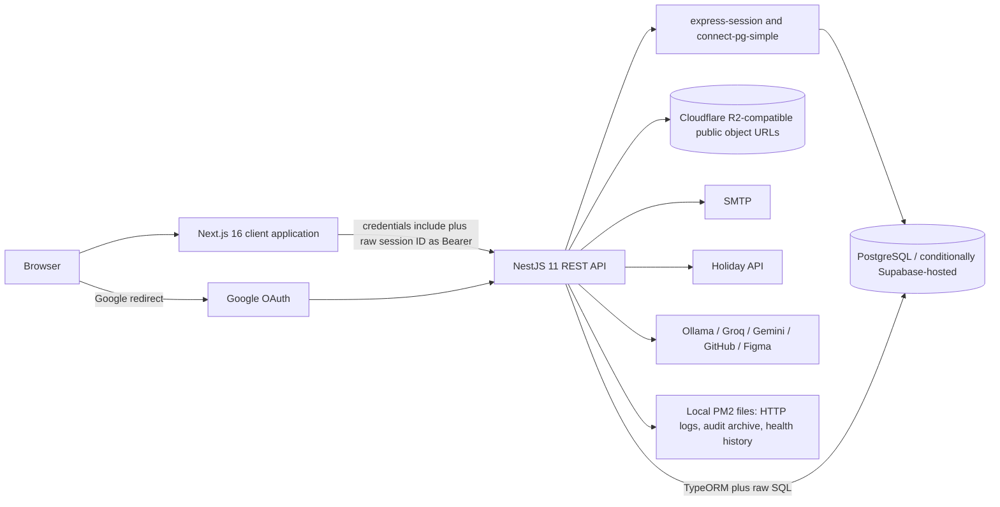
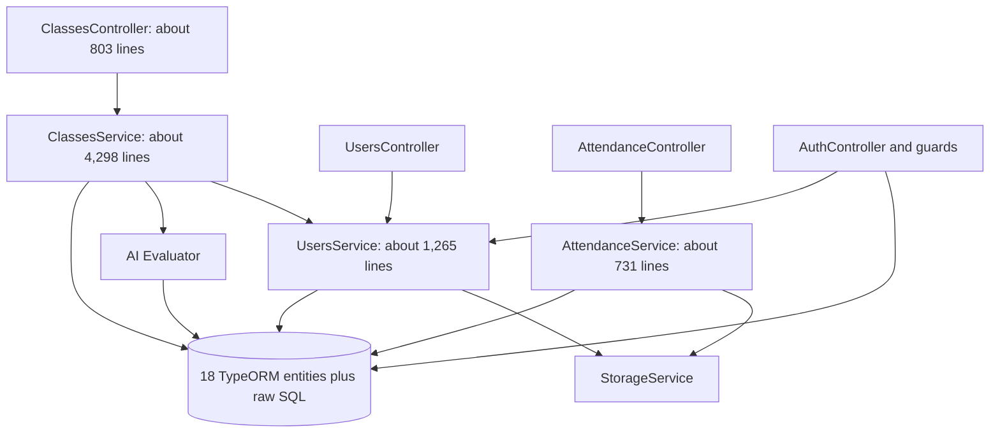
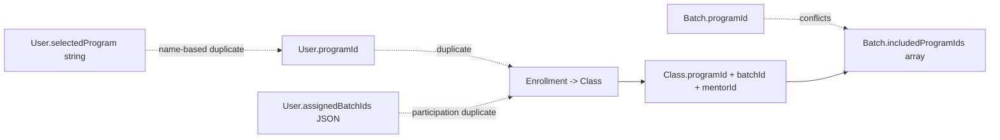
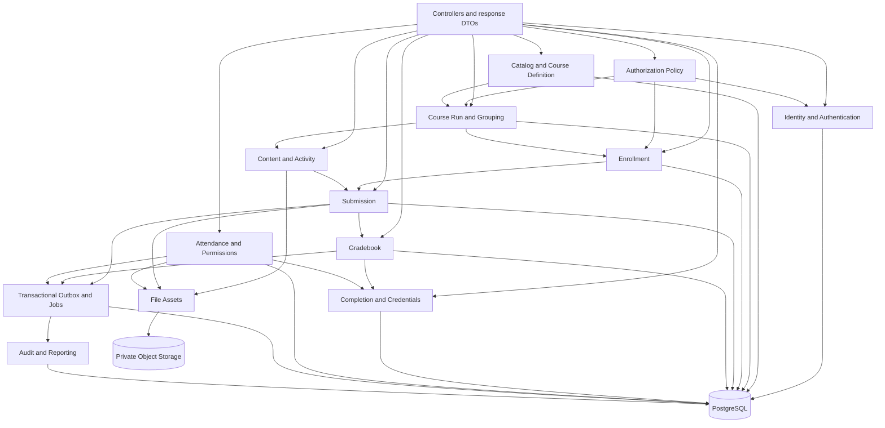

# LMS Codebase Audit and Remediation Reference

**Audit date:** 1 September 2026  
**Scope:** `backend`, `frontend`, root architecture/product/security/test documentation, deployment configuration, TypeORM entities, and Graphify repository graph  
**Backend revision audited:** `dd3413e` (`staging`)  
**Frontend revision audited:** `d1793b1` (`staging`)  
**Benchmark:** `LMS_Modern_Moodle_Benchmark_Architecture_Business_Flow.md`

> **Decision:** The LMS is a functional prototype/early production system, but it is **not currently safe to treat as an authoritative academic system of record**. Two code paths permit direct critical compromise: unauthenticated password replacement and grade import by any authenticated user. Multiple high-severity authorization, stored-XSS, session, file-privacy, SSRF, and learner-history defects compound those issues. The recommended response is an incremental hardening and domain-boundary program; a full rewrite is neither necessary nor recommended.

---

## Audit method, evidence, and limits

This was a source audit, not a filename-only or documentation-only review. The review traced controller entry points into service methods, repository writes, entity relationships, frontend callers, session behavior, object-storage handling, AI integrations, audit logging, and deployment bootstrap behavior.

Graphify was used as a code-navigation and dependency index, then every material conclusion was checked against source. The graph contained 2,069 nodes and 3,962 edges; `graphify benchmark` estimated approximately 137,933 tokens for a naive corpus read versus approximately 4,347 tokens per graph query, a 31.7x reduction. Graphify correctly identified `ClassesService`, `ClassesController`, `User`, `AttendanceService`, `StorageService`, and `AuditService` as central coupling points. Graph results were not treated as proof on their own.

Reviewed surfaces include:

- All 18 TypeORM entity files and their relations/cascade settings.
- All backend controllers and the principal service flows in auth, users, classes, attendance, storage, AI evaluation, audit, health, and mail.
- Frontend application routes, direct API callers, dashboard role selection, session bootstrap, material/assignment rendering, profile and attendance flows.
- `SourceOfTruth.MD`, the benchmark, PRD, technical specification, auth guide, security assessment, summaries, UAT scenarios, E2E scenario document, READMEs, environment template, package scripts, and deployment script.
- Static verification: backend Jest, backend TypeScript, frontend TypeScript, and frontend ESLint.

This audit did **not** connect to or mutate a live database, validate whether the committed-looking third-party key is still active, inspect Cloudflare R2 bucket policy, inspect Supabase project settings/RLS/Data API exposure, inspect nginx/Cloudflare rules, or execute active attacks against deployment. Those are explicit deployment-verification tasks, not assumptions in the findings. Real database constraints and indexes may differ from TypeORM declarations because the repository has no migrations; that uncertainty is itself a finding.

Severity means:

- **Critical:** unauthenticated or low-privilege compromise of accounts or authoritative academic records, or an immediate systemic integrity failure.
- **High:** practical cross-scope data access/mutation, sensitive-data exposure, session compromise, SSRF, or major academic integrity loss.
- **Medium:** meaningful defense, reliability, or confidentiality weakness requiring pre-production correction.
- **Low:** limited information exposure or hardening gap with modest direct impact.

---

# 1. Executive Summary

## Overall condition

The application is a client-rendered Next.js frontend calling a NestJS REST API backed by PostgreSQL and Cloudflare R2-compatible storage. It has useful working concepts—multi-role users, batches, programs, mentor-owned classes, enrollments, materials, assignments, submissions, competency/rubric scores, attendance, logbooks, session persistence, rate limiting, and audit records. A modular monolith is appropriate for the product's current size.

The central problem is not the technology stack. It is that **global identity attributes are repeatedly used as contextual authority**, while course participation, delivery, grading, completion, and history lack explicit ownership and lifecycle boundaries. The 4,298-line `ClassesService` has become the effective domain model. It contains course delivery, enrollment, curriculum, grading, certificates, logbooks, mentor allocation, AI, copying, repair, and batch lifecycle logic, frequently without transactions.

## Highest-impact findings

1. **Critical account takeover:** unauthenticated `POST /auth/setup-password` replaces the password of any known user, even when a password already exists, and immediately logs the caller in. Evidence: `backend/src/auth/auth.controller.ts:145-173` and `backend/src/auth/auth.service.ts:88-106`.
2. **Critical grade compromise:** `POST /classes/programs/:programId/smart-import-scores` has no role requirement; the service checks only that the caller is a user, then can create competencies and overwrite any student's competency or rubric scores. Evidence: `backend/src/classes/classes.controller.ts:481-497` and `backend/src/classes/classes.service.ts:4033-4138`.
3. **High stored-XSS/session-theft chain:** mentor-authored HTML is entity-decoded and inserted with `dangerouslySetInnerHTML` without sanitization; the replayable PostgreSQL session ID is also returned to JavaScript and retained in `localStorage`. Evidence: `frontend/components/rich-text-renderer.tsx:11-27,30-58`, `frontend/lib/config.ts:22-68`, and `backend/src/auth/auth.controller.ts:128-140`.
4. **High BOLA across academic contexts:** broad endpoints authenticate a global role but do not verify enrollment, class ownership, program, batch, or resource ancestry. Any authenticated user can toggle transcript/certificate release and clone class content; any mentor can grade or edit many resources outside their assigned class. Evidence: `backend/src/classes/classes.controller.ts:35-48,321-483,503-715` and the corresponding service methods.
5. **High attendance/privacy failure:** any authenticated user can create a permission request for an arbitrary `studentId`/`batchId`, which automatically changes attendance to Izin/Sakit; any authenticated user can list permission requests and sensitive proof URLs. Evidence: `backend/src/attendance/attendance.controller.ts:43-60` and `backend/src/attendance/attendance.service.ts:643-729`.
6. **High session exposure:** the system calls the raw session-store key a token, accepts it in Bearer headers and query strings, logs cookies/session IDs/token values, and does not regenerate sessions on authentication. Evidence: `backend/src/auth/guards/session-auth.guard.ts:17-64`, `backend/src/common/middleware/http-logger.middleware.ts:24-63`, and `frontend/app/dashboard/page.tsx:37-63`.
7. **No dependable academic history:** assignment deletion removes submissions, user deletion removes submissions/scores/attendance/logbooks, score updates overwrite in place, course content is mutable, and no grade or submission revision history exists. Evidence: `backend/src/classes/classes.service.ts:2368-2379`, `backend/src/users/users.service.ts:1087-1248`, and entity definitions.
8. **No transaction boundaries:** no explicit `transaction`, `createQueryRunner`, or `manager.transaction` call exists under `backend/src`; multi-record enrollment, batch, grading, handover, deletion, permission, and AI operations can partially commit.
9. **Documentation overstates controls:** `SourceOfTruth.MD` labels itself final and binding, yet its core constraints are not database constraints or backend policies. It also contradicts itself on global versus per-program batch lifecycle and on deleting versus preserving historical progress.
10. **The test gate is nonfunctional:** all three backend Jest suites fail, backend TypeScript fails on a stale test, the frontend type-check passes, and frontend ESLint reports 589 problems (390 errors, 199 warnings). The 1,098-line E2E document contains test scenarios, not executable tests.

## Risk disposition

Do not release new functionality until the P0 containment items are complete. In particular, immediately disable initial-password setup, restrict grade/release/copy endpoints, rotate the committed third-party credential, stop logging session credentials, invalidate active sessions after the auth fix, and make permission-proof objects private. Before relying on the LMS for transcripts/certificates, add unique constraints, transactions, grade history, and an explicit completion/certificate decision model.

---

# 2. Actual Architecture

## Runtime topology



### Frontend reality

- The Next.js App Router is used primarily as a client application. Dashboard pages are `"use client"`, fetch profile/data after render, and redirect in browser code. There is no server middleware or server-side authorization boundary.
- `frontend/lib/config.ts:22-76` monkey-patches global `window.fetch`. It takes `auth_token` from `localStorage`, attaches it as a Bearer value, and also enables cookies.
- `frontend/app/dashboard/page.tsx` processes an OAuth exchange code and legacy `?token` session identifier, persists the returned raw session ID, and chooses an admin/facilitator/mentor/student dashboard in the browser.
- Frontend role checks are presentation controls only. They cannot compensate for missing server authorization.
- Course HTML is rendered without sanitization, and arbitrary external material URLs may be placed in unsandboxed iframes (`frontend/app/dashboard/class/[classId]/material/[materialId]/page.tsx:92-134,244-254`).

### Backend reality

- NestJS modules exist for `auth`, `users`, `classes`, `attendance`, `storage`, `audit`, and `health`. The nominal module structure is clean, but most LMS domains are concentrated in `ClassesService`.
- Authentication uses Google OAuth and local bcrypt passwords. Authorization is a global `roles` JSON array plus endpoint decorators, with scattered service checks based on `programId`, `mentorId`, or the user's mutable `specialization` string.
- Sessions are database-backed. TypeORM and `connect-pg-simple` create separate PostgreSQL pools with no explicit pool limits or idle/statement timeouts (`backend/src/app.module.ts:40-63`, `backend/src/main.ts:139-165`).
- TypeORM schema synchronization is enabled whenever `NODE_ENV` is anything other than exactly `production`. Runtime startup also runs DDL for a user status enum, a transcript column, and the session table (`backend/src/app.module.ts:57-62`, `backend/src/main.ts:34-85`). There are no migrations in the repository.
- PostgreSQL TLS uses `rejectUnauthorized: false` when `DB_SSL=true` or the hostname contains `supabase`, disabling certificate verification in both pools.
- R2 uploads result in direct public URLs and are stored as strings/JSON arrays. There is no `FileAsset` ownership or access-control record.
- Audit logging is an interceptor over non-GET HTTP calls, not a domain-event or before/after change log. Old DB audit rows are copied to local JSONL and deleted.
- “Background jobs” are in-process timers for health snapshots and audit archiving. There is no durable queue, worker, retry, deduplication, or outbox.

## Effective dependency map



The architectural center is therefore not a set of LMS domain modules; it is `ClassesService`. A change to enrollment can affect classes, users, scores, mentor distribution, batch status, and frontend projections through that service. This is the main recurring-bug multiplier.

## Trust boundaries

| Boundary | What crosses it | Actual control | Audit result |
|---|---|---|---|
| Browser -> Next.js UI | Profile, roles, academic data, raw HTML | Client state and conditional rendering | Not an authorization boundary |
| Browser -> NestJS API | Cookie plus raw session ID, IDs in paths/query/body | Session guard, optional global role decorator, scattered service checks | Context and ownership frequently missing |
| NestJS -> PostgreSQL | ORM and raw SQL | App-level validation; partial FK constraints | No migrations, no explicit transactions, missing uniqueness/index declarations |
| NestJS -> R2 | Base64 and fetched URL bytes | Claimed MIME and generated filename | Public delivery, no contextual access, scanning, or lifecycle |
| NestJS -> external URL | Avatar URLs, submission links, Ollama host | Inconsistent string/URL checks | Practical SSRF paths |
| NestJS -> external AI | Student content, rubric, feedback, tokens | Provider API call | Prompt injection, privacy, fail-open grading |
| NestJS -> logs/local disk | URL, IP, identity, audit rows | Fire-and-forget writes | Credentials leak into logs; archives are not durable or tamper-evident |

---

# 3. Entity & Dependency Map

## Actual relational model

```mermaid
erDiagram
    USER ||--o{ ENROLLMENT : student
    PROGRAM ||--o{ CLASS : identifies
    BATCH ||--o{ CLASS : contains
    USER ||--o{ CLASS : mentor
    CLASS ||--o{ ENROLLMENT : participants
    CLASS ||--o{ MATERIAL : content
    CLASS ||--o{ ASSIGNMENT : assessments
    ASSIGNMENT ||--o{ SUBMISSION : receives
    USER ||--o{ SUBMISSION : submits
    PROGRAM ||--o{ PROGRAM_COMPETENCY : groups
    PROGRAM ||--o{ COMPETENCY : defines
    PROGRAM_COMPETENCY ||--o{ COMPETENCY : syllabuses
    USER ||--o{ COMPETENCY : creates
    COMPETENCY ||--o{ COMPETENCY_SCORE : scored
    USER ||--o{ COMPETENCY_SCORE : receives
    PROGRAM ||--o{ RUBRIK_ASSESSMENT : defines
    PROGRAM_COMPETENCY ||--o{ RUBRIK_ASSESSMENT : contains
    RUBRIK_ASSESSMENT ||--o{ RUBRIK_ASSESSMENT_SCORE : scored
    USER ||--o{ RUBRIK_ASSESSMENT_SCORE : receives
    USER ||--o{ ATTENDANCE : records
    BATCH ||--o{ ATTENDANCE : scopes
    USER ||--o{ PERMISSION_REQUEST : requests
    BATCH ||--o{ PERMISSION_REQUEST : scopes
    USER ||--o{ LOGBOOK : writes
    BATCH ||--o{ LOGBOOK : scopes
    USER ||--o{ MENTOR_ASYNC_DAY : declares
```

`AuditLog` deliberately has no FK to `User`. `User.programId`, `User.selectedProgram`, `User.assignedBatchIds`, `Batch.programId`, and `Batch.includedProgramIds` are scalar/array values rather than a normalized relationship model. `Submission.gradedByMentorId` is also a scalar without an FK.

## Major entities and canonical-source assessment

| Entity/data | Actual purpose | Ownership/source today | Problems |
|---|---|---|---|
| `User` | Identity, global roles/status, learner/mentor profile, program hints, batch arrays, AI credentials | `users` row | Identity, participation hints, authority hints, and secrets are mixed; status is global across contexts |
| `Program` | Named academic program | `programs` | No unique name/status/version; GET auto-creates defaults |
| `Batch` | Global cohort and sometimes per-program run | `batches` | Both `programId` and `includedProgramIds`; no DB single-active constraint; lifecycle not enforced on writes |
| `Class` | Program+batch+mentor grouping, course run, release state, link container | `classes` | Conflates course run, personal mentor group, instructor assignment, content container, and certificate release |
| `Enrollment` | Student-to-class participation | `enrollments` | Only IDs/time; no status/start/end/source; no unique pair; CASCADE deletes learner participation |
| `ProgramCompetency` / `Competency` | Curriculum grouping and syllabus/rubric container | Rows plus string names in content | Duplicate concepts; optional/global program; assignments/materials refer by mutable name strings |
| `Material` | Class content item | `materials` | Type is free string; no availability/completion/version/file ownership |
| `Assignment` | Class assessment configuration | `assignments` | Competency is a string; rubric selection is JSON; weights unconstrained; mutable active/historical config |
| `Submission` | Latest learner link plus grade/AI/manual feedback | `submissions` | Submission, attempt, grade, feedback, and grader are conflated; no uniqueness/revisions/grade history |
| `CompetencyScore` | Per-student competency value | score row | Unique student+competency is good, but no course run, source, grader, override, or history |
| `RubrikAssessmentScore` | Per-student rubric-assessment value | score row | Same missing run/source/history; global IDs allow cross-program writes |
| `RubrikAssessment` | Weighted assessment graph | row plus JSON edges | JSON IDs have no FKs, normalization, total-weight check, or cycle prevention |
| `Attendance` | One student/batch/date status plus copied SP level | `attendances` | No unique key; `spLevel` is duplicated across dates; absent record is treated as non-alpha |
| `PermissionRequest` | Evidence for absence | row plus public URL arrays | No requester binding, approval/rejection state, reviewer, decision, or private file policy |
| `Logbook` | Monthly student reflection and review status | `logbooks` | No unique student+batch+month; no enrollment/schedule validation |
| `MentorAsyncDay` | Mentor date exception | row | No unique mentor+date; scoring removes all mentors' dates globally |
| `AuditLog` | HTTP mutation outcome | `audit_logs`, then local JSONL | No domain entity/change set; not transactionally coupled; identity is detached |
| File URL strings | Avatar, proof, material/submission link | Direct URL/base64 value | No asset owner/context/access/lifecycle canonical record |

## Duplicate and conflicting sources of truth



The code attempts to reconcile these through “heal” and “auto-repair” routines. `UsersService.findAll()` can create enrollments during an admin GET; login can assign an orphan class and update `assignedBatchIds`; `ClassesService.getProgramsWithDetails()` can create programs and complete a legacy batch. Repair-on-read hides drift instead of making invalid state impossible.

## Foreign key and deletion posture

- `Enrollment`, `Submission`, `CompetencyScore`, `RubrikAssessmentScore`, `Logbook`, and `MentorAsyncDay` use CASCADE from user and/or academic parent. This can erase authoritative learner history when identities or configuration are deleted.
- `Class.programId`, `Class.batchId`, attendance relations, and permission relations use default `NO ACTION`, while service methods perform hand-written deletion sequences without transactions.
- `creatorMentorId` is generally `SET NULL`, which preserves curriculum but removes attributable FK identity; the audit log is not a replacement for grade/curriculum authorship history.
- No explicit indexes were declared for most FK columns. PostgreSQL does not automatically create an index on every referencing FK. The live database must be inventoried before adding indexes, because schema synchronization means declarations are not a reliable migration history.

---

# 4. Business Flow Analysis

## 4.1 User provisioning and authentication

### Actual flow

```mermaid
sequenceDiagram
    participant A as Admin
    participant U as UsersService
    participant DB as PostgreSQL
    participant B as Browser
    participant AU as AuthController

    A->>U: invite user
    U->>DB: save user with global roles/profile/password
    U->>DB: optionally create class/enrollment/batch arrays
    Note over U,DB: separate writes; enrollment failure may be swallowed
    B->>AU: login-local OR setup-password OR Google OAuth
    AU->>DB: bind userId to PostgreSQL session
    AU-->>B: HttpOnly cookie plus raw session ID in JSON
    B->>B: store session ID in localStorage
    B->>AU: cookie plus Bearer raw session ID
```

### Findings

- Invitation creates a predictable shared password for non-Gmail accounts (`UsersService:300` and a second import path at `ClassesService:1369`). The invitation email still says Google-only, so documentation and behavior diverge.
- User save and auto-enrollment are not atomic; the service catches enrollment errors and can return a successfully invited but unassigned user.
- `setupInitialPassword` is not a one-time invitation proof. It accepts only email/password, overwrites existing password, activates invited users, and establishes a session.
- Login/exchange writes into the existing session rather than regenerating it.
- Only `SUSPENDED` is rejected by `SessionAuthGuard`; `INACTIVE` and `GRADUATED` identities can continue to authenticate and use role-bearing endpoints.
- The Google strategy reads `emails[0]` and binds `googleId`; it does not explicitly check a verified flag. The bigger current risk is the local password path.
- `check-status` reveals registration, name, password presence, and Google binding, assisting account enumeration and the setup-password attack.
- The OAuth exchange code is kept in a process-local static `Map`; it breaks multi-instance operation and lacks cleanup for unredeemed entries until process restart.

## 4.2 Program, batch, class, and enrollment

### Actual flow

1. Admin creates or updates a `Batch`, including an array of program IDs.
2. Service code creates or finds a `Class` for each program/batch/mentor combination.
3. Student invitation/import or explicit enrollment chooses a program and a class, then inserts `Enrollment`.
4. `User.programId`, `selectedProgram`, and `assignedBatchIds` may also be updated.
5. Mentor allocation may move enrollments between classes.
6. Read and login paths can auto-repair missing relationships.

### Flawed transitions and dependencies

- There is no unique constraint on `Enrollment(studentId,classId)`. `ON CONFLICT DO NOTHING` at `UsersService:362` and `:1005` has no relevant conflict target and therefore does not guarantee idempotency.
- Enrollment has no state. Suspend, complete, drop, transfer, expire, and re-enroll are modeled as user status changes, row deletion, or a new row.
- `createProgramBatch` completes active batches, creates another, then takes an arbitrary existing class for the program and changes its `batchId` (`ClassesService:1527-1563`). That can move old enrollments/content into a new delivery period.
- `assignMentorToProgram` searches by program and mentor without constraining the batch (`ClassesService:1740-1779`), so historical classes can be reused and receive active enrollments.
- “Clean transfer” deletes enrollments but not submissions, scores, attendance, or logbooks; the SOT and code both misrepresent the resulting history.
- Admin `GET /users` may enroll students with no enrollment into the first active batch and first/default program (`UsersService:75-136`). This violates safe-query semantics and mandatory explicit program assignment.
- A self-service user PATCH accepts `programId`, `selectedProgram`, `specialization`, `batchIds`, and `assignedBatchIds` because those properties are in `CreateUserDto`; `UsersService.update` then changes enrollment/class relationships (`users.controller.ts:127-149`, `create-user.dto.ts:37-65`, `users.service.ts:871-1010`). Students can change participation hints; mentors can make themselves `Professional`, which other authorization checks interpret as all-program scope.
- The single-active-batch rule is implemented by sequential service updates, not a database constraint/lock; concurrent activation can create multiple active rows.
- Completed batches are not consistently read-only. Content, grading, phase dates, copying, import, and enrollment endpoints generally do not reject completed batch state.

## 4.3 Course authoring and content access

### Actual flow

- `ProgramCompetency`, `Competency`, `Material`, `Assignment`, and `RubrikAssessment` collectively form the curriculum.
- Program/global competency names group materials and assignments. JSON rubric criteria and JSON assessment-to-assessment edges calculate scores.
- Content is created directly in a mutable `Class`; copying duplicates materials and assignments to another class.
- Learners and staff fetch class/material/assignment details by IDs.

### Findings

- There is no course definition/version/publish boundary. A class is both delivery and content source, while program-level competencies are shared across deliveries.
- Any mentor can create, update, or delete competencies and assessment structures outside their own program in several methods. The SOT's specialization-specific authorship constraints are not enforced centrally.
- `GET /classes/:classId`, material detail, and assignment detail require authentication but not enrollment or staff scope. A user who knows IDs can read another class's content.
- `POST /classes/:classId/clone` has no role decorator and `cloneClassData` does not evaluate `mentorId` at all; any authenticated user can duplicate content between same-program classes. Repeated calls duplicate all items.
- Rubric assessment `competencies` and `subAssessments` store IDs in JSON. No FK or acyclic graph check exists. Grade calculation recursively calls itself without a visited set (`ClassesService:188-215`), so a cycle can cause unbounded recursion.
- Assignment and rubric weights are not bounded or normalized. `PUT /classes/assignments/weights` updates arbitrary assignment IDs sequentially and does not verify class ownership or sum-to-one.
- Mentor-authored rich HTML is executable in every learner/admin browser that renders it.

## 4.4 Assignment submission and grading

### Actual flow

```mermaid
sequenceDiagram
    participant L as Authenticated user
    participant C as ClassesController
    participant S as ClassesService
    participant DB as PostgreSQL
    participant AI as AI provider

    L->>C: submit link for assignmentId
    C->>S: caller userId, assignmentId, link
    S->>DB: find latest row; create or overwrite
    S->>DB: status=submitted
    Note over S,DB: no enrollment, due-date, run-state, or unique constraint
    L->>C: mentor/admin grade or bulk AI
    C->>S: submissionId/assignmentId/score
    S->>DB: overwrite Submission score and feedback
    S->>DB: optionally update CompetencyScore
    S->>AI: fetch student URL and evaluate
    Note over S,AI: no transaction or grade history
```

### Findings

- Submission checks the caller's identity but not student role, active enrollment, route `classId`, assignment ancestry, batch state, due/cutoff policy, or availability.
- The check-then-save path plus absent unique `(studentId,assignmentId)` constraint permits duplicate rows under concurrency.
- Resubmission overwrites the link/status but retains prior score/feedback/grader fields. `createdAt` remains the original creation time, while late grading uses `createdAt`; late status can therefore be wrong on resubmission (`ClassesService:3023-3088`).
- A global mentor/admin role is enough to list submissions and grade any submission. The route's class and assignment IDs are not used to authorize the target row.
- Backend score bounds are absent in manual/import paths. UI `min`/`max` controls are not a trust boundary.
- Manual grade save and competency-score synchronization are separate commits. Bulk AI sets `Submission.status='graded'` but does not consistently set grader or synchronize the competency score, producing divergent grade views.
- The AI evaluator returns a score of 75 on general failure (`ai-evaluator.service.ts:625-640`), and bulk evaluation persists non-video results as final `graded` rows (`ClassesService:3467-3473`). A provider outage can manufacture passing grades.
- Untrusted submission content is inserted into an AI prompt. Prompt injection can influence score and feedback; fetched internal content can also be relayed to an AI provider.
- There are no `SubmissionRevision`, `Grade`, `GradeHistory`, override reason, lock, moderation, or immutable rubric/version references.

## 4.5 Grade aggregation, transcript, certificate, progress, and completion

### Actual flow

- `findMyGrades()` reads enrollments, program/global competencies, rubric assessments, competency scores, imported rubric scores, logbook counts, and release booleans.
- It recursively calculates assessment totals on each read.
- Missing, falsy, NaN, or below-65 values are forced to 65, and phase/final outputs are bounded to at least 65 (`ClassesService:182-247` and later final aggregation).
- Transcript/certificate release is a pair of booleans on every `Class` row.
- Logbook acceptance contributes to certificate presentation; there is no explicit course-completion record or issued-certificate record.

### Findings

- Grade, progress, completion eligibility, and release visibility are conflated in one read model.
- “No evidence” becomes a passing 65. This makes the reported grade non-auditable and prevents distinguishing ungraded, absent, failed, overridden, and passed.
- The calculation uses current mutable rubric/weight structures; historical displayed grades can silently change after curriculum edits.
- `releaseTranscript` and `releaseCertificate` ignore the supplied caller ID. Any authenticated user can toggle release for every class in a program (`ClassesService:360-423`). Sequential saves can leave class release flags inconsistent.
- Certificate release checks only the first class's transcript flag. There is no per-learner eligibility, issuance ID, immutable snapshot, revocation state, or audit proof.
- There is no material progress, activity completion, course progress, or course completion entity. “Completed assignment count” and accepted logbooks are UI-derived signals, not declared completion semantics.

## 4.6 Attendance, permission, and suspension

### Actual flow

1. Staff submits attendance for a `studentId`, `batchId`, date, and status.
2. Service looks for an existing row; otherwise inserts.
3. If any permission request exists for that student/batch/date, status becomes Izin/Sakit.
4. SP level is recalculated from Alpha rows in the month and copied to each attendance row.
5. At SP4, the global `User.status` becomes suspended.

### Findings

- Staff writes do not validate that the student is enrolled in the batch or that the mentor/facilitator owns that learner scope.
- The student permission endpoint does not derive `studentId` from the session. A student can submit for another user/batch; the request is immediately effective without review.
- Permission proof and chat evidence are served through public object URLs and can be listed by any authenticated user.
- Attendance upsert is check-then-save without a unique key. Concurrent writes can create duplicates.
- Missing attendance rows are not counted as Alpha. A learner with no records is absent from score output; otherwise missing days inflate “clean attendance.”
- Attendance scores have a hard minimum 65 and cap 95, including when total synchronous days is zero (`AttendanceService:497-579`). That is a business-rule flaw unless explicitly approved, and it is not documented as a grade policy.
- All mentors' async dates are loaded and removed from active days for every student (`AttendanceService:466-486`), rather than using the learner's assigned mentor/class.
- One batch's attendance discipline suspends the global identity, including unrelated student/mentor/admin contexts. Unsuspend resets copied SP fields but not the Alpha evidence, so the next recalculation can resuspend.
- Date operations use server-local `Date` behavior inconsistently, despite Asia/Jakarta being a business requirement. Timestamp columns lack an explicit timezone policy.

## 4.7 Logbooks

- Students submit one intended row per batch/month; service performs a check-then-save without a unique key (`ClassesService:3580-3604`).
- The write does not verify enrollment, batch state, or configured `logbookSchedule`; arbitrary month indexes are accepted through an inline body type.
- Accepted rows are locked from student changes, which is a useful transition guard.
- Mentor review does verify that the student belongs to a class owned by the mentor; this is one of the better contextual checks.
- Review status uses an inline `any` body and the entity has only pending/revision/accepted; the E2E document expects approved/rejected terminology, showing contract drift.

## 4.8 Files, external content, and AI

- `uploadBase64` trusts the data URI MIME, has no signature/type/size/malware checks, and may return the original base64 when storage is unavailable.
- `uploadUrlToR2` fetches any HTTP(S) avatar URL with no IP/DNS/redirect allowlist, timeout, or response-size limit, then republishes bytes to R2. Any authenticated user can reach this through self-profile update.
- The AI evaluator fetches arbitrary submission links. It follows redirects, reads the response, and sends the result into an AI prompt; this is an SSRF and potential data-exfiltration chain.
- The model-discovery endpoint accepts `hostOrApiKey` directly. For Ollama it fetches `${host}/api/tags`; request-body hosts bypass the stricter saved-profile validation.
- GitHub, Figma, Groq, and Gemini credentials are plaintext columns. `GET /classes/mentor/ai-config` returns the stored secrets to browser JavaScript (`ClassesService:3234-3245`).
- Student work may be sent to external AI services without a recorded consent/data-classification/retention policy.

## 4.9 Audit, notifications, and operations

- The audit interceptor skips all GETs and logs only request outcome, method/path/query/params, not domain entity, before/after values, reason, or durable actor context.
- Audit writes are fire-and-forget after the business response and are not in the business transaction (`AuditService:41-60`). A crash can lose them.
- Raw URL logging captures `?token`/`?sid`; the auth guard explicitly logs Cookie headers and session IDs.
- Audit rows older than 30 days are appended to local instance disk and deleted from PostgreSQL (`AuditService:91-128`). PM2 multi-instance or ephemeral-host operation can duplicate, lose, or split archives. Files are not tamper-evident.
- Invitation email is synchronous from the use case and failure handling is inconsistent; there is no notification delivery state.
- Health and audit “jobs” are `setInterval` timers. There is no job lease, single-run coordination, durable retry, or shutdown tracking for the audit timer.
- The deploy script pulls directly on the server, deletes `dist`, builds, deletes/restarts PM2, and has no migration, smoke-test, rollback, immutable artifact, or zero-downtime step (`backend/deploy.sh:8-33`).

---

# 5. Source of Truth Audit

`backend/SourceOfTruth.MD` is a product intent document, not an implemented source of truth. Its opening claim that it is “final,” binding, and unconditionally implemented (`SourceOfTruth.MD:1-13`) is **Incorrect**. The implementation is current reality and materially diverges.

## Statement classification

| SOT statement/rule | Classification | Implementation evidence and consequence |
|---|---|---|
| Admin, Mentor, Student, Program, Batch are principal concepts | **Partially Correct** | These exist, plus Facilitator. Mentor/student are roles on `User`, not separate entities. Program/batch semantics are overloaded. |
| Exactly one active cohort globally (`:54-61`, Rule 27 `:407`) | **Partially Correct** | Services usually complete other active batches, but there is no DB constraint/lock; concurrent requests can violate it. Elsewhere the same SOT says each program has an independent batch lifecycle (`:438-440`), which contradicts the global rule. |
| Every mentor/student enrollment must belong to active cohort | **Incorrect** | Enrollment has no status and links only student to class. Imports and self-updates can use draft/completed/arbitrary batches; mentor membership is represented by class ownership/user arrays. |
| Completed batch data is read-only and historically isolated (`:60`, Rules 21/23, `:401-403`) | **Incorrect** | Most mutation services do not guard `COMPLETED`; hard deletes and shared mutable competency/rubric structures can alter history. |
| Personal mentor cardinality exactly one and specialization-compatible (Rules 1-4) | **Missing** | No `StudentMentor`/group membership entity or unique constraint exists. Class enrollment approximates it but duplicates and multiple classes are possible. |
| Even distribution to primary mentors and remainder to UI/UX/Professional (Rule 16) | **Partially Correct** | Modulo distribution exists, but authorization and stable assignment semantics are weak and sequential. Repeated execution can move enrollments. |
| Competency authorship limited by specialization (Rules 5-11) | **Incorrect** | Global mentor role is sufficient in multiple create/update/delete methods. Some class content checks call `validateCompetencyAuthor`, but program competency/rubric/global operations bypass the claimed exclusive ownership. |
| Student has only one active program (Rule 12) | **Incorrect** | `User.programId`, `selectedProgram`, enrollments, and batch arrays can disagree; no unique active enrollment/run rule exists. |
| Admin delegates only own-program enrollment/edit/deactivation to Primary Mentor (Rule 17) | **Partially Correct** | Enrollment endpoints allow every mentor but do not reliably validate primary/own-program scope. User suspend endpoints are admin-only, so the documented delegated deactivation flow is not implemented. |
| Admin may also be mentor; mentor cannot self-add admin (Rule 18) | **Correct for the narrow role mutation rule** | Multi-role array exists and self role/status changes are blocked in `UsersService.update`. There is no approval-workflow entity or endpoint for promotion. |
| No hard delete for active mentor/student (Rule 19) | **Partially Correct** | `UsersService.remove/bulkDelete` check active classes/enrollments, but count-then-delete is nontransactional and historical users are hard-deleted with academic records. |
| Atomic mentor handover before deactivation (Rule 20) | **Partially Correct** | A handover endpoint exists and validates specialization, but no explicit DB transaction exists; partial reassignment is possible. |
| Completed-user handling is soft delete/inactive with immutable history (Rule 21) | **Incorrect** | Admin delete physically removes learner records; `INACTIVE` is not denied by the auth guard. |
| Four default programs plus dynamic expansion (Rule 22) | **Correct in outcome, flawed in mechanism** | Defaults/dynamic creation exist, but a GET endpoint creates missing programs. Program names are not unique. |
| Mentor can CRUD/deactivate own students but never hard delete (Rule 24) | **Outdated/Incorrect** | Current controllers reserve user suspend/delete for admin; mentor UI still calls endpoints that return 403. |
| Cross-program transfer deletes all old progress (Rule 25) | **Incorrect implementation and flawed policy** | Code deletes enrollment only. The SOT's deletion policy also contradicts Rules 21/28 historical preservation and the benchmark's learner-history invariant. Prefer preserved historical enrollment with a new active enrollment. |
| Batch opt-in program list is canonical (Rule 26) | **Partially Correct** | `includedProgramIds` exists, but `Batch.programId`, `Class.programId`, program filters, and empty-array-as-all logic compete with it. |
| Unique `(User, Program, Batch)` and fresh re-enrollment with preserved old history (Rule 28) | **Incorrect** | Enrollment is `(studentId,classId)` without uniqueness/status. Scores do not contain batch/run, so same-program re-enrollment cannot reliably isolate grades. |
| Every student and mentor must have a program at creation (Rule 29) | **Incorrect** | DTO fields are optional; invite/repair chooses a first/default program in some paths and permits programless users in others. |
| Multi-role RBAC list (`:419`) | **Correct structurally, Partially Correct behaviorally** | `roles` is a JSON array, but it remains system-global rather than contextual; a multi-role user cannot safely express learner in one run and instructor in another. |
| Admin approval workflow for mentor-to-admin escalation (`:420`) | **Missing** | No request/approval model or route exists. |
| Mentors cannot see other programs (`:421`) | **Incorrect** | Multiple read/write endpoints are unscoped; Professional/UIUX scope is inferred from a self-editable string. |
| Centralized business validation and accurate ownership (`:417-422`) | **Incorrect** | Validation is spread through the 4,298-line class service, inline body types bypass runtime DTO validation, and critical resource checks are absent. |

## Internal contradictions and obsolete assumptions

1. **Global versus per-program batch lifecycle:** Rule 27 requires one global active batch (`:407`), while Chapter 8 says every program has independent batch history and a new program batch archives its prior active batch (`:438-440`). The schema carries both models.
2. **Delete progress versus preserve history:** Rule 25 requires deleting grades/attendance/tasks/progress on transfer (`:405`), while Rules 21 and 28 require intact historical archives (`:401,408`). Historical preservation should win.
3. **Three roles versus Facilitator:** Rule 17 and technical note describe three roles; implementation and TechSpec use four.
4. **Mentor operational authority:** Rules 17/24 grant own-program student editing/deactivation; `SUMMARY.md:62-64` says suspend is admin-only; current controller agrees with the summary, not the SOT.
5. **Google-only versus local passwords:** `Auth.MD:652-660` says no passwords and every private endpoint is guarded. Current implementation supports local passwords, setup/change endpoints, raw session tokens, and several broadly guarded routes.
6. **Secure session assertion:** `Auth.MD:483-503` says frontend stores no access token; current frontend stores the raw session ID in `localStorage` and the E2E scenario explicitly expects it.
7. **“Enterprise-grade” TechSpec claims:** `TechSpec.MD:9-12,103-118,138-140` describes strict RBAC, JWT/session middleware, secure uploads, and AI drafts requiring manual approval. Actual code uses a session-store ID as Bearer, public objects, missing contextual checks, and bulk AI finalizes `graded` rows.
8. **Security summary status:** `backend/SUMMARY.md:18-33,68-73` says IDOR is closed, audit records important changes, access logging is zero-blocking, and build/lint pass. User-controller self-role escalation was fixed, but cross-module IDOR remains; `appendFileSync` is used; current test/lint verification fails.
9. **Historical security assessment:** `Security_Assessment.md` accurately records an earlier users-API takeover. Those exact unprotected-user findings are now mostly outdated, but token storage, URL token handling, attendance exposure, and SSRF concerns remain or have evolved.

## Missing SOT domains

The SOT does not adequately define submission revisions, grade ownership/history/override, explicit completion, certificate issuance/revocation, attendance approval state, file privacy/retention, AI grading governance, audit retention, timezone, notification delivery, data retention, idempotency, transaction boundaries, or concurrency behavior. These omissions allow implementation details such as “minimum score 65” and automatic permission approval to become accidental policy.

---

# 6. Benchmark Gap Analysis

The benchmark is a comparison model, not a mandate to clone Moodle. The right target remains a modular NestJS monolith with clearer domain ownership. The following differences are acceptable only where product scope truly does not require the abstraction; differences that break current business requirements are not acceptable simplifications.

| Benchmark boundary | Actual implementation | Acceptable difference? | Risk/gap | Incremental direction |
|---|---|---|---|---|
| Organization/tenant | Single implicit institution | **Yes, currently** | No tenant isolation if multi-organization is later added | Keep an explicit `organizationId` migration plan; do not build multi-tenancy until required |
| User vs participation | `User` has program/batch hints; `Enrollment` links to class | **No** | Identity fields become course membership and authorization | Make active `Enrollment` to `CourseRun` canonical; profile hints become projections |
| Contextual capability | Global JSON `roles`; class checks are inconsistent | **No** | Cross-program/class BOLA; multi-role ambiguity | Add policy service and scoped staff assignment/capabilities before a generic ACL engine |
| Course definition vs run | `Program`, `Batch`, and `Class` overlap; content lives on class | **No** because batches repeat | Historical class movement, copy drift, mutable past grades | Introduce `CourseRun(programId,batchId)` and later `CourseDefinitionVersion`; migrate `Class` to learning group/instructor scope |
| Cohort | `Batch` functions as cohort and partial run | **Partly** | Cohort and delivery lifecycle are conflated | Retain Batch as cohort; stop using it as per-program run identity |
| Group/instructor scope | Class mentor approximates a personal group | **No** for current ownership rules | Exactly-one mentor and team/supporting scopes cannot be enforced | Add `LearningGroup`, `GroupMember`, and `CourseRunStaff` or a smaller equivalent |
| Course structure/module abstraction | Materials and assignments grouped by competency string | **Temporarily** | Renames/dangling references; no order/availability/completion | First add FK-backed learning-item identity/order; avoid over-general plugin architecture |
| Availability | Due date only; access mostly by ID | **No** for secure delivery | Unenrolled users and completed runs remain interactive | Central `canAccessActivity` policy with run/enrollment/date state; add general rules later |
| Submission history | One mutable submission row | **No**, because resubmission is supported | Lost evidence, incorrect lateness, race ambiguity | Add submission aggregate + immutable revisions |
| Quiz/question bank | Not implemented | **Yes if out of current scope** | Only a product gap, not a defect | Do not build until required; use benchmark semantics when added |
| Gradebook | Scores split across Submission, CompetencyScore, RubrikAssessmentScore, attendance and on-read calculations | **No** | No canonical grade, history, override, or stable final calculation | Add GradeItem/Grade/GradeHistory and one calculation policy |
| Progress/completion | No explicit entities; grade/logbook/release inferred | **No** | Cannot explain eligibility; grades change with mutable config | Add CompletionRule, ActivityCompletion, CourseCompletion projection |
| Calendar | Dates embedded in assignment/batch | **Acceptable short-term** | No unified learner schedule/timezone | Keep dates canonical at source; add calendar projection when needed |
| Notifications | Direct invitation mail only | **Acceptable short-term with outbox** | No delivery state/retry and side effects mixed | Use internal events/outbox, not a new microservice |
| Files | Public URL/base64 strings | **No** for medical evidence | No ownership, privacy, revocation, deletion, or scanning | Add private `FileAsset` metadata and authorized download/signing route |
| Domain events/background work | In-process timers and direct calls | **No** for audit/AI/notifications reliability | Lost/duplicate jobs; no retry/dedupe | Transactional outbox + one worker process is sufficient |
| Audit/history | HTTP outcome log, local archive | **No** for academic records | Cannot prove who changed which grade/value | Domain audit records and grade/submission history; central durable archive |
| Course versions | None | **No long-term; can be phased** | Active edits silently alter historical calculations | First preserve references/history; later immutable published versions |
| Microservices | Modular monolith | **Yes** | No inherent issue | Retain monolith and enforce module interfaces |

## Alignment with the benchmark's three critical separations

### Enrollment is not role/permission

The code has an `Enrollment` entity, so it is superficially separate from `User.roles`. Operationally, however, controllers frequently authorize only `role === mentor`, and services derive scope from `User.specialization`, `programId`, or `assignedBatchIds`. Conversely, enrollment has no lifecycle and does not consistently gate learner access. The separation therefore exists in table names but not in policy.

### Completion is not grade/progress

The application has no completion model. Certificate/transcript views combine mutable grades, accepted logbook counts, and release booleans. Missing grades become 65. This is a direct benchmark violation that creates incorrect outcomes, not a harmless simplification.

### Course content is not learner state

Materials/assignments are separate from submissions, which is a good start. However, class reuse can move historical deliveries, assignments can be hard-deleted with submissions, competency/rubric edits change historical grade calculations, and scores omit course run. Current separation does not preserve historical meaning.

## Where Moodle patterns are especially relevant

- **Contextual access:** current multi-role and personal-mentor requirements make global roles insufficient.
- **Enrollment lifecycle:** current re-enrollment and completed-batch requirements require status/dates/history.
- **Central gradebook:** three score stores plus activity-level grade fields already demonstrate the drift the benchmark warns about.
- **Contextual files:** medical evidence proves that direct public URLs are not enough.
- **Events:** invitation, audit, grade completion, certificate, and AI work need reliable post-commit behavior.

## Where a smaller design is preferable

- Do not reproduce Moodle's full context tree initially. A policy API over System, CourseRun, LearningGroup, and Activity contexts is enough.
- Do not introduce microservices. Module boundaries, PostgreSQL transactions, and an outbox/worker address the present risks.
- Do not build quiz, question bank, LTI, SCORM, or organization tenancy without confirmed requirements.
- Do not require a universal learning-item plugin system before fixing resource ancestry, enrollment gates, and history.

---

# 7. Security Findings

## SEC-01 — Unauthenticated password replacement and account takeover

**Severity:** Critical  
**Affected:** `backend/src/auth/auth.controller.ts:145-173`; `backend/src/auth/auth.service.ts:88-106`; `frontend/app/login/page.tsx:86-125`

**Vulnerable flow:** An unauthenticated caller submits a known email and a new password to `/auth/setup-password`. The service loads that user regardless of whether an existing password or Google identity exists, hashes the caller's password, saves it, optionally activates the user, and the controller creates a logged-in session.

**Realistic impact:** Takeover of any known student, mentor, facilitator, or admin account. Known emails are exposed through multiple authenticated list endpoints and are also present in project UAT documents. The attack does not require possession of the mailbox or an invitation token.

**Root cause:** “Initial password setup” is modeled as lookup-by-email rather than a one-time, expiring, hashed invitation credential with explicit unused/expired state. The `isPasswordChanged` flag is written but never used as a precondition.

**Recommended fix:** Immediately disable the route. Invalidate all sessions and require credential reset for potentially exposed users. Replace it with a one-time invitation/reset token stored as a hash with subject, expiry, purpose, and consumed timestamp. Require current-password or verified reset proof for an account that already has a password. Use at least 12-character policy or a modern passphrase policy and rate-limit by account plus IP.

## SEC-02 — Any authenticated user can create/overwrite authoritative grades

**Severity:** Critical  
**Affected:** `backend/src/classes/classes.controller.ts:459-497`; `backend/src/classes/classes.service.ts:2393-2451,4033-4138`

**Vulnerable flow:** The smart-import endpoint has no `@Roles`. Its service verifies only that `mentorId` maps to an existing user, not that the user has mentor/admin role or owns the program. It resolves students globally by name/email, creates competencies, and writes rubric/competency scores for arbitrary IDs. The older import endpoint is also role-unrestricted at the controller and only broadly checks mentor-like service behavior.

**Realistic impact:** Any logged-in student can alter another learner's transcript inputs, manufacture competencies, or corrupt academic records. Out-of-range values are accepted and later transformed by display calculations.

**Root cause:** Route authentication was mistaken for authorization; the application lacks a central grade-write capability and course-run ownership check.

**Recommended fix:** Temporarily disable both import routes. Restore only behind `grade.import` capability at a specific CourseRun, validate every student has an active/historical enrollment appropriate to that run, validate every grade item belongs to it, bound/parse values, require preview+confirmation, run the import in one transaction, and insert immutable `GradeHistory` with actor/source/import ID. Add negative tests using student, unrelated mentor, facilitator, completed run, foreign student, and foreign grade item.

## SEC-03 — Replayable session IDs are exposed in JavaScript, query strings, and logs

**Severity:** High  
**Affected:** `backend/src/auth/auth.controller.ts:91-105,115-170`; `backend/src/auth/guards/session-auth.guard.ts:17-64`; `backend/src/common/middleware/http-logger.middleware.ts:24-63`; `frontend/lib/config.ts:22-76`; `frontend/app/dashboard/page.tsx:37-66`

**Vulnerable flow:** The server returns `req.sessionID` as `token`; the browser stores it in `localStorage` and sends it as Bearer. The guard also accepts `?token` and `?sid`, looks the value up directly in the session store, and copies the authenticated user into a new session. Diagnostic logs print Cookie headers, current session IDs, fallback tokens, URLs, identities, and roles. Access logs preserve query tokens.

**Realistic impact:** XSS, browser extension compromise, URL/referrer/history leakage, frontend logging, or log-reader access yields a replayable authenticated session. A stolen mentor/admin session provides its full role scope.

**Root cause:** A server-side session-store key is being treated as an API bearer token while also retaining cookie authentication. Debug logging includes credentials. Sessions are not regenerated after login/exchange.

**Recommended fix:** Stop returning/accepting raw session IDs outside the HttpOnly cookie; remove query and Authorization fallbacks. Delete `auth_token` handling from frontend. Redact cookies, Authorization, `token`, `sid`, and OAuth codes in every logger. Regenerate the session at successful local/Google login and privilege changes. Use a host-only API cookie, explicit cookie name/options on clear, idle and absolute expiry, and session revocation. Invalidate existing sessions when deployed.

## SEC-04 — Stored XSS in course and assignment content

**Severity:** High  
**Affected:** `frontend/components/rich-text-renderer.tsx:11-27,30-58`; usages at material page `:293-316` and assignment page `frontend/app/dashboard/class/[classId]/assignment/[assignmentId]/page.tsx:323`; content writes in `backend/src/classes/classes.controller.ts:508-559`

**Vulnerable flow:** Stored content is decoded up to two entity-escaping layers and passed directly to `dangerouslySetInnerHTML`. No DOMPurify/HTML sanitizer, element/attribute allowlist, or Content Security Policy is present. Mentor-authored event handlers, malicious SVG/iframe HTML, or equivalent markup executes when another user opens the material/assignment.

**Realistic impact:** Session theft from `localStorage`, actions as admin/mentor/student, data exfiltration, persistent phishing, and cross-user compromise. Because any mentor can reach broad authoring surfaces, this is a cross-trust-boundary issue rather than self-XSS.

**Root cause:** Entity decoding is described as sanitization in documentation, but decoding is the opposite; it restores active markup. Rich text has no trusted-content policy.

**Recommended fix:** Sanitize on write and render with a strict allowlist. Strip all `on*` attributes, scripts, style injection, dangerous URLs, forms, and unapproved iframes. Prefer structured TipTap JSON. Allow iframes only for explicit provider origins with `sandbox` and least `allow`. Add CSP without `unsafe-inline` where feasible. Re-sanitize existing content in a reviewed migration and add stored-XSS tests.

## SEC-05 — Missing CSRF defense for credentialed cookie mutations

**Severity:** High  
**Affected:** `backend/src/main.ts:103-129,131-178`; all mutating controllers

**Vulnerable flow:** Production cookies are `SameSite=None; Secure`, and the backend accepts JSON and URL-encoded requests. There is no CSRF token, double-submit check, or trusted Origin/Referer enforcement. CORS blocks reading cross-origin responses but does not prevent browser form submission with cookies. Bodyless POST routes such as transcript release are especially easy targets.

**Realistic impact:** A logged-in victim can be induced to mutate release flags, logout, create/alter records, or perform other state changes, subject to each endpoint's role/validation.

**Root cause:** CORS and SameSite behavior were treated as CSRF protection while cross-subdomain cookie operation forced `SameSite=None`.

**Recommended fix:** Use host-only cookies and reassess whether `SameSite=Lax` is possible. Enforce CSRF tokens for unsafe methods and reject untrusted Origin/Referer at the API gateway/application. Require JSON for mutation endpoints and reject simple form content types where not needed. Keep CORS allowlisting as a separate browser-read control.

## SEC-06 — Missing resource ancestry and ownership checks (BOLA/IDOR)

**Severity:** High  
**Affected:** `backend/src/classes/classes.controller.ts:35-48,321-497,503-715`; `backend/src/classes/classes.service.ts:360-423,2270-2451,2630-2770,3023-3513,3746-3804`

**Vulnerable flow:** Authenticated users address programs, classes, materials, assignments, submissions, competencies, rubrics, and scores by IDs. Many endpoints check only login or a global role. Route `classId`/`assignmentId` values are often not joined back to the target resource. Transcript/certificate release ignores caller identity; clone ignores it; score list endpoints are authentication-only; mentors can grade/delete/update outside assigned classes.

**Realistic impact:** Cross-program content disclosure, grade tampering, unauthorized release, destructive curriculum edits, submission access, and corruption of other instructors' classes.

**Root cause:** Authorization is implemented endpoint-by-endpoint and does not start from a canonical resource context. Global role membership is treated as sufficient authority.

**Recommended fix:** Introduce one policy service with methods such as `requireCourseRunCapability(actor, runId, capability)`, `requireActivityAccess(actor, activityId)`, and `requireSubmissionGradeAccess(actor, submissionId)`. Each method should resolve the target and its ancestors server-side, verify role assignment/group scope/enrollment/run state, and return the authorized aggregate for mutation. Deny by default and make all controllers use these methods.

## SEC-07 — Self-editable scope fields permit participation and mentor-scope escalation

**Severity:** High  
**Affected:** `backend/src/users/users.controller.ts:112-149`; `backend/src/users/dto/create-user.dto.ts:37-65`; `backend/src/users/users.service.ts:871-1050`; consumers at `backend/src/classes/classes.service.ts:433-524,1996-2016` and `backend/src/attendance/attendance.service.ts:336-359`

**Vulnerable flow:** Non-admin users may PATCH their own `programId`, `selectedProgram`, `specialization`, `batchIds`, and `assignedBatchIds`. The service uses those fields to alter enrollments and class assignments. Elsewhere a mentor whose specialization contains `Professional` receives all active classes; UI/UX receives web/mobile scope.

**Realistic impact:** A student can alter their intended program/batch participation. A mentor can set their specialization to Professional and gain cross-program learner/content visibility and broader authorization outcomes.

**Root cause:** One DTO serves both admin authority updates and self-profile updates. Derived/profile strings are accepted as authorization inputs.

**Recommended fix:** Split `SelfProfileUpdateDto` from `AdminUserAssignmentDto`. Self updates should allow only presentation/contact fields and a validated avatar upload. Program, specialization, roles, status, batch assignment, and enrollment must be separate authorized commands. Stop reading authority from free-form specialization; use scoped `CourseRunStaff` assignments/capabilities.

## SEC-08 — Attendance and permission-request BOLA with automatic approval

**Severity:** High  
**Affected:** `backend/src/attendance/attendance.controller.ts:43-92`; `backend/src/attendance/dto/permission-request.dto.ts:3-30`; `backend/src/attendance/attendance.service.ts:249-308,311-389,643-729`

**Vulnerable flow:** Permission creation takes `studentId` from the body and does not receive the authenticated actor. Saving it automatically upserts Izin/Sakit attendance. Permission reads accept arbitrary filters and no caller. Staff attendance writes also do not receive the actor for scope validation. A mentor can omit `mentorId` and read all attendance.

**Realistic impact:** Learners can forge permission/attendance state for themselves or others; any authenticated user can obtain sensitive reasons and proof URLs; unrelated mentors/facilitators can read or alter other programs' attendance.

**Root cause:** Request ownership, approval lifecycle, and staff scope are absent. A submitted request is treated as approved evidence.

**Recommended fix:** Derive requester from session, require active enrollment in the batch, add `PENDING/APPROVED/REJECTED/CANCELLED` state, reviewer/time/reason, and make only approved decisions affect attendance in a transaction. Scope staff through CourseRun/LearningGroup policy. Student reads must always force their own ID; staff reads must force server-derived scope.

## SEC-09 — Sensitive proof files are publicly served and uploads are untrusted

**Severity:** High  
**Affected:** `backend/src/storage/storage.service.ts:29-119`; `backend/src/attendance/attendance.service.ts:655-674`; `backend/src/attendance/entities/permission-request.entity.ts:41-45`

**Vulnerable flow:** Medical/permission screenshots are uploaded to R2 and stored as direct public URLs. Base64 upload trusts the claimed MIME and has no signature, size, malware, or active-content validation. If R2 configuration is absent or upload fails, original base64 may be retained.

**Realistic impact:** Anyone with a leaked URL can access sensitive health/communication evidence without authentication; BOLA endpoints disclose the URLs. Malicious files can consume resources or be hosted on an institution-associated media domain.

**Root cause:** Files are modeled as public strings instead of contextual assets with privacy classification and access decisions.

**Recommended fix:** Make proof buckets/objects private. Add `FileAsset(id, ownerId, contextType, contextId, purpose, storageKey, detectedMime, size, hash, scanStatus, retentionState)`. Validate magic bytes and limits, quarantine/scan, strip dangerous image metadata if appropriate, and serve via an authorized endpoint or short-lived signed URL after policy evaluation. Migrate and invalidate public proof URLs.

## SEC-10 — Multiple server-side request forgery paths

**Severity:** High  
**Affected:** `backend/src/storage/storage.service.ts:133-183`; `backend/src/classes/services/ai-evaluator.service.ts:20-41,137-174`; `backend/src/classes/classes.controller.ts:678-707`; `backend/src/classes/classes.service.ts:3334-3336,3415-3427`; self avatar path at `users.service.ts:911-925`

**Vulnerable flow:** Any authenticated user can make avatar upload fetch an arbitrary URL. Students can submit arbitrary links later fetched by AI evaluation. Mentors can send an arbitrary Ollama host directly to model discovery/bulk evaluation, bypassing saved-host checks. Redirects and DNS resolution are not constrained.

**Realistic impact:** Access to cloud metadata, loopback/private services, internal admin endpoints, or large/slow resources; internal response bytes may be republished to public R2 or relayed into AI output visible to a mentor/provider.

**Root cause:** User URLs are fetched from the application network without a shared egress policy, safe DNS resolution, redirect revalidation, or response limits.

**Recommended fix:** Centralize outbound fetch. Allowlist Google avatar hosts and known GitHub/Figma APIs. For general submission URLs, use an isolated fetch worker/proxy with private/link-local/loopback/metadata ranges blocked after DNS resolution on every redirect, HTTPS policy, method/header restrictions, connect/body timeouts, byte limits, content-type validation, and no ambient credentials. Do not accept per-request Ollama hosts in production.

## SEC-11 — AI grading is vulnerable to prompt injection and fails open

**Severity:** High  
**Affected:** `backend/src/classes/services/ai-evaluator.service.ts:137-174,428-640`; `backend/src/classes/classes.service.ts:3338-3513`

**Vulnerable flow:** Fetched student-controlled content is interpolated into the grading prompt. General evaluation errors return a synthetic score of 75. Bulk evaluation writes AI feedback/score and final status `graded` without mandatory human approval, stable rubric version, or grade history.

**Realistic impact:** A student can influence model instructions, potentially obtain a higher score, cause internal content to be included, or exploit provider failure to receive a passing value. Provider outages silently corrupt academic results.

**Root cause:** LLM output is treated as authoritative business data; error fallback and draft/final state semantics are inconsistent with the UI/documentation.

**Recommended fix:** AI may create a non-authoritative `EvaluationSuggestion` only. Never persist a fallback score; mark provider failures explicitly. Require human confirmation to create/update a Grade, record model/prompt/rubric/content version and approver, constrain score server-side, label external-data transfer, and treat submission content as untrusted data with prompt-injection-resistant structure. Add tenant/institution policy and opt-out where required.

## SEC-12 — External API credentials are plaintext and returned to the browser

**Severity:** High  
**Affected:** `backend/src/users/entities/user.entity.ts:91-120`; `backend/src/classes/classes.service.ts:3234-3331`; `frontend/app/dashboard/components/mentor/mentor-profile-settings.tsx:103-270`

**Vulnerable flow:** GitHub, Figma, Google AI, and Groq credentials are stored as varchar columns. The mentor AI-config response returns token values to JavaScript. Stored XSS/session compromise or database/read-path compromise exposes reusable third-party credentials.

**Realistic impact:** Unauthorized access to source repositories/design files, AI quota/cost abuse, and exposure of external organizational data.

**Root cause:** Secrets are treated as user profile fields and the UI requires round-tripping their plaintext values.

**Recommended fix:** Encrypt with a managed application/KMS key or use a secret broker; store only ciphertext/reference and last-four/status metadata. Never return secret values after write. Use provider-scoped least-privilege tokens, rotate current tokens, add revocation, and audit use. Prefer institution-managed provider credentials over per-user secrets where appropriate.

## SEC-13 — Broad PII and academic-record reads

**Severity:** High  
**Affected:** `backend/src/classes/classes.controller.ts:56-63,321-441`; `backend/src/classes/classes.service.ts:661-829`; `backend/src/attendance/attendance.controller.ts:48-92`

**Vulnerable flow:** Any authenticated user can call program/batch/detail and score endpoints. `getProgramsWithDetails()` returns program mentors and students with email, WhatsApp, status, and enrollment-derived data. Score endpoints expose all student score rows for a program/global scope. Permission and attendance reads have the gaps described above.

**Realistic impact:** Cross-program harvesting of learner and staff contact details, academic scores, attendance, permission reasons, and operational structure.

**Root cause:** Dashboard projection endpoints were made broadly authenticated for UI convenience, and response DTO/minimization/context checks are absent.

**Recommended fix:** Create actor-specific read models. Students receive self/enrolled-run data; mentors receive assigned groups; facilitators receive explicit supervised runs; admins receive administrative projections. Remove contact data unless needed by the use case. Add pagination and response DTOs, and test object/field-level authorization.

## SEC-14 — Source-embedded third-party API credential

**Severity:** High  
**Affected:** `backend/src/attendance/attendance.service.ts:53-78`

**Vulnerable flow:** Holiday synchronization falls back to a production-format API credential literal in source when `INDO_API_KEY` is absent.

**Realistic impact:** Credential theft, quota/cost abuse, external API suspension, and inability to distinguish authorized usage. Repository history retains the value even after source removal.

**Root cause:** Fail-open configuration with a hardcoded secret.

**Recommended fix:** Revoke/rotate the credential immediately, remove the fallback, scrub where feasible according to repository policy, and fail health/startup or disable holiday sync when the required secret is absent. Add secret scanning to CI and pre-commit. The value is intentionally not reproduced in this audit.

## SEC-15 — Deactivated and graduated accounts are not denied

**Severity:** High  
**Affected:** `backend/src/auth/guards/session-auth.guard.ts:72-99`; `backend/src/auth/auth.service.ts:64-85`; `backend/src/users/entities/user.entity.ts:16-22`

**Vulnerable flow:** Guard and role guard reject only `SUSPENDED`. Local authentication permits `INACTIVE` and `GRADUATED`, updates last login, and establishes a role-bearing session. Existing sessions also remain valid after most lifecycle changes unless the next request is specifically suspended.

**Realistic impact:** Former staff or archived learners may retain access and, for mentors/admins, mutation capabilities contrary to the SOT's deactivation rule.

**Root cause:** Identity/account status and course-participation status are conflated, and account status lacks an explicit access-state machine/session revocation hook.

**Recommended fix:** Define identity access states separately (`INVITED`, `ACTIVE`, `DISABLED`, optionally `LOCKED`). Deny anything except ACTIVE at authentication/guard boundaries. Keep graduation/completion on enrollment/course-completion records, not identity. Revoke sessions when access/roles change.

## SEC-16 — Fail-open security and schema configuration

**Severity:** High  
**Affected:** `backend/src/main.ts:23-51`; `backend/src/app.module.ts:43-62`; `backend/src/auth/strategies/google.strategy.ts:10-41`

**Vulnerable flow:** Missing `SESSION_SECRET` becomes `change-me`; database user/password/name default to `postgres`; missing admin configuration creates a named active bootstrap admin; missing Google credentials use placeholders; schema sync is enabled for every environment not exactly named `production`.

**Realistic impact:** A misnamed production/staging environment can start insecurely, create an unintended privileged identity, or alter schema automatically. Predictable secrets/defaults reduce defense if session IDs or infrastructure are exposed.

**Root cause:** Development convenience defaults are used in the production bootstrap path; environment schema is not validated.

**Recommended fix:** Validate configuration before Nest application creation with environment-specific required fields and no credential defaults. Bootstrap admin via a one-time deployment command requiring explicit identity and audit, not every startup. Disable `synchronize` in all shared environments and use migrations. Fail closed when Google/local auth mode is misconfigured.

## SEC-17 — PostgreSQL TLS certificate verification disabled

**Severity:** Medium  
**Affected:** `backend/src/app.module.ts:58-62`; `backend/src/main.ts:151-155`

**Vulnerable flow:** When SSL is enabled or host contains `supabase`, both database pools set `rejectUnauthorized:false`.

**Realistic impact:** An attacker with a viable network/DNS interception position can impersonate the database endpoint, exposing credentials and data or altering queries/results.

**Root cause:** TLS encryption was enabled without peer identity verification.

**Recommended fix:** Use the provider CA/system trust with verification enabled. Support an explicit CA bundle environment setting if required. Test connection failure against an invalid certificate. Use least-privilege database roles and pooled connection settings.

## SEC-18 — Unbounded request/fan-out paths enable resource exhaustion

**Severity:** Medium  
**Affected:** `backend/src/main.ts:20-21`; `backend/src/classes/classes.service.ts:3438-3455`; bulk import/delete/attendance endpoints; `backend/src/storage/storage.service.ts:119-128`

**Vulnerable flow:** JSON and URL-encoded bodies permit 25 MB. File arrays, CSV/import rows, user ID arrays, and AI `batchSize` have no practical per-use-case caps. A single bulk AI request can create concurrency equal to all submissions.

**Realistic impact:** Memory/CPU/DB exhaustion, large public object writes, AI/provider quota spikes, and request timeout cascades despite per-IP request throttling.

**Root cause:** Global rate limit counts requests rather than work; application commands lack size and concurrency budgets.

**Recommended fix:** Set small route-appropriate body limits, row/ID/file count and byte limits, cap AI concurrency server-side, enqueue long work, apply actor-level quotas, and return asynchronous job status. Configure DB pool/statement/idle timeouts.

## SEC-19 — Audit evidence is incomplete, lossy, and partially spoofable

**Severity:** Medium  
**Affected:** `backend/src/audit/audit.interceptor.ts:16-94`; `backend/src/audit/audit.service.ts:32-135`; `backend/src/common/middleware/http-logger.middleware.ts:24-68`; `backend/src/main.ts:97-100`

**Vulnerable flow:** HTTP success/failure is logged asynchronously after the mutation, without body change set or domain ID. GET access to sensitive records is skipped. User identity can be absent on auth routes. IP selection trusts raw proxy headers while Express trusts all proxies. DB rows are archived to local files and removed.

**Realistic impact:** Investigators cannot reliably prove who changed a grade/release/enrollment or viewed sensitive data; logs may be lost on crash/deploy and IP attribution may be forged if upstream network enforcement is absent.

**Root cause:** Request telemetry is being used as an audit trail; there is no domain audit/outbox contract or durable central sink.

**Recommended fix:** Add transactional domain audit records for privileged/academic changes with actor, capability/context, entity, before/after or delta, reason, correlation/import ID, and timestamp. Audit sensitive reads where policy requires. Redact secrets. Forward immutable append-only events to durable centralized storage; configure exact trusted proxy hops/CIDRs.

## SEC-20 — Public health endpoints expose operational internals

**Severity:** Low  
**Affected:** `backend/src/health/health.controller.ts:12-58`; `backend/src/health/health-history.service.ts`

**Vulnerable flow:** Unauthenticated endpoints disclose database connectivity/latency, process uptime, RSS/heap memory, and historical incidents.

**Realistic impact:** Helps attackers time outages/resource pressure and fingerprints backend behavior. This is limited compared with the other findings and may be an intentional public status feature.

**Root cause:** Public status and internal diagnostics share the same response.

**Recommended fix:** Keep a minimal public component status; move memory, exact DB latency, detailed history, and incident internals behind admin/monitoring authentication. Rate-limit and cache public health.

## Security controls that are present

The audit should not erase implemented improvements:

- User management controllers now have session/role protection; the older unauthenticated `/users/*` takeover described in `Security_Assessment.md` is no longer the exact current path.
- User email is unique, passwords are bcrypt-hashed, most repository queries are parameterized, Helmet is enabled, Express fingerprinting is disabled, origins are allowlisted, and a global request throttle exists.
- `ValidationPipe` with whitelist is useful on decorated DTO classes.
- Mentor logbook review and several class content write paths contain real class ownership checks.
- Competency and rubric score tables have unique student+item constraints.

These controls reduce some attack classes but do not offset the critical and high findings above.

## Supabase-specific deployment verification (not asserted as a code vulnerability)

The code uses a direct server-side PostgreSQL connection and does not use `supabase-js` or the Supabase Data API. The repository cannot prove whether public-schema tables are exposed through PostgREST or whether RLS is enabled. Before production, inspect the live project: if the Data API exposes these tables, enable RLS and explicit policies or move/revoke them from exposed schemas. Also use least-privilege DB roles rather than an owner/superuser connection. See Supabase's current guidance on [securing data](https://supabase.com/docs/guides/database/secure-data) and [product security](https://supabase.com/docs/guides/security/product-security).

## SEC-21 — Predictable shared invitation password

**Severity:** High  
**Affected:** `backend/src/users/users.service.ts:292-304`; `backend/src/classes/classes.service.ts:1361-1372`

**Vulnerable flow:** Non-Gmail invite/import paths hash the same source-coded default password for every account. Local login accepts it, and the password-setup endpoint can also overwrite it.

**Realistic impact:** Anyone who knows or guesses an invited institutional email can log in with the shared default. Account enumeration and broadly disclosed emails make this practical.

**Root cause:** A universal bootstrap credential substitutes for identity verification; `isPasswordChanged` does not block use.

**Recommended fix:** Remove all default passwords. Use single-use invitation links or verified SSO. Until removed, disable local login for default-password accounts, force reset with a verified token, and review authentication logs. Rotate affected credentials and sessions.

## SEC-22 — Production dependency advisories are unresolved

**Severity:** High  
**Affected:** `backend/package-lock.json`, `frontend/package-lock.json`; direct packages `@nestjs/platform-express`, `typeorm`, and `next`, plus transitive packages reported by npm

**Vulnerable flow:** A fresh `npm audit --omit=dev` on 1 September 2026 reported three backend production-tree findings (two high, one moderate) and eleven frontend production-tree findings (nine high, two moderate). The backend high path is `@nestjs/platform-express` through Multer DoS advisories; TypeORM has a moderate migration-template code-injection advisory. Frontend Next 16.2.9 is in the affected range for multiple advisories and npm proposes a non-major upgrade to 16.3.4. Transitive findings include PostCSS, Sharp, Undici, `fast-uri`, `ip-address`, and others. Examples: [Multer nested-field DoS](https://github.com/advisories/GHSA-72gw-mp4g-v24j), [Next middleware/proxy bypass](https://github.com/advisories/GHSA-6gpp-xcg3-4w24), and [TypeORM migration template injection](https://github.com/advisories/GHSA-2rp8-mm9q-fp49).

**Realistic impact:** The directly reachable impact depends on deployed Next features and whether multipart/Multer routes are exposed; the code currently uses large JSON/base64 more than multipart. Nevertheless, supported runtime/framework packages are behind published security fixes, including denial-of-service, SSRF/access-bypass, parser, and information-disclosure classes. The TypeORM migration advisory is lower reachability because migrations are not currently used and exploitation requires a privileged generation workflow, but it becomes relevant when migrations are introduced.

**Root cause:** No dependency-advisory gate or routine patch cadence is present; documentation asserts successful verification without a current audit result.

**Recommended fix:** Upgrade Next to the npm-recommended patched compatible release and update Nest platform/Multer and TypeORM to fixed versions, regenerate locks, and run build/type/lint/API/E2E regression tests. Use `npm audit` plus reachability review in CI; do not automatically accept major `audit fix` changes. Remove runtime dependencies that are actually CLI/build-only where possible and document accepted residual advisories with expiry.

---

# 8. Architecture & Business-Logic Findings

These are structural defects or accidental business rules. Some enable security findings; others primarily create recurring bugs and inconsistent academic outcomes.

## AR-01 — `ClassesService` is the de facto entire LMS domain

**Type:** Architecture flaw / technical debt  
**Evidence:** `backend/src/classes/classes.service.ts` is approximately 4,298 lines and injects 16 repositories/services. `classes.controller.ts` exposes roughly 70 route handlers.

Enrollment, batch lifecycle, mentor allocation, content, rubric design, submissions, grade synchronization, AI, logbooks, release, links, and repair all share one service. There is no enforceable ownership of invariants. A safe incremental split is by use case/domain inside the same Nest application, not by microservice.

## AR-02 — Role is substituted for contextual capability

**Type:** Schema/design flaw and business-rule flaw  
**Evidence:** `roles.guard.ts:18-52`; unscoped class/attendance methods; mutable specialization consumers.

The application answers “is this user a mentor?” rather than “may this actor grade this submission in this course run/group?” This directly contradicts multi-role, primary/supporting mentor, facilitator, personal-mentor, and cross-program rules.

## AR-03 — `Class` conflates course run, instructor assignment, learner group, content container, and release state

**Type:** Domain-model flaw  
**Evidence:** `class.entity.ts:17-69`; `createProgramBatch`, `assignMentorToProgram`, and clone flows.

A course run should remain stable for a program+batch; multiple instructor groups can exist within it. Current methods sometimes assume one class per program/batch, sometimes one per mentor, and often select the first. This explains historical class reuse and duplicate content/projections.

## AR-04 — Enrollment has no lifecycle and role/status takes over its job

**Type:** Domain-model/business-rule flaw  
**Evidence:** `enrollment.entity.ts:12-32` has only IDs and creation time.

Active, pending, suspended, completed, expired, dropped, and transferred participation cannot be represented. The global user status then controls attendance/course access across all contexts. Re-enrollment cannot isolate learner state because grades omit the run.

## AR-05 — Grade, completion, progress, and release are conflated

**Type:** Academic domain flaw  
**Evidence:** `findMyGrades` in `classes.service.ts:145-357`; class release booleans; attendance minimum score; no completion entities.

The system cannot distinguish “not graded,” “failed,” “passed,” “completed,” “eligible,” “released,” and “certificate issued.” A default/minimum 65 silently changes evidence rather than applying a transparent grading policy.

## AR-06 — Course definition and learner state do not preserve historical meaning

**Type:** Architecture/data-lifecycle flaw  
**Evidence:** mutable competencies/rubrics, hard assignment deletion, class movement, score rows without run/version.

Current grades are calculated from current curriculum structures. Editing a rubric or deleting an assignment can change or erase previous learner outcomes. The system lacks a content version or even a snapshot reference on grade/submission.

## AR-07 — Reads and authentication perform repair writes

**Type:** Implementation/business-flow flaw  
**Evidence:** `UsersService.findAll:75-136`; `UsersService.updateLastLogin/autoRepairMentorClassLinkage:678-767`; `ClassesService.findMentorClasses:433-434`; `getProgramsWithDetails:661-690`.

GET and login operations create programs/enrollments, alter a legacy batch, assign mentor classes, and update batch arrays. This is surprising, hard to audit, unsafe under concurrency, and masks upstream invalid data. Repair should be an explicit idempotent command/report.

## AR-08 — State machines are implicit strings/booleans

**Type:** Business-rule flaw  
**Evidence:** free-string submission status; two release booleans; permission request has no status; batch status guards are scattered.

Invalid transitions—graded back to submitted with stale grade, certificate without per-learner completion, permission submitted directly to effective—are possible because commands do not validate previous state.

## AR-09 — Multi-record commands have no transaction or idempotency boundary

**Type:** Implementation/data-integrity flaw  
**Evidence:** zero explicit transaction calls under `backend/src`; sequential loops across enrollment, class, score, delete, attendance, and release methods.

The service layer is performing application orchestration but not atomic application transactions. Catch-and-continue imports further obscure partial state.

## AR-10 — JSON arrays, free strings, and duplicate scalar FKs model core relations

**Type:** Schema flaw  
**Evidence:** `User.assignedBatchIds`, `Batch.includedProgramIds`, `Assignment.selectedRubrics`, `RubrikAssessment.competencies/subAssessments`, string competency on material/assignment, raw `User.programId`.

JSON is reasonable for display configuration, but not for core membership, dependency, ownership, or score graph edges requiring FKs, uniqueness, joins, and lifecycle.

## AR-11 — Files are values, not owned resources

**Type:** Domain/security design flaw  
**Evidence:** public URLs and base64 arrays in user/material/permission records.

There is no way to answer who owns a file, which context authorizes it, whether it passed validation, where it is referenced, when it expires, or whether deleting an entity should delete the object.

## AR-12 — Side effects and integrations lack durable workflow state

**Type:** Reliability architecture flaw  
**Evidence:** direct SMTP call, direct AI calls, holiday sync inside GET, timer jobs, fire-and-forget audit.

Retries can duplicate work; failures can be swallowed or converted to grades; horizontally scaled instances run their own timers. A PostgreSQL outbox/job table is enough at this scale.

## AR-13 — API contracts are weak and inconsistent

**Type:** Implementation flaw / technical debt  
**Evidence:** many inline TypeScript body shapes and `any` in `classes.controller.ts:131-171,385-715`; global `forbidNonWhitelisted:false`.

Inline types emit no class-validator metadata. UUIDs, arrays, score ranges, URLs, statuses, weights, dates, and object limits are inconsistently checked. Response DTOs are absent, leading to PII over-return.

## AR-14 — Business timezone is not a system invariant

**Type:** Business-rule flaw  
**Evidence:** mixed `Date`, local midday normalization, locale-only WIB formatting, timestamp without timezone.

Attendance active days, deadlines, phase midpoints, late penalties, archive cutoffs, and displayed dates can differ by server timezone/DST behavior. Indonesia has no DST, but the server may run UTC; `timestamp without time zone` remains ambiguous.

## AR-15 — Facilitator is a UI role without a coherent backend domain

**Type:** Documentation/domain mismatch  
**Evidence:** role enum and dashboard exist, but no facilitator-course assignment entity; attendance logic treats facilitator as globally unscoped.

The frontend says a facilitator is assigned to a program, while backend authority is global. This is an example of presentation state pretending to be scope.

## AR-16 — Implemented feature calls and documented tests have drifted

**Type:** Implementation bug / documentation debt  
**Evidence:** frontend `mentor-students-view.tsx:53,84` calls `/classes/unassigned-students` and `/classes/claim-mentee`, but `ClassesController` defines neither route. E2E documentation expects statuses/flows absent from entities.

This produces guaranteed runtime 404s and false test coverage claims.

## AR-17 — Deployment is mutable and non-reproducible

**Type:** Operational architecture flaw  
**Evidence:** `backend/deploy.sh`, missing migrations, runtime DDL, schema sync, server-local logs.

The deployed database schema and code cannot be reconstructed from repository history with confidence. Pull/build-in-place prevents reliable rollback and makes migration ordering implicit.

## AR-18 — Query performance will degrade with scale

**Type:** Performance/maintainability flaw  
**Evidence:** N+1 loops in `findMyClasses`, `findMyGrades`, attendance phase scoring, imports, and batch distribution; no explicit FK indexes for most relations; two unconstrained DB pools.

The current user counts may hide the issue, but grade/attendance dashboards repeatedly query per learner/item. Add indexes only after live `EXPLAIN`/index inventory, then replace loops with bounded joins/batches/read models.

---

# 9. Data Integrity Risks

| ID | Risk | Concrete path | Failure mode | Required control |
|---|---|---|---|---|
| DI-01 | Duplicate enrollments | `Enrollment` has no unique key; check/insert and ineffective `ON CONFLICT` | Duplicate student counts, multiple mentor ownership, repeated content/grades | Clean duplicates; unique `(studentId,classId)` immediately, then unique active `(studentId,courseRunId)` policy |
| DI-02 | Duplicate submissions | check-then-save, no `(studentId,assignmentId)` unique | Two “latest” rows, grading wrong row | Submission aggregate plus revisions; transitional unique current row/version lock |
| DI-03 | Duplicate attendance | check-then-save, no student/batch/date unique | Conflicting statuses and inflated Alpha/on-cam counts | Unique `(studentId,batchId,date)` plus atomic upsert |
| DI-04 | Duplicate logbooks/async days | no unique student+batch+month or mentor+date | Multiple accepted rows; inconsistent active days | Add unique constraints after dedupe |
| DI-05 | Multiple active batches | sequential complete/activate, no lock/constraint | Two active cohorts and nondeterministic “first active” selection | Partial unique index for `status='active'` if global rule retained, serializable/advisory lock |
| DI-06 | Last admin race | count then status/role/delete write (`users.service.ts:769-803`) | Concurrent demotions/deletes leave zero admins | Transaction + locked authority row or invariant trigger/serialized command |
| DI-07 | Partial invite/enrollment | user save, class create, enrollment, arrays, email are separate | Invited user without valid participation or contradictory profile | Transaction canonical writes; outbox for email |
| DI-08 | Partial transfer/distribution | enrollment deletes/inserts and profile writes are separate | Learner left unenrolled, in both scopes, or with orphan state | Transaction, explicit transfer state, idempotency key |
| DI-09 | Partial grade | Submission grade save then competency score sync | Assignment page and transcript disagree | Grade transaction plus history/outbox; one grade source |
| DI-10 | Partial release | class flags toggled in loop | Some groups see transcript/certificate, others do not | CourseRun-level release row and one atomic update |
| DI-11 | Historical data deletion | assignment/user/batch hard deletes and CASCADE | Academic evidence and authorship permanently lost | Soft/archive master data; restrict delete; preserve transactional rows |
| DI-12 | Historical class movement | existing class `batchId` changed for new batch | Prior enrollments/content appear in new cohort | Immutable CourseRun identity; never repurpose a delivered class |
| DI-13 | Cross-run score collision | score unique keys omit batch/course run | Re-enrollment reuses old grade for same competency/rubric | Include grade item/course run in score identity |
| DI-14 | Stale duplicate participation | user program/name/batch arrays vs enrollment/class | UI, auth, import, and reports disagree | Enrollment/run canonical; remove or rebuild projections |
| DI-15 | Rubric graph cycle/dangling IDs | JSON `subAssessments`/competencies | Infinite recursion, missing components, silent 65 | FK-backed edges or publish-time graph validation with cycle detection |
| DI-16 | Invalid weights and scores | no bounds/sum constraints | Negative, >100, NaN-like inputs; totals outside policy | DTO + DB CHECK constraints; versioned grading policy |
| DI-17 | Missing evidence becomes grade 65 | `ensureMin` and attendance floors | Non-participation reported as pass; inflated transcript | Nullable/ungraded state; policy separately computes displayed/letter result |
| DI-18 | SP duplication and global status | SP copied to attendance rows; user suspended | Stale SP after corrections; all roles blocked from one batch event | DisciplinaryCase/EnrollmentStatus scoped to run; derive projection |
| DI-19 | Async-day global leakage | all mentor dates removed for all students | Attendance denominator wrong across classes | Bind date exception to CourseRun/LearningGroup and learner mentor |
| DI-20 | Object orphans/leaks | no file entity/deletion coordination | Public files remain after DB deletion; base64 remains in rows | File reference tracking and retention job |
| DI-21 | Read-triggered repair race | GET/login creates/moves associations | Repeated/concurrent reads produce duplicates/nondeterminism | Explicit repair job with dry-run, lock, idempotency and audit |
| DI-22 | Program duplicates | no unique name; GET creates defaults | Same-named programs split classes/scores | Canonical code/slug unique constraint and merge migration |
| DI-23 | FK performance and delete locks | most referencing columns lack declared indexes | Slow joins/deletes, lock amplification | Live index audit; add indexes on every common FK/filter combination |
| DI-24 | Schema drift/data loss | `synchronize` and startup DDL; no migration ledger | Different environments and accidental column/table changes | Versioned forward migrations and schema-drift CI |
| DI-25 | Archive loss | audit/health on local instance disk | Missing or split operational history after deploy/scale | Central durable log/object sink with retention and integrity controls |

## Recommended database constraints after cleanup

At minimum, add or confirm:

```sql
-- Transitional constraints; exact names/types should be implemented as migrations.
UNIQUE (student_id, class_id)                         -- enrollments
UNIQUE (student_id, batch_id, attendance_date)       -- attendance
UNIQUE (student_id, batch_id, month_index)           -- logbook
UNIQUE (mentor_id, async_date)                       -- mentor async day
UNIQUE (student_id, assignment_id)                   -- only while one current submission row remains
CHECK (score >= 0 AND score <= 100)                  -- every raw grade source
CHECK (weight >= 0 AND weight <= 1)                  -- if fractional weights are retained
```

If one global active Batch remains the approved policy, use a PostgreSQL partial unique index on a constant expression for rows with `status='active'`; otherwise define uniqueness per intended scope. Do not add constraints before profiling and repairing duplicates. Do not automatically cascade-delete submissions, attempts, grades, completions, certificates, or audit evidence.

---

# 10. Recommended Target Architecture

## Design objective

Evolve the current modular monolith so each command has a canonical owner, explicit authorization context, transaction boundary, and history. Keep Next.js, NestJS, PostgreSQL, TypeORM (if desired), R2, and the existing UI. Avoid service decomposition until operational need justifies it.



## Proposed domain ownership

### Identity and authentication

- `User` owns stable identity/profile and login access state only.
- `ExternalIdentity` optionally stores provider/subject binding.
- Invitation/reset tokens are one-time and purpose-specific.
- Global system roles remain only for truly system-wide Admin. Mentor/student/facilitator participation belongs to contextual assignments/enrollments.

### Authorization policy

Start with explicit capability constants and four contexts:

```text
SYSTEM
COURSE_RUN
LEARNING_GROUP
ACTIVITY
```

Use `CourseRunStaff(userId, courseRunId, staffRole, capabilities, status)` or normalized role assignments. Primary, supporting, UI/UX, Professional, Facilitator, and grader scope become records, not strings on User. A policy service resolves inheritance and enrollment/group conditions.

### Catalog, delivery, and grouping

- Existing `Program` becomes or references `CourseDefinition`.
- Add `CourseRun(id, courseDefinitionId/programId, batchId, status, startAt, endAt, contentVersionId, transcriptReleaseAt, certificatePolicyId)` with unique `(programId,batchId)`.
- Existing `Class` transitions to `LearningGroup` or `ClassGroup(courseRunId, mentor/staff assignment)`; do not move old rows between batches.
- Keep `Batch` as the cohort/period. Resolve the SOT contradiction and choose one active-batch policy explicitly.

### Enrollment

```text
Enrollment
- id
- userId
- courseRunId
- status: PENDING | ACTIVE | SUSPENDED | COMPLETED | DROPPED | EXPIRED
- source
- startedAt / endedAt
- priorEnrollmentId (optional transfer/re-enroll lineage)
- version
```

Enrollment is canonical participation. `User.selectedProgram` and `assignedBatchIds` should be removed or maintained only as rebuildable projections during migration. Group membership requires an active/historical enrollment and has its own unique constraints.

### Content and course version

Near-term, preserve current Material/Assignment tables but bind them to `courseRunId`, use FK-backed `competencyId`, add ordering/status, and guard completed runs. Medium-term, introduce immutable `CourseVersion` and `LearningItem`; a run binds to a published version. Copying creates a draft definition/version and never copies learner state.

### Submission and gradebook

```text
Submission(id, assignmentId, studentId, state, latestRevisionNo)
SubmissionRevision(id, submissionId, revisionNo, link/fileAssetId, submittedAt, lateState)
GradeItem(id, courseRunId, activityId, categoryId, maxScore, weight, policyVersion)
Grade(id, gradeItemId, studentId, rawScore, status, source, overriddenBy, version)
GradeHistory(id, gradeId, before, after, actorId, reason, createdAt)
```

AI outputs `EvaluationSuggestion`, not Grade. Manual confirmation writes Grade and GradeHistory transactionally. Attendance may feed a GradeItem only through an explicit policy and snapshot, not a hardcoded floor inside attendance queries.

### Completion and credentials

- `CompletionRule` defines evidence such as viewed, submitted, accepted logbook, minimum grade, or attendance policy.
- `ActivityCompletion` records evidence/state separately from grade.
- `CourseCompletion` records evaluated result, policy version, timestamp, and evidence snapshot.
- `Certificate` records issue ID, learner/run, completion snapshot, issued/revoked state, and immutable document hash/key. “Release” controls visibility or issuance workflow at CourseRun/policy level, not booleans copied across instructor classes.

### Attendance and permission

- Attendance unique by enrollment/date (or student/run/date), with source/editor and correction history if audit requires.
- `PermissionRequest` has requester, enrollment, state, decision actor/time/reason, and private file assets.
- Approval transaction updates/creates attendance and audit/outbox event.
- SP/disciplinary state is scoped to an Enrollment/CourseRun; global account disable remains a separate administrator action.

### Files

All stored objects use a private key and a `FileAsset` record. Authorization happens when requesting a short-lived signed URL or streamed download. Material public links may remain external URL resources, but uploads, avatars, submissions, and permission evidence require distinct validation/privacy policies.

### Events, jobs, and audit

Use a PostgreSQL outbox inserted in the same transaction as a domain command. A single worker can deliver invitation/grade notifications, AI jobs, file scanning, completion recalculation, and analytics with retries and dedupe. Domain audit rows remain immutable and queryable; operational logs go to a central sink.

## Migration strategy: expand, backfill, cut over, contract

1. **Contain:** deny unsafe endpoints, fix auth/session/XSS/files, stop destructive writes.
2. **Inventory:** export live schema, constraints, indexes, duplicates, orphan counts, batch/class/enrollment topology, grade divergence, public files, and active sessions.
3. **Expand:** add new tables/columns and constraints as `NOT VALID`/nullable where appropriate; deploy policy service behind feature flags.
4. **Backfill:** map `(Program,Batch)` to CourseRun; map current Class to LearningGroup; derive enrollments and staff assignments. Produce exception reports rather than guessing silently.
5. **Dual write/read compare:** write old projections and new canonical records in one transaction; compare dashboards and grade calculations without serving new results initially.
6. **Cut over:** make policy/enrollment/gradebook/completion new sources, then make old fields read-only projections.
7. **Contract:** remove `assignedBatchIds`, mutable program hints as authority, score duplication, old release booleans, and repair-on-read only after measured parity and rollback window.

No historical learner row should be deleted as part of this migration. Ambiguous rows should be quarantined for administrator reconciliation with an audit trail.

---

# 11. Remediation Roadmap

Complexity is an implementation estimate, not elapsed time. Security containment and data cleanup should be deployed separately from large domain migrations so failures can be isolated and rolled back.

## P0 — Critical

| ID | What should change | Why | Affected modules/files | Dependencies | Migration considerations | Complexity |
|---|---|---|---|---|---|---|
| P0-01 | Disable `/auth/setup-password`; implement verified one-time invite/reset tokens; remove universal default password | Stops immediate account takeover | Auth controller/service, Users invite/import, login UI, mail | Mail/SSO decision; token table | Invalidate all sessions; rotate/reset affected account credentials; review logs | **Medium** |
| P0-02 | Remove raw session-ID JSON/Bearer/query handling; stop credential logs; regenerate sessions; add CSRF defense | Stops replay, fixation, log leakage, and cross-site mutations | `main.ts`, auth controller/guard, HTTP logger, frontend config/dashboard/login/logout | Cookie domain/CORS deployment test | Force global session logout; deploy frontend/backend together; redact retained logs if policy permits | **Medium** |
| P0-03 | Deny smart/import grade routes until contextual grade-import policy and transaction/history exist | Any user can corrupt grades | Classes controller/service, mentor import UI | Policy service skeleton; grade audit record | Snapshot current scores and reconcile imports before re-enable | **Medium** |
| P0-04 | Add deny-by-default ancestry checks to release, clone, class/material/assignment, submission, grading, weights, competency/rubric, score, enrollment, and phase-date endpoints | Eliminates practical BOLA/IDOR | Classes controller/service; new policy module | Canonical resolver for class->program/batch and actor assignments | Start with current Class/Enrollment data; produce exceptions for ambiguous mentor ownership | **Large** |
| P0-05 | Bind permission requester to session; restrict reads; add pending approval; staff scope attendance | Prevents forged attendance and proof disclosure | Attendance controller/service/entities/DTOs/frontend | Policy service; permission state migration | Existing requests need a migration state, preferably `APPROVED_LEGACY` after review; do not silently reapply | **Large** |
| P0-06 | Make permission evidence private and serve only after authorization | Protects medical/chat evidence | Storage, Attendance, R2 configuration, frontend viewers | FileAsset transitional table; R2 policy | Copy/move existing objects or revoke public access; preserve keys and audit unavailable objects | **Medium** |
| P0-07 | Sanitize stored HTML and add CSP/iframe allowlist; remove localStorage credential | Prevents stored-XSS account compromise | RichTextRenderer, editor/content DTOs, Next config | Sanitizer choice; approved embed origins | Dry-run sanitizer over existing content; retain original in restricted archive for rollback/review | **Medium** |
| P0-08 | Rotate source-embedded holiday key and current third-party mentor tokens where exposure is plausible; add secret scanning | Treats committed credentials as compromised | Attendance service, user AI config, CI | Provider access; KMS/secret-store plan | Do not print secrets in migration/logs; invalidate old tokens only after replacements | **Small** for holiday key, **Large** for AI secret vault |
| P0-09 | Block hard deletion of submissions, scores, attendance, logbooks, enrollments from delivered/completed runs | Prevents irreversible academic data loss during remediation | User/class delete services, cascades, admin UI | Define archive/retention policy | Change FKs before enabling delete again; snapshot/backup live DB | **Medium** |
| P0-10 | Inventory/dedupe and add uniqueness for enrollment, attendance, logbook, async day, transitional submission; use atomic upsert | Stops immediate duplicate/race corruption | Entity schema/migrations and write services | Live data audit and conflict-resolution policy | Constraints only after deterministic dedupe with before/after report and backup | **Large** |
| P0-11 | Add transactions to grade, permission approval, enrollment/transfer, batch activation, handover, release, and destructive commands | Prevents partial authoritative state | Split application services; TypeORM DataSource | P0-10 constraints; command boundaries | Keep external email/AI/R2 outside DB transaction via outbox; test rollback | **Large** |
| P0-12 | Fail startup on missing security config; disable synchronize; enable verified PostgreSQL TLS | Prevents insecure/mutating deployment | `app.module.ts`, `main.ts`, env schema, deployment | Migration framework and provider CA | First baseline current live schema; deploy migration before code expecting it | **Medium** |
| P0-13 | Upgrade direct framework/runtime packages to patched releases and review transitive advisory reachability | Current production lock trees contain high advisories | Backend/frontend package manifests and locks, CI | Regression test gate | Upgrade in isolated commits; do not combine with domain migrations; retain rollback lockfiles | **Medium** |

### P0 release gate

P0 is complete only when:

- an unauthenticated user cannot set/reset a password without a valid one-time proof;
- a student cannot invoke any grade/curriculum/release/copy mutation;
- an unrelated mentor cannot read or alter another run/group's records;
- permission files cannot be fetched without authorized, expiring access;
- the browser has no session-store key in JavaScript storage or URLs;
- stored HTML test payloads do not execute;
- concurrent duplicate/partial-write tests pass; and
- current sessions and exposed credentials have been rotated/revoked.

## P1 — High Priority

| ID | What should change | Why | Affected modules/files | Dependencies | Migration considerations | Complexity |
|---|---|---|---|---|---|---|
| P1-01 | Create `CourseRun` for each Program+Batch; reinterpret Class as LearningGroup/instructor grouping | Separates definition, delivery, and personal mentor scope | Classes entities/services/controllers, batch/admin/mentor/student UI | Resolve global batch rule | Backfill without moving Class; create stable mapping table; unique Program+Batch | **Large** |
| P1-02 | Add Enrollment lifecycle/status/dates/source/version and make it canonical | Re-enrollment/suspend/transfer/history become explicit | Enrollment entity/module, Auth policy, imports, dashboards | P1-01 | Backfill current rows ACTIVE/COMPLETED from batch state; flag duplicates/ambiguous rows | **Large** |
| P1-03 | Add CourseRunStaff/LearningGroup membership and contextual capabilities | Implements primary/supporting/facilitator scope safely | New authorization/grouping modules; replace specialization checks | P1-01 | Backfill from class mentor, program, specialization with admin exception review | **Large** |
| P1-04 | Split `ClassesService` into course-run, enrollment, curriculum, submission, grade, logbook application services | Makes invariants ownable/testable | Classes module | P0 policy/transactions | Move methods without schema change first; preserve routes via facades | **Large** |
| P1-05 | Introduce SubmissionRevision and explicit submission state machine | Preserves resubmission/late evidence and solves races | Submission entities/services/UI | Assignment/run mapping | Convert each current row to revision 1; preserve score separately | **Large** |
| P1-06 | Add GradeItem, Grade, GradeHistory and central calculation policy | Establishes authoritative academic result | Score/submission/attendance/certificate flows and export UI | P1-01, P1-05 | Dual-read compare old/new grades; preserve null/ungraded; no automatic 65 | **Large** |
| P1-07 | Add CompletionRule, ActivityCompletion, CourseCompletion, and Certificate records | Separates completion/eligibility/issuance from grade/release | Student dashboard/certificate, logbook, attendance, gradebook | P1-06 | Backfill only where evidence/policy is explicit; mark unknown instead of guessing | **Large** |
| P1-08 | Enforce completed CourseRun read-only state with explicit admin correction workflow | Protects archives without preventing governed correction | Every academic command/policy | P1-01/P1-02 | Existing completed data may be inconsistent; correction commands require reason/history | **Medium** |
| P1-09 | Replace repair-on-read with audited data-repair commands and health reports | Makes reads deterministic | UsersService, ClassesService, admin tools | Canonical model established | Dry-run/reconcile reports; remove repair writes gradually | **Medium** |
| P1-10 | Correct attendance semantics and scoped discipline | Prevents inflated scores/global suspension | Attendance service/entities/reporting | Enrollment/run/staff scope | Recalculate projections from raw rows; version attendance grading policy | **Large** |
| P1-11 | Resolve SOT contradictions and publish versioned domain decisions | Prevents code from reintroducing ambiguity | SourceOfTruth, TechSpec, Auth, API docs | Product/admin decision | State global/per-program batch, transfer retention, facilitator scope, grade floors | **Medium** |

## P2 — Medium Priority

| ID | What should change | Why | Affected modules/files | Dependencies | Migration considerations | Complexity |
|---|---|---|---|---|---|---|
| P2-01 | Add `FileAsset`, validation, scan state, reference tracking, signed delivery, retention | Secure lifecycle for all uploads | Storage, user avatar, content, submission, permission | P0 private proofs | Backfill object metadata/hash/MIME; flag missing objects/base64 | **Large** |
| P2-02 | Add transactional outbox and bounded worker for email, completion, AI, scanning, analytics | Reliable retry/dedupe and shorter transactions | Common infrastructure, Mail, AI, Audit | Transaction boundaries | Backfill not required; use idempotency keys and dead-letter state | **Large** |
| P2-03 | Make AI evaluation advisory, bounded, auditable, and privacy-governed | Protects grade integrity/cost/data | AI evaluator, bulk modal, gradebook | P1 gradebook; secret storage | Existing AI-graded rows require source marking/review | **Large** |
| P2-04 | Replace inline/`any` bodies with DTOs and response DTOs; `forbidNonWhitelisted:true` on versioned API | Consistent validation/minimal responses | Controllers, frontend API layer | Contract tests | Roll out per endpoint/API version to avoid breaking legacy UI silently | **Large** |
| P2-05 | Centralize Asia/Jakarta time policy and use timezone-aware instants/local dates deliberately | Correct deadlines/attendance/archives | Entities/services/frontend formatting | Product cutoff rules | Migrate timestamp meaning carefully; never reinterpret stored instants blindly | **Medium** |
| P2-06 | Add FK/filter indexes and optimize N+1 read paths based on live EXPLAIN | Prevents dashboard/grade degradation | Migrations/query services | Live index/query inventory | Use concurrent index creation where supported; observe write overhead | **Medium** |
| P2-07 | Replace HTTP-only audit with immutable domain audit plus central log sink/redaction | Defensible academic/security history | Audit, logger, all critical commands, deployment | Outbox helpful | Preserve legacy logs with provenance; do not pretend they are change history | **Large** |
| P2-08 | Build executable unit/integration/API authorization/concurrency/E2E tests and CI gates | Current documented coverage is not real | Backend specs, new test DB, Playwright, CI | Stable fixtures/migrations | Tests must create isolated DB/schema; never use staging data | **Large** |
| P2-09 | Add reproducible immutable deployment, migration step, smoke/rollback and config validation | Eliminates schema/artifact drift | deploy script, CI/CD, PM2/nginx docs | Migrations/tests | Establish DB backup/restore drill before first destructive migration | **Medium** |
| P2-10 | Align frontend API layer/types; remove global fetch monkey patch and nonexistent endpoint calls | Reduces trust-boundary and runtime drift | `frontend/lib`, dashboard components | Session change and API DTOs | Deploy compatibility adapter during endpoint transition | **Medium** |
| P2-11 | Add pool limits/timeouts and operational metrics | Avoids Supabase connection exhaustion and hidden failures | TypeORM/Pg Pool, health/metrics | Capacity baseline | Account for two current pools or share configured pool | **Small/Medium** |

## P3 — Nice to Have

| ID | What should change | Why | Affected modules/files | Dependencies | Migration considerations | Complexity |
|---|---|---|---|---|---|---|
| P3-01 | Immutable CourseDefinitionVersion and publish validation | Stable repeated delivery and safe authoring | Catalog/content | CourseRun and learner-history foundations | Version current content as v1; preserve run binding | **Large** |
| P3-02 | Generic LearningItem/Section and reusable availability rules | Supports consistent modules/resources/prerequisites | Content/availability/frontend | Course versions/completion | Adapt Material/Assignment incrementally | **Large** |
| P3-03 | Calendar projection and notifications center | Unified learner deadlines/status | Calendar/notification/UI | Outbox | Backfill future events only unless history is needed | **Medium** |
| P3-04 | Advanced groups/team teaching and delegated grading moderation | Better instructor collaboration | Grouping/auth/gradebook | Contextual authorization | Map existing classes/mentors first | **Large** |
| P3-05 | Quiz/question bank/attempt model if product confirms need | Expands LMS assessment safely | New domain/UI | Gradebook/completion/versioning | Do not model quiz as assignment status | **Large** |
| P3-06 | Organization/tenant boundary if multi-institution use is planned | Future isolation | All canonical entities/policy | Explicit product requirement | Add before onboarding a second organization | **Large** |
| P3-07 | Learning event/analytics projections and external integration mappings | Rebuildable reporting/integration | Outbox/reporting/integration | Stable domain events | Do not derive history only from current mutable rows | **Large** |

---

# 12. Developer Action Checklist

The checklist is ordered so teams can work in parallel only where dependencies permit. Each item should result in code, migration, automated tests, and documentation changes.

## Workstream A — Emergency authentication/session containment

- [ ] **A1** Remove public routing to `setup-password`; add a temporary deny response and alert on attempts.
- [ ] **A2** Query audit/access logs for prior setup-password use and unusual logins; preserve evidence with restricted access.
- [ ] **A3** Implement hashed one-time invitation/reset token with purpose, user, expiry, consumed time, and attempt limit.
- [ ] **A4** Remove the source-coded universal password from both invite/import paths.
- [ ] **A5** Regenerate session on local login, Google callback/exchange, password change, and privilege change.
- [ ] **A6** Remove `token` from auth JSON responses and query/Bearer session-store lookup from `SessionAuthGuard`.
- [ ] **A7** Remove `auth_token` localStorage and global fetch monkey patch; rely on API host cookie.
- [ ] **A8** Implement CSRF token plus Origin enforcement for unsafe methods.
- [ ] **A9** Redact Cookie, Authorization, session ID, token/sid/code, email where unnecessary, and query secrets from logs.
- [ ] **A10** Revoke every active session when the new flow ships; verify logout uses identical cookie name/domain/path options.
- [ ] **A11** Make guard deny every access state except ACTIVE and revoke sessions on disable/role change.
- [ ] **A12** Add auth tests for takeover, enumeration response minimization, fixation, CSRF, logout, inactive/graduated, and multi-tab behavior.

## Workstream B — Authorization and API boundary

- [ ] **B1** Inventory every controller route with required capability/context and data classification.
- [ ] **B2** Implement resource resolver/policy methods for Program, CourseRun/Class, Activity, Submission, GradeItem, Enrollment, Attendance, Permission, and FileAsset.
- [ ] **B3** Add explicit role/capability protection to smart import, score import, release, clone, remap, delete assignment, and all score reads.
- [ ] **B4** Make route ancestry authoritative: load submission -> assignment -> class/run and reject mismatched path IDs.
- [ ] **B5** Add separate self-profile DTO; deny self program/specialization/batch/role/status fields.
- [ ] **B6** Replace caller-provided mentor scope query parameters with server-derived assignments.
- [ ] **B7** Add actor-specific response DTOs that omit unrelated emails, WhatsApp, secrets, scores, and proof data.
- [ ] **B8** Add a negative authorization matrix test for Student, unrelated Mentor, assigned Mentor, supporting Mentor, Facilitator, Admin, inactive user, and completed run.

## Workstream C — Data inventory, constraints, and transactions

- [ ] **C1** Take a verified backup and export actual PostgreSQL schema, indexes, constraints, extensions, grants, exposed schemas, and RLS settings.
- [ ] **C2** Produce duplicate/orphan reports for enrollment, submission, attendance, logbook, async days, class/run, program names, score references, and file URLs.
- [ ] **C3** Agree deterministic dedupe rules with academic owners; never use arbitrary `first()` as the cleanup policy.
- [ ] **C4** Introduce versioned TypeORM migrations; set `synchronize:false` in every shared environment.
- [ ] **C5** Add unique/check/FK constraints after cleanup and validate them online where PostgreSQL supports it.
- [ ] **C6** Add indexes for FKs and common `(courseRun/batch, student, date/status)` filters after EXPLAIN review.
- [ ] **C7** Wrap enrollment/transfer/distribution, batch activation, handover, permission approval, grade write/sync, release, and delete/archive in explicit transactions.
- [ ] **C8** Add idempotency keys to imports/bulk jobs and atomic upsert for natural unique records.
- [ ] **C9** Add concurrent-request tests for double submit, attendance upsert, enrollment, batch activation, last-admin changes, permission approval, and grade update.

## Workstream D — Participation and course delivery

- [ ] **D1** Decide and record whether active Batch is global or per program; remove the contradictory SOT statement.
- [ ] **D2** Add `CourseRun` and backfill every Program+Batch pair without changing existing Class batch IDs.
- [ ] **D3** Map Class to LearningGroup/instructor assignment; identify duplicate/ambiguous historical groups for review.
- [ ] **D4** Add Enrollment lifecycle, dates, source, version, and run ID; migrate active/completed history.
- [ ] **D5** Add CourseRunStaff/GroupMember records and backfill mentor/facilitator scope.
- [ ] **D6** Replace `User.assignedBatchIds`, `selectedProgram`, `programId`, and `specialization` as authority inputs.
- [ ] **D7** Implement explicit enroll, suspend, reactivate, drop, transfer, and re-enroll commands with allowed transitions.
- [ ] **D8** Enforce completed-run read-only mode and separate admin correction command with reason/audit.
- [ ] **D9** Remove all repair writes from GET/login; build a dry-run reconciliation command/dashboard.

## Workstream E — Submission, grading, completion, and credentials

- [ ] **E1** Stop coercing missing/failed scores to 65; represent `UNASSESSED`/null distinctly.
- [ ] **E2** Define approved grading policies, weight normalization, bounds, late policy, rounding, and attendance contribution in versioned configuration.
- [ ] **E3** Add SubmissionRevision and migrate current submissions as revision 1 with preserved timestamps.
- [ ] **E4** Add GradeItem/Grade/GradeHistory; dual-write from manual/import flows and compare old/new outputs.
- [ ] **E5** Move grader identity to a real FK/history record and require reason for override/regrade.
- [ ] **E6** Mark existing AI grades by source; queue them for review where provenance/approval is missing.
- [ ] **E7** Add CompletionRule, ActivityCompletion, and CourseCompletion with evidence snapshots.
- [ ] **E8** Replace per-class release booleans with CourseRun policy/release timestamp and per-learner Certificate issuance records.
- [ ] **E9** Add tests for resubmission lateness, rubric edits after grading, grade override/history, no-evidence grade, re-enrollment isolation, completion without grade, grade without completion, and certificate revocation.

## Workstream F — Attendance, permissions, and logbooks

- [ ] **F1** Derive permission requester from authenticated user and require active Enrollment.
- [ ] **F2** Add permission state/decision/reviewer fields and transactional approval-to-attendance flow.
- [ ] **F3** Bind attendance writes/reads to staff CourseRun/Group scope.
- [ ] **F4** Make attendance unique and correct missing-day semantics according to approved policy.
- [ ] **F5** Scope async days to group/run; recalculate historical projections with a policy/version label.
- [ ] **F6** Move SP/disciplinary state off User into Enrollment-scoped records; preserve raw evidence and correction history.
- [ ] **F7** Add logbook unique key, schedule/month validation, run state checks, and explicit review transitions.
- [ ] **F8** Standardize status vocabulary across entities, UI, SOT, and E2E tests.

## Workstream G — Files, SSRF, AI, and secrets

- [ ] **G1** Revoke/rotate the source-embedded holiday API key and add CI secret scanning.
- [ ] **G2** Make proof objects private immediately; enumerate and invalidate existing public access.
- [ ] **G3** Add FileAsset metadata, purpose-specific MIME/magic-byte/size rules, quarantine/scan, reference and retention state.
- [ ] **G4** Implement authorized signed download; test self/assigned mentor/admin/unrelated user access.
- [ ] **G5** Replace arbitrary avatar fetch with direct validated upload or strict Google-host allowlist.
- [ ] **G6** Isolate outbound submission inspection and block private/metadata networks after DNS and redirects; enforce time/byte limits.
- [ ] **G7** Remove request-body Ollama host in production and restrict outbound providers.
- [ ] **G8** Encrypt or externally store provider secrets; never return secret plaintext to the frontend; rotate existing tokens.
- [ ] **G9** Store AI results only as suggestions; require human approval for Grade and record provenance.
- [ ] **G10** Add prompt-injection, SSRF, redirect, DNS rebinding, oversized file/response, provider outage, and quota tests.

## Workstream H — Frontend content safety and API correctness

- [ ] **H1** Sanitize rich text with explicit element/attribute/protocol/provider allowlists on write and render.
- [ ] **H2** Add CSP and sandbox external iframes; remove generic arbitrary-site embedding.
- [ ] **H3** Migrate existing content through sanitizer with reviewed diff and restricted original backup.
- [ ] **H4** Replace `any` API data with generated/shared response types and a scoped API client.
- [ ] **H5** Remove calls to nonexistent `/classes/unassigned-students` and `/classes/claim-mentee` or implement authorized contracts if the feature remains required.
- [ ] **H6** Treat frontend role selection solely as view selection; consume backend capability projection for available actions.
- [ ] **H7** Add browser E2E tests for stored XSS, session absence from storage/URL, CSRF, ID guessing, and protected file URLs.

## Workstream I — Audit, jobs, tests, docs, and deployment

- [ ] **I1** Define domain audit event schema and mandatory events for auth, role, enrollment, attendance decision, content publish, grade, release, completion, certificate, and file access.
- [ ] **I2** Add transactional outbox and bounded worker with retries, lease, idempotency, and dead-letter state.
- [ ] **I3** Move audit/HTTP logs to a durable central sink with redaction and retention; restrict exact trusted proxy hops.
- [ ] **I4** Split public status from authenticated operational diagnostics.
- [ ] **I5** Replace stale backend tests; make unit and integration suites pass against isolated PostgreSQL.
- [ ] **I6** Turn the E2E scenario document into executable Playwright/API tests; remove false coverage marks until automated.
- [ ] **I7** Reduce frontend lint to zero errors and fail CI on new errors; current baseline is 390 errors/199 warnings.
- [ ] **I8** Add migration, type-check, lint, tests, secret scan, dependency audit, and schema drift checks to CI.
- [ ] **I9** Build immutable deployment artifacts; run migration and smoke tests before controlled PM2 rollout; document rollback/restore.
- [ ] **I10** Rewrite SourceOfTruth, Auth, TechSpec, SUMMARY, API, entity, deployment, retention, AI/privacy, and incident-response docs from implemented behavior.

---

# Verification Results and Quality Baseline

Commands were run without production-data access and without modifying production source:

| Check | Result | Meaning |
|---|---|---|
| `graphify benchmark` | Pass; 2,069 nodes, 3,962 edges, estimated 31.7x query token reduction | Graph was useful for full-surface navigation |
| Backend `npm audit --omit=dev` | **Fail: 3 findings** (2 high, 1 moderate) | Direct Nest platform/Multer and TypeORM paths have fixes available |
| Frontend `npm audit --omit=dev` | **Fail: 11 findings** (9 high, 2 moderate) | Direct Next and multiple transitive production-tree paths have fixes available |
| Backend `npm test -- --runInBand` | **Fail: 3/3 suites** | App test calls removed `getHello`; Classes specs omit required injected repositories/guards |
| Backend `npx tsc --noEmit` | **Fail** | Stale `app.controller.spec.ts` calls nonexistent method |
| Frontend `npx tsc --noEmit` | Pass | Current TypeScript compiles without emit |
| Frontend `npm run lint` | **Fail: 589 issues** (390 errors, 199 warnings) | Large `any`, hook, ref, unused, image, and other lint debt; not a passing quality gate |
| Executable E2E tests | **Missing** | Root `tests` has no files; `e2e_testing_scenarios.md` is documentation only |
| Explicit backend DB transactions | **None found** | Search found no transaction/query-runner use under `backend/src` |
| Versioned DB migrations | **Missing** | Runtime sync/DDL are the current schema-management mechanisms |

The frontend and backend git worktrees were clean before the audit. The audit added only this Markdown document.

---

# Endpoint Containment Matrix

This is a starting point for P0 route review, not a replacement for the complete route inventory task.

| Endpoint group | Current effective gate | Required immediate gate |
|---|---|---|
| `/auth/setup-password` | Public + IP rate limit | Disable; verified one-time token only |
| `/classes/programs/:id/smart-import-scores` | Any authenticated user | CourseRun `grade.import` + transaction/history |
| `/classes/programs/:id/rubrik-assessments/import-scores` | Any authenticated user; partial service check | Same as smart import |
| Transcript/certificate release | Any authenticated user | Assigned academic authority/admin at CourseRun + state policy |
| Class clone/remap/delete assignment | Authentication; inconsistent service checks | `content.copy/manage` on source and target contexts; completed-run guard |
| Class/material/assignment detail | Any authenticated user | Active enrollment or scoped staff/admin |
| Score lists | Any authenticated user | Self or scoped staff/admin; minimal response |
| Submission | Any authenticated user | Student role + active enrollment + assignment ancestry/availability |
| Submission list/grade/AI/weights | Global mentor/admin | Assigned grader capability for target group/run |
| Competency/rubric/program competency CRUD | Global mentor/admin | Program/CourseDefinition author capability + ownership/version state |
| Program/batch detail projections | Any authenticated user | Actor-scoped projection; admin endpoints separate |
| Enrollment/distribution | Global mentor/admin; no reliable caller scope | Primary mentor capability for run or admin |
| Attendance writes | Global mentor/facilitator/admin | Assigned run/group attendance capability |
| Attendance reads/scores | Any authenticated user with caller/query gaps | Self or assigned run/group/admin |
| Permission create/list | Any authenticated user | Self active enrollment; scoped reviewer/admin |
| AI models/config | Global mentor/admin; arbitrary host/secrets to JS | Self scoped, no plaintext read, fixed provider egress |

---

# Final Technical Position

The existing application can evolve safely. The stable pieces—NestJS modular runtime, PostgreSQL, Next.js UI, TypeORM repositories, class/material/assignment concepts, R2 integration, and current user experience—do not need replacement. The remediation must instead establish five non-negotiable boundaries:

1. **Identity is not participation or academic completion.**
2. **Every action is authorized against the target context and resource ancestry.**
3. **Learner submissions, grades, completion, certificates, and attendance evidence are historical transactional records, not disposable cache.**
4. **Multi-record commands are atomic/idempotent, while external side effects occur through a durable post-commit workflow.**
5. **Documentation and tests describe and prove the implementation actually deployed.**

Until those boundaries and the P0 controls are in place, dashboards and exports should be treated as provisional operational views, not definitive academic records.
