# LMS Modern & Moodle Benchmark
## Reference Architecture, Entity Dependencies, Data Flow, Business Flow, and Audit Checklist

**Purpose:** dokumen referensi untuk membandingkan, mengaudit, dan menemukan kesalahan arsitektur, alur data, dependency, state management, serta business flow pada LMS internal.

**Benchmark utama:** Moodle LMS 5.2 dan pola arsitektur yang umum pada LMS modern seperti Canvas LMS dan Open edX.

**Tanggal referensi:** September 2026.

---

## 0. Cara Menggunakan Dokumen Ini

Dokumen ini **bukan desain database Moodle yang disalin mentah-mentah** dan bukan instruksi bahwa LMS internal harus mengimplementasikan semua fitur Moodle. Moodle memiliki sejarah panjang, plugin ecosystem besar, dan schema yang jauh lebih kompleks daripada yang dibutuhkan banyak LMS internal.

Dokumen ini menggunakan Moodle sebagai **behavioral benchmark**: bagaimana sebuah LMS matang memisahkan domain, menentukan source of truth, mengatur state, permission, enrollment, grading, completion, dan side effect. Canvas dan Open edX digunakan sebagai pembanding untuk memisahkan mana yang khas Moodle dan mana yang merupakan pola LMS modern secara umum.

Gunakan dokumen ini dengan urutan berikut:

1. Petakan entity LMS internal ke **Entity Dependency Registry**.
2. Gambar alur aktual LMS internal untuk flow kritis: enrollment, access, assignment, quiz, grading, progress, dan completion.
3. Bandingkan dengan bagian **Reference Business Flows**.
4. Cari pelanggaran terhadap bagian **System Invariants**.
5. Tandai masalah menggunakan **Bug & Architecture Smell Checklist**.
6. Prioritaskan berdasarkan dampaknya terhadap data integrity, authorization, grading, dan learner state.
7. Isi **Audit Worksheet** di akhir dokumen untuk setiap flow bermasalah.

> Prinsip penting: targetnya bukan membuat “Moodle clone”, tetapi memastikan LMS memiliki separation of concerns, ownership data, lifecycle, dan business rule yang konsisten seperti LMS yang sudah teruji lama.

---

# 1. Executive Summary

Secara konseptual, LMS modern dapat dipahami sebagai alur utama berikut:

```text
Identity
   ↓
Enrollment / Membership
   ↓
Authorization in Context
   ↓
Course / Course Run
   ↓
Course Structure
   ↓
Availability / Release Rules
   ↓
Learning Activity
   ↓
Learner Interaction
   ↓
Attempt / Submission / Completion Evidence
   ↓
Grade / Feedback
   ↓
Progress / Course Completion
   ↓
Certificate / Outcome
```

Di samping alur utama tersebut terdapat subsistem transversal:

```text
Groups / Cohorts
Files / Assets
Calendar / Deadlines
Messaging / Notifications
Events / Audit Logs
Analytics / Reporting
Integrations / SIS / API
Background Jobs
```

### Tiga pemisahan paling penting

#### 1. Enrollment ≠ Role / Permission

Enrollment menjawab:

> “Apakah user merupakan participant dari course/course run ini?”

Role/capability menjawab:

> “Apa yang boleh user lakukan pada context tertentu?”

Moodle secara eksplisit memisahkan keduanya. Record enrollment menyimpan hubungan user dengan enrollment instance, status, serta periode aktif; role assignment disimpan terhadap **context** yang terpisah.

#### 2. Completion ≠ Grade

Completion menjawab:

> “Apakah requirement aktivitas/course telah dipenuhi?”

Grade menjawab:

> “Berapa nilai/hasil evaluasinya?”

Sebuah aktivitas dapat:

- completed tanpa grade,
- graded tetapi belum dianggap completed karena rule lain,
- completed tetapi failed,
- submitted tetapi belum graded,
- graded dan passed tetapi course belum completed karena requirement lain.

#### 3. Course Content ≠ Learner State

Course structure dan content adalah definisi pembelajaran.

Learner progress, attempts, submissions, grades, dan completion adalah state milik learner.

Mengubah struktur course tidak boleh sembarangan menghancurkan atau mengubah makna historical learner state.

Open edX bahkan menyimpan versi struktur/content dan mengaitkan version context dengan grade untuk membantu debugging dan audit.

---

# 2. Benchmark Basis

## 2.1 Moodle

Moodle 5.2 dirilis 20 April 2026. Dokumentasi developer Moodle memisahkan berbagai kemampuan LMS ke subsystem/API tersendiri, termasuk:

- Access / Roles
- Enrolment
- Groups
- Availability
- Activity Completion
- Gradebook
- Advanced Grading
- Questions
- Files
- Calendar
- Messaging
- Events / Logging
- Backup / Restore
- External Services
- Analytics

Pemisahan ini merupakan salah satu alasan Moodle dapat berkembang sangat luas tanpa menjadikan satu business flow sebagai pusat semua logic.

## 2.2 Canvas LMS

Canvas menunjukkan pola yang sama:

- Enrollment merupakan object tersendiri.
- Course memiliki section.
- Module mengorganisasi learning materials dan dapat mempunyai prerequisite/requirement.
- Assignment memiliki submission.
- Submission hanya valid untuk participant yang memenuhi enrollment state.
- Grading dan visibility tunduk pada permission/course-section context.

## 2.3 Open edX

Open edX memperlihatkan beberapa pola penting:

- Course adalah hierarchical content structure.
- XBlock menjadi compositional learning unit.
- Learner state dipisahkan dari course content.
- Grade dihitung dari problem → assignment/subsection → course.
- Grade update dapat memicu asynchronous recalculation.
- Content memiliki versioning sehingga perubahan authoring tidak kehilangan historical structure begitu saja.

---

# 3. Core System Invariants

Bagian ini adalah **aturan yang sebaiknya selalu benar**. Jika LMS internal melanggar salah satu invariant ini, biasanya akan muncul bug berulang di banyak fitur.

## INV-01 — User identity tidak menentukan course participation secara langsung

```text
User ≠ Student in every course
User ≠ Instructor in every course
```

User menjadi participant melalui enrollment/membership.

---

## INV-02 — Authorization harus dievaluasi pada context

Hindari logic seperti:

```ts
if (user.role === "mentor") {
  allowGrade();
}
```

Lebih aman secara konseptual:

```text
Can user X perform capability Y
within context Z?
```

Contoh context:

```text
System
└── Organization
    └── Course
        └── Activity
```

User dapat menjadi instructor di Course A tetapi learner di Course B.

---

## INV-03 — Active enrollment adalah gate untuk learner participation

Untuk learner biasa, akses participant-level harus mempertimbangkan enrollment state.

```text
ACTIVE      → participant
SUSPENDED   → participant record exists, interaction denied
PENDING     → belum aktif
COMPLETED   → historical participant; interaction tergantung policy
EXPIRED     → historical participant; interaction biasanya read-only/denied
DROPPED     → tidak lagi participant aktif
```

Authorization administratif dapat melewati enrollment jika user memiliki capability yang memang mengizinkannya.

---

## INV-04 — Course structure tidak menyimpan daftar learner sebagai embedded array

Anti-pattern:

```json
{
  "courseId": 12,
  "students": [2, 5, 19, 33]
}
```

Gunakan entity enrollment:

```text
User ← Enrollment → CourseRun
```

Karena enrollment memiliki lifecycle, metadata, role binding, source, start/end date, status, dan audit history.

---

## INV-05 — Grade tidak boleh menjadi satu-satunya representasi progress

```text
Grade != Progress
Grade != Completion
Progress != Completion
```

Ketiganya dapat berhubungan tetapi bukan entity yang sama.

---

## INV-06 — Attempt dan Submission adalah transactional learner records

Assignment submission dan quiz attempt tidak boleh hanya direpresentasikan sebagai `activity.status`.

Satu learner dapat memiliki:

- beberapa submission revisions,
- beberapa quiz attempts,
- late submission,
- resubmission,
- overridden attempt,
- manually graded attempt.

---

## INV-07 — Gradebook adalah aggregation boundary

Activity menghasilkan raw result/score.

Gradebook mengelola:

- grade item,
- learner grade,
- weighting,
- category,
- overrides,
- locking,
- final calculation.

Jangan membuat setiap activity menghitung `course.final_score` secara independen.

---

## INV-08 — Completion harus berdasarkan explicit rules

Contoh:

```text
Video → viewed
Article → viewed or manually marked
Quiz → attempt submitted AND minimum score >= 70
Assignment → submission exists
Project → grade >= passing threshold
```

Hindari rule implicit seperti:

```text
GET /material/:id → progress = 100%
```

kecuali memang business rule-nya secara eksplisit mendefinisikan “view” sebagai completion evidence.

---

## INV-09 — Availability dan completion adalah dua hal berbeda

Availability menentukan apakah activity **boleh diakses sekarang**.

Completion menentukan apakah activity **telah memenuhi requirement**.

Contoh:

```text
Module B available if Module A completed.
```

Module B availability bergantung pada completion Module A, tetapi keduanya tetap subsystem berbeda.

---

## INV-10 — Derived data tidak boleh tanpa sumber canonical

Contoh derived data:

- course progress percentage,
- final grade,
- outstanding assignments count,
- course completion status,
- dashboard statistics.

Derived data boleh di-cache, tetapi harus dapat direbuild dari canonical records.

---

## INV-11 — Business transaction dan side effect harus dipisahkan

Contoh submission:

```text
1. Validate access
2. Persist submission          ← canonical transaction
3. Record event
4. Recalculate completion
5. Notify instructor
6. Update analytics
```

Jika pengiriman email gagal, submission seharusnya **tidak ikut gagal**.

---

## INV-12 — Historical learner data tidak boleh rusak karena course editing

Jika quiz/question/content diedit setelah learner attempt, sistem harus mempunyai policy jelas:

- immutable version,
- snapshot,
- revision reference,
- atau explicit invalidation/regrade workflow.

Silent mutation terhadap historical attempt adalah red flag besar.

---

# 4. Reference Domain Architecture

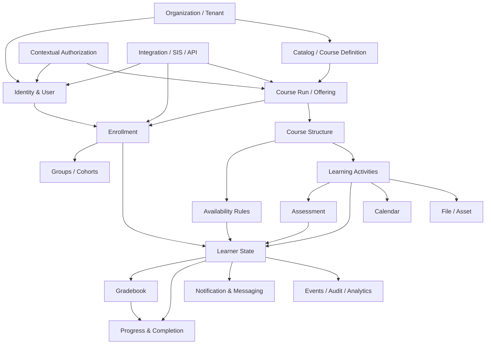

---

# 5. Recommended Layering

LMS internal tidak harus microservices. Bahkan untuk banyak tim, **modular monolith** jauh lebih masuk akal.

Yang penting adalah boundary logic-nya.

```text
Presentation / API
        ↓
Application Services / Use Cases
        ↓
Domain Modules
        ↓
Persistence / Infrastructure
```

Domain modules:

```text
identity/
authorization/
catalog/
course/
enrollment/
grouping/
content/
availability/
assessment/
submission/
quiz/
gradebook/
completion/
calendar/
notification/
files/
events/
reporting/
integration/
```

Bukan:

```text
controllers/
services/
models/
repositories/
```

saja tanpa domain boundary, karena folder teknis semata sering membuat business rule enrollment, grading, dan completion tersebar ke mana-mana.

---

# 6. Course Definition vs Course Run

Ini tidak wajib meniru Moodle, tetapi sangat disarankan untuk LMS organisasi yang menjalankan batch berulang.

## Course Definition

Template akademik/content.

```text
AI Development
Python Fundamentals
Backend Engineering
```

## Course Run / Offering

Instance pelaksanaan course.

```text
AI Development — Batch 10 — 2026
AI Development — Batch 11 — 2026
```

Relasi:

```text
CourseDefinition
      │
      ├── CourseRun A
      ├── CourseRun B
      └── CourseRun C
```

### Mengapa berguna?

Tanpa pemisahan ini, tim sering melakukan salah satu dari dua hal:

1. Menggunakan course yang sama untuk batch baru lalu membersihkan learner state secara manual.
2. Menduplikasi seluruh course dan kehilangan hubungan dengan template asal.

Open edX memiliki konsep course rerun yang secara eksplisit menyalin struktur/content tetapi **tidak membawa learner enrollment, answers, progress, grades, atau discussion state**.

### Rekomendasi

Jika LMS internal punya batch/cohort berulang, pertimbangkan:

```text
CourseDefinition
CourseVersion
CourseRun
```

Minimal:

```text
Course
CourseRun
```

---

# 7. Entity Dependency Registry

Legenda dependency:

- **Strong** — entity tidak bermakna tanpa parent.
- **Contextual** — bergantung pada scope/context.
- **Optional** — fitur tambahan.
- **Derived** — dapat dihitung dari canonical records.

---

## 7.1 Organization / Tenant

**Purpose:** boundary organisasi jika LMS multi-tenant/multi-program.

**Depends on:** none.

**Referenced by:** User membership, CourseDefinition, CourseRun, RoleAssignment, integrations.

**Canonical data:** organization identity dan configuration.

**Do not store here:** participant lists, grades, progress.

---

## 7.2 User

**Purpose:** identity/account manusia atau service account.

**Depends on:** identity provider/authentication layer.

**Referenced by:** enrollment, role assignment, submissions, attempts, grades, events.

**Canonical data:** stable user identity.

Recommended separation:

```text
User
UserProfile
ExternalIdentity
```

agar authentication identity tidak bercampur dengan profile akademik.

---

## 7.3 Context

Moodle memodelkan authorization sebagai tree context.

Logical model:

```text
SYSTEM
  ↓
ORGANIZATION / CATEGORY
  ↓
COURSE
  ↓
ACTIVITY
```

**Depends on:** target entity yang di-scope.

**Referenced by:** RoleAssignment, capability evaluation, files, audit.

Jika LMS sederhana, context tidak harus menjadi tabel literal. Tetapi authorization layer harus tetap memahami scope.

---

## 7.4 Role

**Purpose:** kumpulan capability.

Contoh:

```text
Learner
Instructor
Mentor
Reviewer
Course Admin
Organization Admin
```

**Depends on:** capability definitions.

**Important:** role adalah policy set, bukan participation record.

---

## 7.5 Capability / Permission

**Purpose:** atomic action.

Contoh:

```text
course.view
course.manage
activity.create
submission.view.all
grade.manage
grade.override
participant.manage
```

Authorization lebih stabil jika business code bertanya capability daripada nama role.

---

## 7.6 RoleAssignment

```text
User + Role + Context
```

**Depends on:** User, Role, Context.

**Purpose:** mengikat capability set user terhadap scope tertentu.

Contoh:

```text
Arifian + Instructor + CourseRun#125
Arifian + Learner + CourseRun#221
```

---

## 7.7 CourseCategory / Catalog Node

**Purpose:** klasifikasi course.

**Depends on:** Organization optional.

**Referenced by:** CourseDefinition.

Tidak boleh digunakan sebagai enrollment entity.

---

## 7.8 CourseDefinition

**Purpose:** identitas reusable course/program content.

**Depends on:** Organization/Catalog optional.

**Children:** versions, course runs.

---

## 7.9 CourseVersion

**Purpose:** immutable atau semantically stable revision dari course definition.

**Depends on:** CourseDefinition.

**Referenced by:** CourseRun.

Sangat berguna jika content sering diedit saat learner sudah aktif.

---

## 7.10 CourseRun

**Purpose:** pelaksanaan nyata sebuah course.

**Depends on:** CourseDefinition atau CourseVersion.

**Owns/scope:**

- enrollment,
- groups,
- schedule,
- grading policy,
- learning structure deployment,
- completion policy.

Lifecycle contoh:

```text
DRAFT → READY → ACTIVE → ENDED → ARCHIVED
```

---

## 7.11 Enrollment

**Purpose:** participation relationship.

```text
User ← Enrollment → CourseRun
```

**Depends on:** User, CourseRun, enrollment method/source.

Suggested fields:

```text
id
user_id
course_run_id
status
source
started_at
ended_at
enrolled_at
suspended_at
completed_at
external_ref?
```

Status bukan role.

---

## 7.12 Cohort

**Purpose:** grouping lintas course/course-category untuk mass enrollment atau program membership.

Moodle cohort bersifat site-wide atau category-wide dan dapat disinkronkan ke enrollment course.

**Depends on:** Organization/Category.

**Children:** CohortMember.

---

## 7.13 CohortMember

```text
Cohort + User
```

**Purpose:** membership administratif/program-level.

**Important:** cohort membership tidak otomatis berarti active enrollment kecuali ada explicit sync/enrollment rule.

---

## 7.14 Group

**Purpose:** subgroup di dalam CourseRun.

Moodle group secara konseptual berada pada course scope dan dapat menggunakan mode separate/visible.

**Depends on:** CourseRun.

Contoh:

```text
CourseRun: AI Development Batch 10
Groups: WMA1, WMA2, WA1
```

---

## 7.15 GroupMember

**Depends on:** Group + Enrollment/User.

Recommended invariant:

> User sebaiknya tidak menjadi active group member jika tidak mempunyai enrollment yang relevan di course run tersebut.

---

## 7.16 CourseSection / Module

**Purpose:** structural container.

```text
CourseRun
  └── Section / Module
        └── LearningItem
```

**Depends on:** CourseRun atau versioned course structure.

Fields:

```text
position
visibility
release_at?
```

Canvas modules juga dapat memiliki prerequisite dan completion requirements.

---

## 7.17 LearningItem / CourseModule

**Purpose:** unified position dalam struktur pembelajaran.

```text
LearningItem
- id
- section_id
- type
- target_id
- position
- visibility
```

`target_id` menunjuk resource/activity concrete:

```text
VIDEO
PAGE
FILE
LINK
ASSIGNMENT
QUIZ
DISCUSSION
LIVE_SESSION
SCORM
H5P
```

Moodle memiliki pola serupa melalui course module yang menghubungkan course structure dengan activity module instance.

---

## 7.18 AvailabilityRule

**Purpose:** menentukan apakah section/activity dapat diakses.

**Depends on:** LearningItem/Section.

Condition dapat menggunakan:

- date/time,
- group/grouping,
- profile criteria,
- previous activity completion,
- grade threshold,
- manual release.

Moodle Availability API menggabungkan rule tersebut untuk menghitung user visibility/access.

---

## 7.19 CompletionRule

**Purpose:** mendefinisikan evidence yang membuat activity complete.

**Depends on:** LearningItem/Activity.

Examples:

```text
VIEWED
MANUAL
SUBMITTED
RECEIVED_GRADE
PASSED
MIN_SCORE
CUSTOM_RULE
```

Moodle activity completion mendukung completion-on-view, completion-on-grade, dan custom rules.

---

## 7.20 LearningProgress / ActivityCompletion

**Purpose:** learner-specific state terhadap activity.

**Depends on:** Enrollment/User + LearningItem + CompletionRule.

Suggested fields:

```text
status
started_at
last_accessed_at
completed_at
completion_source
rule_version
```

Status:

```text
NOT_STARTED
IN_PROGRESS
COMPLETED
```

Pass/fail sebaiknya **bukan status progress utama**; itu assessment outcome.

---

## 7.21 Assignment

**Purpose:** activity configuration.

**Depends on:** LearningItem/CourseRun.

Owns:

- instructions,
- availability window,
- due/cutoff dates,
- submission types,
- max attempts/resubmission policy,
- grading config,
- rubric.

Assignment bukan submission.

---

## 7.22 Submission

**Purpose:** learner submission aggregate.

**Depends on:** Assignment + active/eligible Enrollment.

Suggested state:

```text
DRAFT
SUBMITTED
LATE
RETURNED
RESUBMITTED
GRADED
```

Namun hindari satu `status` jika dimensi sebenarnya berbeda. Lebih baik pisahkan:

```text
submission_state
workflow_state
grading_state
lateness
```

jika business logic kompleks.

Canvas mensyaratkan active student enrollment untuk melakukan submission melalui API.

---

## 7.23 SubmissionRevision

**Purpose:** history payload/file setiap submit/resubmit.

**Depends on:** Submission.

Penting untuk audit jika learner boleh mengganti file.

Anti-pattern:

```text
submission.file_id = newest file
```

saja tanpa history.

---

## 7.24 Rubric / RubricCriterion / RubricAssessment

**Purpose:** advanced grading.

**Depends on:** Assignment atau GradeItem.

Moodle memisahkan advanced grading interface dari gradebook final value.

---

## 7.25 QuestionBank

**Purpose:** repository reusable questions.

**Depends on:** course/system scope sesuai policy.

Moodle Question subsystem memisahkan question bank dan question engine.

---

## 7.26 Question

**Purpose:** canonical question definition.

**Depends on:** QuestionBank.

Recommended versioning/snapshot jika question dapat diedit setelah attempt.

---

## 7.27 Quiz

**Purpose:** quiz configuration.

**Depends on:** LearningItem.

Owns:

- attempt policy,
- open/close dates,
- time limit,
- review policy,
- grading method,
- question selection.

---

## 7.28 QuizQuestion / QuizSlot

**Purpose:** hubungan Quiz ↔ Question plus order/weight.

```text
Quiz ← QuizQuestion → Question
```

Bukan embed question ID tanpa metadata jika reorder, randomization, weight, section, atau versioning dibutuhkan.

---

## 7.29 QuizAttempt

**Purpose:** one transactional attempt.

**Depends on:** Quiz + eligible Enrollment.

Suggested lifecycle:

```text
IN_PROGRESS
FINISHED
SUBMITTED
ABANDONED
TIMED_OUT
INVALIDATED
```

Attempt harus menyimpan context yang cukup untuk reproducibility.

---

## 7.30 QuestionAttempt / Response

**Purpose:** learner response per question/slot.

**Depends on:** QuizAttempt + Question snapshot/version.

Stores:

- response,
- correctness,
- raw score,
- max score,
- timestamps,
- grader metadata.

---

## 7.31 GradeItem

**Purpose:** representasi sesuatu yang menghasilkan nilai di gradebook.

**Depends on:** CourseRun.

Optional source:

```text
Assignment
Quiz
Project
Attendance
Manual Grade
External Tool
```

Suggested fields:

```text
source_type
source_id
max_score
min_score
weight
category_id
aggregation_policy
locked
hidden
```

---

## 7.32 Grade

**Purpose:** grade learner untuk satu GradeItem.

```text
Enrollment/User + GradeItem
```

Possible fields:

```text
raw_score
final_score
feedback
graded_by
graded_at
overridden
locked
```

Grade bukan submission dan bukan attempt.

---

## 7.33 GradeHistory

**Purpose:** audit perubahan nilai.

**Depends on:** Grade.

Stores:

- previous value,
- new value,
- actor,
- reason,
- timestamp,
- source.

Sangat penting untuk LMS yang melibatkan manual grading.

---

## 7.34 GradeCategory / GradingPolicy

**Purpose:** aggregation policy.

Contoh:

```text
Quiz 20%
Assignments 30%
Final Project 50%
```

Open edX juga memisahkan assignment type/weight dan overall course grading policy.

---

## 7.35 CourseProgress

**Purpose:** derived learner progress overview.

**Depends on:** activity completion states.

Recommended:

```text
completed_required_items / total_required_items
```

atau policy lain yang eksplisit.

Jangan gunakan `grade / 100` sebagai progress.

---

## 7.36 CourseCompletion

**Purpose:** final completion decision.

**Depends on:** completion rules + optionally grade/pass + enrollment lifecycle.

Examples:

```text
All mandatory activities complete
AND final grade >= 70
AND final project submitted
```

CourseCompletion sebaiknya memiliki evidence/reason agar dapat diaudit.

---

## 7.37 CalendarEvent

**Purpose:** projection deadline/schedule.

**Depends on:** source entity.

Source dapat berupa:

- course start/end,
- assignment open/due/cutoff,
- quiz open/close,
- live session,
- manual event.

Moodle Calendar API memungkinkan activity menghasilkan event dan action event.

**Recommended:** calendar bukan source of truth deadline. Assignment/Quiz-lah source of truth; calendar adalah projection.

---

## 7.38 Notification

**Purpose:** system-generated user notification.

**Depends on:** domain event + recipient.

Examples:

```text
AssignmentPublished
SubmissionReceived
SubmissionGraded
QuizAttemptSubmitted
DeadlineApproaching
CourseCompleted
```

Moodle components mendaftarkan message producer dan menggunakan messaging subsystem untuk delivery.

---

## 7.39 Message / Conversation

**Purpose:** human-to-human messaging jika tersedia.

Pisahkan dari Notification karena semantics berbeda.

```text
Notification = system → user
Message      = user ↔ user
```

---

## 7.40 FileAsset

**Purpose:** metadata/reference terhadap binary object.

**Depends on:** owner/context/component/item.

Moodle File API mengidentifikasi logical file area menggunakan context, component, file area, dan item ID; storage serta serving/access check dipisahkan.

Recommended modern implementation:

```text
Database          Object Storage
---------         --------------
FileAsset    →    S3/R2/MinIO
metadata          content bytes
```

---

## 7.41 DomainEvent / LearningEvent

**Purpose:** immutable-ish record bahwa sesuatu terjadi.

Examples:

```text
CourseViewed
ActivityViewed
AssignmentSubmitted
QuizAttemptStarted
QuizAttemptFinished
GradeUpdated
ActivityCompleted
```

Moodle Events API direkomendasikan sebagai mekanisme komunikasi antar-plugin dan menjadi basis logging.

---

## 7.42 AuditLog

**Purpose:** administrative accountability.

Examples:

```text
Admin changed enrollment status
Instructor manually overrode grade
Course structure changed
Question deleted
Role permission changed
```

LearningEvent dan AuditLog dapat berbagi infrastructure, tetapi semantics/query pattern berbeda.

---

## 7.43 Certificate / Credential

**Purpose:** issued outcome.

**Depends on:** CourseCompletion + passing policy.

Certificate sebaiknya snapshot-issued record, bukan sekadar computed page dari current progress.

---

## 7.44 ExternalMapping / IntegrationReference

**Purpose:** hubungan internal ID dengan SIS/HRIS/CRM/external platform.

```text
external_system
external_type
external_id
internal_type
internal_id
```

Hindari menjadikan external ID sebagai primary key internal jika lifecycle sistem berbeda.

---

# 8. Core Entity Relationship Reference

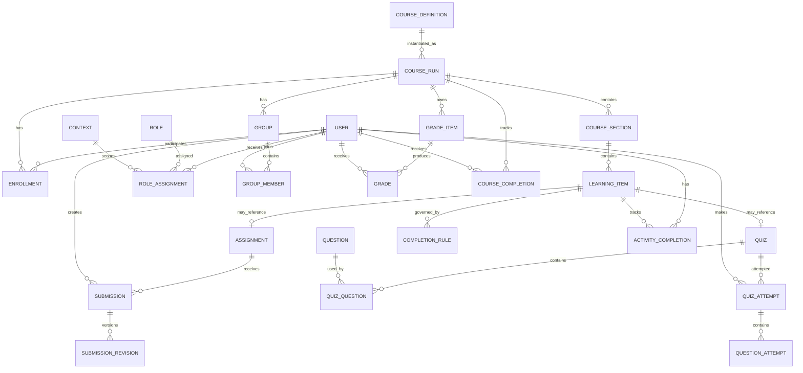

---

# 9. Source-of-Truth Matrix

| Concern | Canonical Source | Derived / Projection | Jangan dijadikan canonical |
|---|---|---|---|
| Identity | User / ExternalIdentity | Profile display cache | token payload lama |
| Course participation | Enrollment | participant count | `course.students[]` |
| Permission | RoleAssignment + capability policy + context | frontend permissions | global `user.role` |
| Group membership | GroupMember | group participant list | user profile field |
| Course content | CourseVersion/Section/LearningItem | navigation tree cache | learner progress row |
| Access availability | AvailabilityRule + runtime state | `isAvailable` cache | hardcoded UI visibility |
| Assignment work | Submission + revisions | latest submission view | grade row |
| Quiz work | QuizAttempt + QuestionAttempt | attempt summary | grade row only |
| Raw assessment result | attempt/submission grading result | gradebook sync | course progress |
| Gradebook | GradeItem + Grade + grading policy | final grade cache | activity-specific final course score |
| Completion | CompletionRule + completion evidence | progress percentage | grade alone |
| Deadline | Assignment/Quiz/activity config | CalendarEvent | calendar row |
| File | FileAsset metadata + object store | CDN URL | arbitrary string path |
| Notification | DomainEvent + Notification delivery state | unread counter | business entity status |
| Analytics | Domain events / learning events | aggregate tables | current transactional row only |

---

# 10. Reference Business Flow — User Provisioning

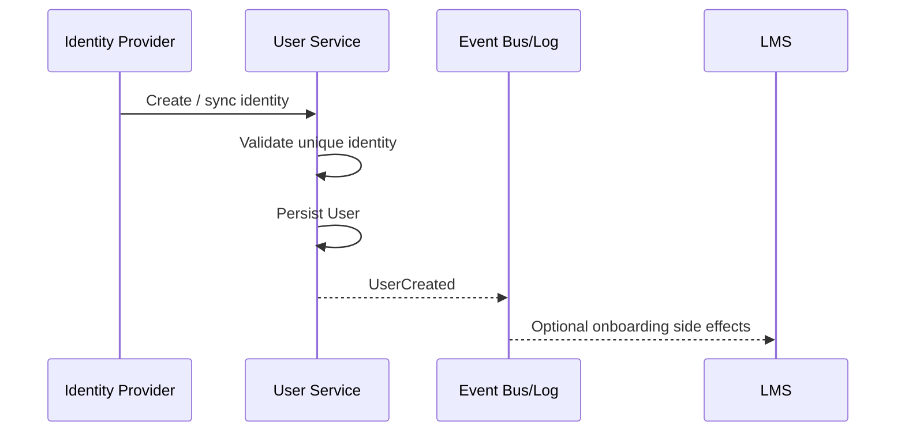

### Rules

1. User creation **tidak otomatis** membuat enrollment pada semua course.
2. User type/profile dapat memengaruhi default UI, tetapi bukan pengganti contextual authorization.
3. External identity mapping harus idempotent.

---

# 11. Reference Business Flow — Course Authoring & Publishing

```text
Create Course Definition
        ↓
Create Draft Version
        ↓
Add Sections
        ↓
Add Learning Items
        ↓
Configure Activities
        ↓
Configure Availability
        ↓
Configure Completion Rules
        ↓
Configure Grade Items / Policy
        ↓
Validate Course
        ↓
Publish Version
        ↓
Bind Course Run
```

### Validation sebelum publish

Minimal cek:

- orphan learning item,
- invalid ordering,
- missing required target,
- impossible availability dependency,
- cyclic prerequisite,
- invalid due/open/cutoff dates,
- invalid grading weights,
- missing max score,
- deleted question referenced by quiz,
- completion rule referencing nonexistent grade/activity.

### Common bug

Course bisa dipublish walaupun struktur invalid. Akhirnya learner baru menemukan error saat membuka halaman tertentu.

**Better:** lakukan structural validation pada authoring/publish boundary.

---

# 12. Reference Business Flow — Enrollment

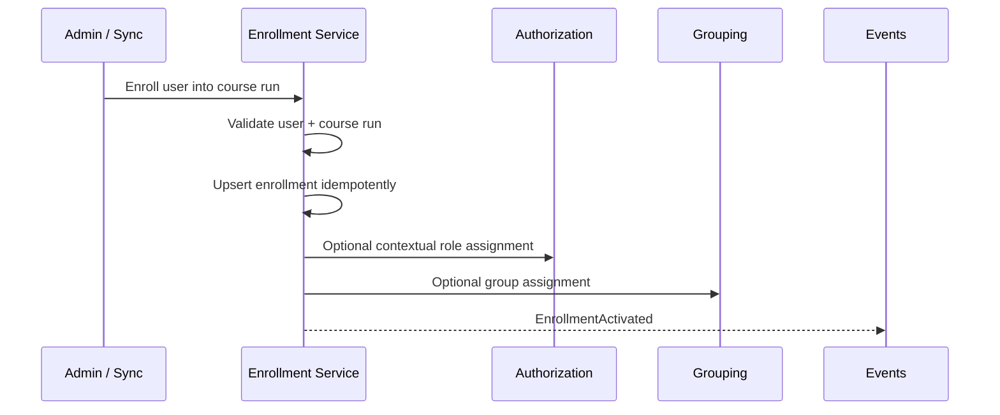

### Important

Moodle memisahkan user enrolment dari role assignment.

Secara logical:

```text
Enrollment
- participant status
- start/end
- enrollment method

RoleAssignment
- role
- context
- capability
```

### Audit questions

- Apakah LMS internal membuat duplicate enrollment jika endpoint dipanggil dua kali?
- Apakah role mentor tersimpan langsung di enrollment atau global user?
- Apakah suspended participant masih dihitung sebagai active learner?
- Apakah group member dapat tetap ada setelah enrollment expired?

---

# 13. Reference Business Flow — Course Access

Setiap request course/activity sebaiknya melewati decision chain:

```text
Authenticated?
    ↓
User active?
    ↓
Has direct administrative capability?
    ├── YES → continue
    └── NO
          ↓
Active/eligible enrollment?
          ↓
CourseRun active/visible?
          ↓
Section visible?
          ↓
Activity available for this user?
          ↓
ALLOW
```

Moodle `require_login`/access logic mempertimbangkan login, hidden course/activity, availability, enrollment, capability, dan guest policy.

### Anti-pattern

Backend:

```ts
GET /courses/:id/activity/:id
// returns content if activity exists
```

Frontend saja yang menyembunyikan activity.

Ini authorization bug, bukan sekadar UI bug.

---

# 14. Reference Business Flow — Availability / Prerequisite

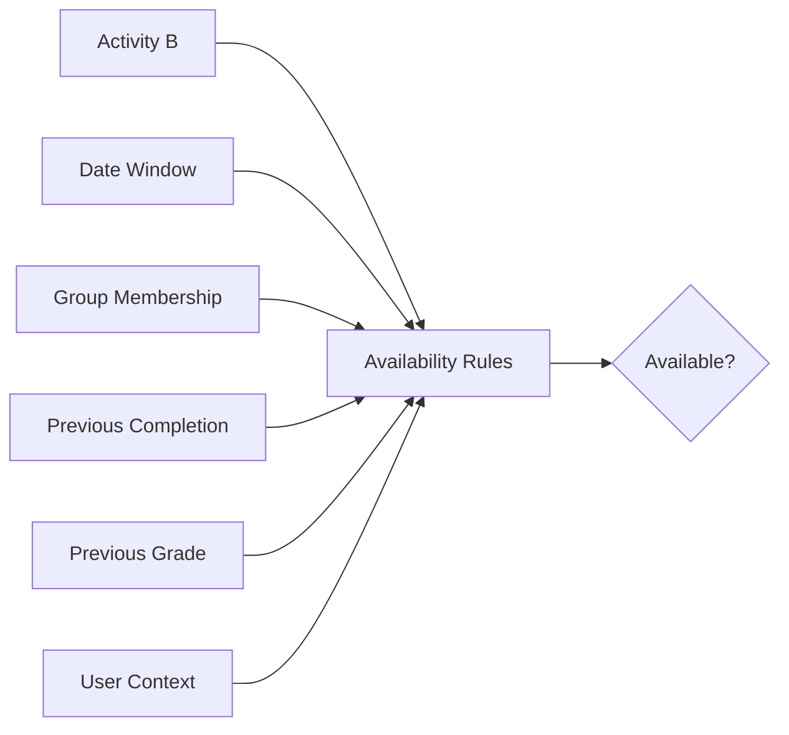

### Example

```text
Assignment B available when:
- current date >= 10 Sep
- learner belongs to Group WMA1
- Quiz A completion = COMPLETED
- Quiz A grade >= 70
```

Semua kondisi tersebut harus dievaluasi terhadap learner yang sedang mengakses.

### Critical warning

Jangan persist `activity.is_locked = true` secara global jika lock sebenarnya user-specific.

Karena:

```text
Activity B
User A → available
User B → locked
```

Availability sering merupakan **function of entity config + learner state**, bukan satu kolom global.

---

# 15. Reference Business Flow — Learning Progress

```text
Learner interacts with activity
        ↓
Canonical interaction persisted
        ↓
Completion evaluator runs
        ↓
Completion rules evaluated
        ↓
ActivityCompletion updated
        ↓
CourseProgress recalculated/projected
        ↓
Dependent availability may change
        ↓
Events / notifications / analytics
```

### Example: video

```text
view event
  ↓
rule = VIEWED
  ↓
ActivityCompletion = COMPLETED
```

### Example: assignment

```text
submission persisted
  ↓
rule = SUBMITTED
  ↓
ActivityCompletion = COMPLETED
```

atau:

```text
submission persisted
  ↓
grade posted
  ↓
rule = MIN_SCORE >= 70
  ↓
ActivityCompletion = COMPLETED / still incomplete
```

### Important

Progress aggregation sebaiknya membaca **completion state**, bukan activity raw event secara acak.

---

# 16. Reference Business Flow — Assignment

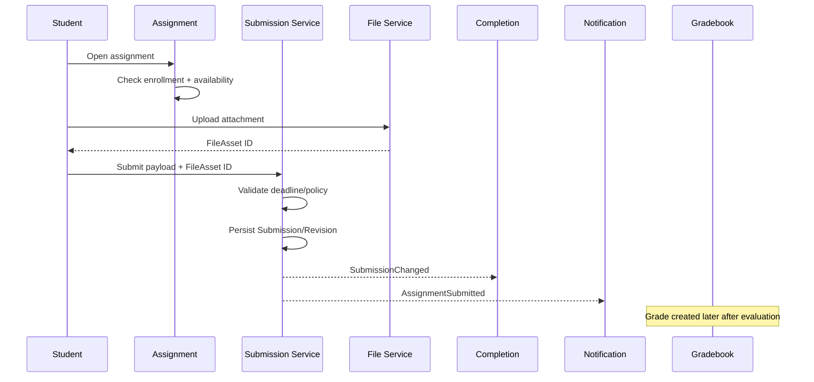

Grading:

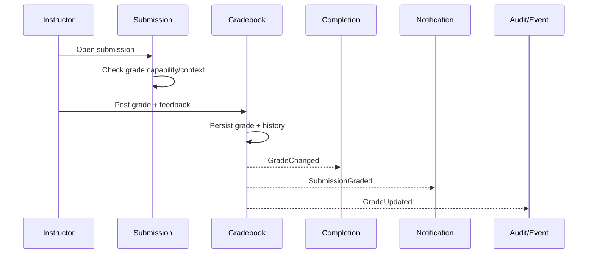

### Invariants

- Submission exists independently from grade.
- `Not graded` bukan berarti `Not submitted`.
- Resubmission tidak boleh menghapus historical submission tanpa policy.
- Grading permission harus terikat context/group scope.
- Grade override harus auditable.

---

# 17. Reference Business Flow — Quiz

```text
Open Quiz
   ↓
Check enrollment + availability + attempt policy
   ↓
Create QuizAttempt
   ↓
Resolve question slots / snapshots
   ↓
Save responses incrementally
   ↓
Submit / timeout
   ↓
Finalize attempt
   ↓
Compute raw score
   ↓
Select grade according to quiz grading method
   ↓
Sync GradeItem
   ↓
Evaluate completion
```

### Attempt grading methods may include

```text
Highest attempt
Latest attempt
First attempt
Average attempts
```

### Why Attempt ≠ Grade?

Learner dapat mempunyai:

```text
Attempt #1 = 40
Attempt #2 = 80
Attempt #3 = 70
```

Gradebook mungkin memilih `highest = 80`.

Jadi:

```text
QuizAttempt = historical assessment transaction
Grade = selected/aggregated academic result
```

### Critical bug smell

Jika database hanya menyimpan:

```text
quiz_user.score = 80
```

maka sistem kehilangan:

- attempt history,
- answer history,
- timing,
- review evidence,
- regrade capability,
- auditability.

---

# 18. Reference Business Flow — Gradebook

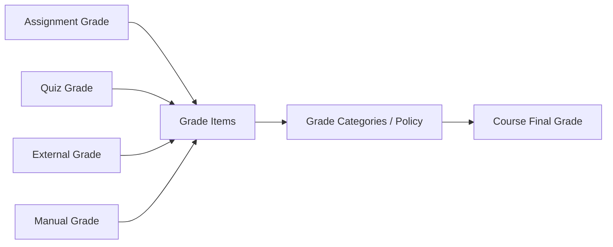

### Gradebook responsibilities

1. register grade item,
2. accept/update learner grade,
3. normalize raw score,
4. calculate weighted results,
5. support category aggregation,
6. handle override,
7. handle lock/finalization,
8. retain history,
9. expose grades according to visibility policy.

Moodle Gradebook API mendukung activity/module mengirim grade ke central gradebook dan menyediakan regrade logic.

### Example

```text
Quiz Python             8 / 10     weight 10%
Assignment Python      75 / 100    weight 20%
Quiz ML                 9 / 10     weight 10%
ML Project             80 / 100    weight 30%
Final Project          90 / 100    weight 30%
```

Gradebook menghitung normalized weighted grade, bukan setiap module sendiri-sendiri.

---

# 19. Reference Business Flow — Course Completion

```text
ActivityCompletion states
          +
Final Grade
          +
Course Completion Policy
          +
Other requirements
          ↓
CourseCompletionEvaluator
          ↓
NOT_COMPLETED / COMPLETED / PASSED / FAILED
          ↓
Certificate eligibility
```

Recommended separation:

```text
completion_status = COMPLETED
outcome_status    = PASSED
```

atau satu aggregate dengan dimensi terpisah.

### Example

Learner:

```text
All modules viewed       = yes
All assignments submitted = yes
Final grade               = 62
Passing threshold         = 70
```

Maka:

```text
Learning requirements completed = yes
Academic outcome = failed
Certificate = not eligible
```

Jangan memaksa seluruh makna tersebut ke satu boolean `is_completed`.

---

# 20. Reference Business Flow — Suspend / Unenroll / Reactivate

Ini salah satu area yang sering merusak LMS custom.

## Suspend

Recommended semantics:

```text
Enrollment remains
Learner state remains
Grades remain
Submissions remain
Access denied/restricted
```

## Unenroll / Drop

Policy harus eksplisit.

Ada dua pilihan umum:

### A. Preserve history

```text
Enrollment.status = DROPPED
Historical state retained
```

### B. Hard purge tertentu

Hanya jika memang required oleh regulation/privacy/business policy.

### Reactivate

```text
SUSPENDED/DROPPED → ACTIVE
```

seharusnya tidak membuat duplicate participant record atau kehilangan historical progress kecuali business rule menyatakan reset.

### Audit red flags

- Suspend menghapus submission.
- Unenroll cascade delete grades.
- Re-enroll membuat learner progress mulai nol tanpa explicit reset.
- Duplicate enrollment menghasilkan duplicate gradebook rows.

---

# 21. Reference Business Flow — Groups & Instructor Scope

Misalnya satu course memiliki 200 learner dan 12 groups.

```text
CourseRun
 ├── Group A → Instructor A
 ├── Group B → Instructor B
 └── Group C → Instructor C
```

Instructor A mungkin memiliki capability:

```text
submission.view
submission.grade
```

namun hanya untuk learner dalam Group A.

Ini berarti authorization tidak cukup hanya:

```text
role = instructor
```

Harus ada scope filtering:

```text
User capability
+
Course context
+
Group restriction
```

Moodle separate groups dapat memengaruhi visibility serta gradebook/reporting.

---

# 22. Reference Business Flow — Calendar

Canonical deadline berada pada activity:

```text
Assignment.due_at
Quiz.close_at
LiveSession.start_at
```

Kemudian:

```text
Activity change
    ↓
Calendar projection updated
    ↓
Dashboard / timeline displays event
```

Moodle Calendar action event memiliki hubungan dengan activity dan dapat ditampilkan di dashboard sebagai actionable deadline.

### Anti-pattern

```text
Assignment due_at = 10 Sep
Calendar due_at   = 12 Sep
```

karena dua-duanya editable sebagai source of truth terpisah.

---

# 23. Reference Business Flow — Notification

Recommended:

```text
Domain transaction
      ↓
Domain Event
      ↓
Notification Policy
      ↓
Notification record
      ↓
Delivery processors
      ├── In-app
      ├── Email
      ├── Push
      └── External channel
```

Example:

```text
GradeUpdated
  ↓
NotificationPolicy
  ↓
Student receives "Your assignment was graded"
```

### Why event-driven?

Jika grading endpoint melakukan:

```text
save grade
send email
send WhatsApp
update analytics
refresh dashboard cache
```

secara synchronous, satu dependency failure dapat menggagalkan business transaction utama.

---

# 24. Reference Business Flow — Files

```text
Client requests upload
       ↓
Validate auth + context
       ↓
Create upload session
       ↓
Store binary in object storage
       ↓
Persist FileAsset metadata
       ↓
Attach FileAsset ID to domain entity
```

Download:

```text
Request file
   ↓
Resolve FileAsset
   ↓
Check context/capability/entity ownership
   ↓
Generate/stream secure file response
```

### Anti-pattern

```text
submission.file_url = public permanent URL
```

untuk file private.

### Better

```text
submission_revision.file_asset_id
```

kemudian access diputuskan saat serving.

Moodle File API secara eksplisit memisahkan storage, metadata, file areas, dan access-controlled serving.

---

# 25. Reference Business Flow — Event Logging & Analytics

```text
Business Event
    ↓
Operational Event Log
    ↓
Analytics Pipeline
    ↓
Aggregates / Dashboard
```

### Event examples

```text
course.viewed
activity.viewed
activity.completed
assignment.submitted
assignment.graded
quiz.attempt.started
quiz.attempt.submitted
grade.updated
enrollment.activated
enrollment.suspended
```

Suggested event envelope:

```json
{
  "event_id": "...",
  "event_type": "assignment.submitted",
  "occurred_at": "...",
  "actor_user_id": "...",
  "subject_user_id": "...",
  "course_run_id": "...",
  "entity_type": "submission",
  "entity_id": "...",
  "context": {},
  "schema_version": 1
}
```

### Do not derive all historical analytics from mutable current tables

Contoh:

Jika user awalnya group A lalu dipindah ke group B, query current `group_member` tidak dapat menjawab secara akurat:

> “Saat submission tanggal 1 Agustus dibuat, user berada di group apa?”

Event/snapshot membantu historical analysis.

---

# 26. Synchronous vs Asynchronous Responsibilities

## Synchronous — harus berhasil agar transaction valid

```text
Authentication
Authorization
Enrollment eligibility
Availability validation
Deadline validation
Canonical submission persistence
Attempt state transition
Grade persistence
```

## Asynchronous / side effect candidate

```text
Email notification
Push notification
Analytics aggregation
Search indexing
Heavy course progress recalculation
Large grade recomputation
Report generation
Certificate rendering
External webhook
```

Open edX menggunakan asynchronous task untuk recalculation grade setelah learner submission pada flow tertentu.

### Rule

> Jangan gunakan async untuk sesuatu yang harus dijamin selesai sebelum user menerima success jika hasilnya menentukan validitas transaction.

---

# 27. Recommended State Machines

## 27.1 Enrollment

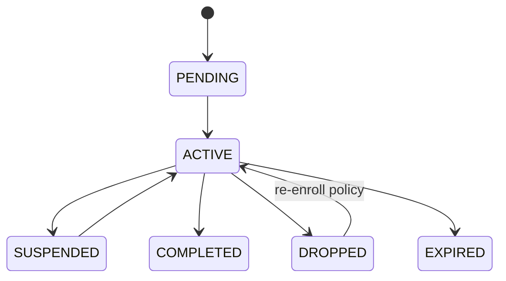

---

## 27.2 Course Run

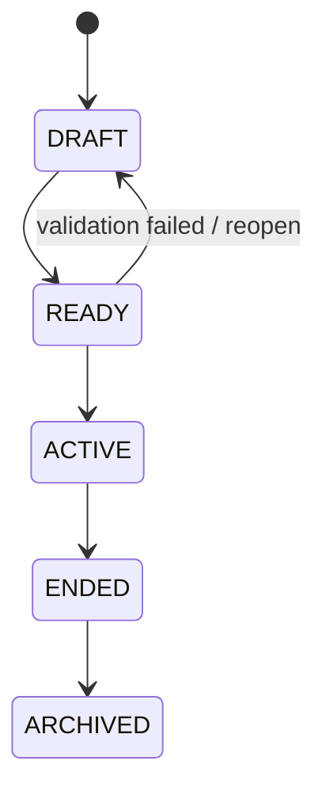

---

## 27.3 Submission

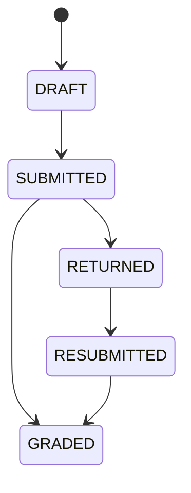

`LATE` sebaiknya dipertimbangkan sebagai attribute hasil evaluasi deadline daripada workflow state apabila learner tetap bisa berada di state `SUBMITTED` dan `GRADED`.

---

## 27.4 Quiz Attempt

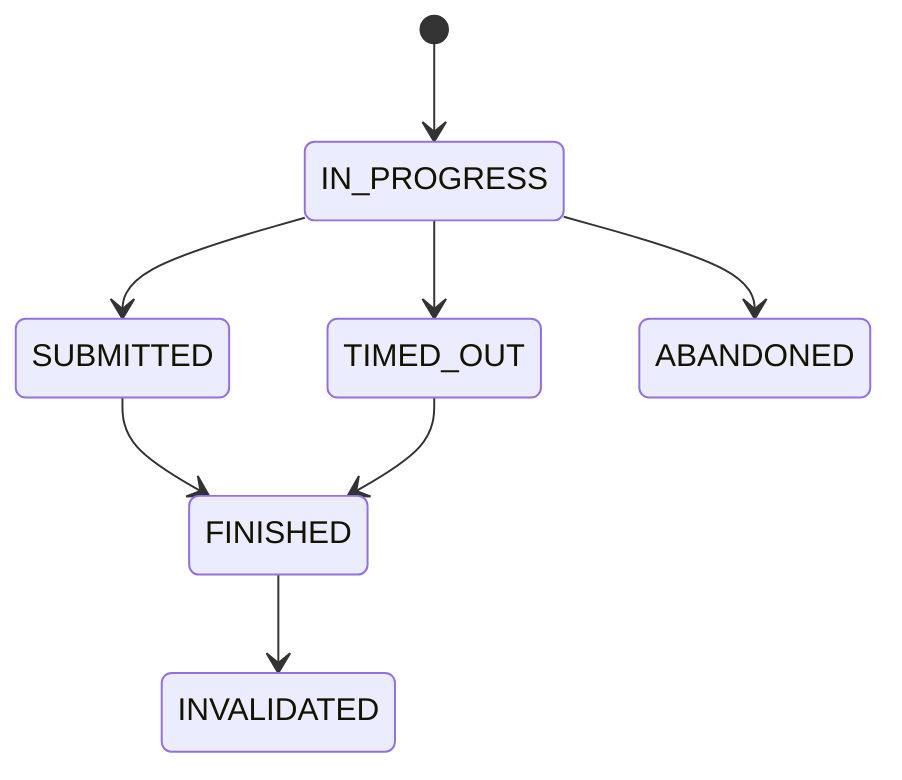

---

## 27.5 Activity Completion

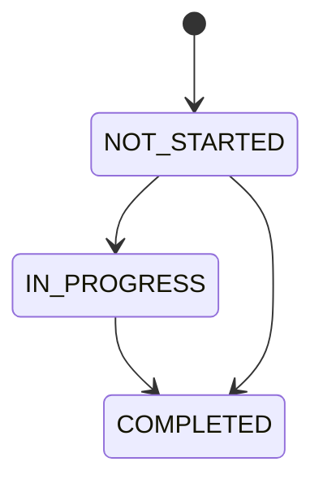

Pass/fail sebaiknya disimpan sebagai outcome/grade dimension, bukan dipaksa masuk progress state machine ini.

---

# 28. Dependency Direction

Ideal dependency:

```text
Identity
  ↓
Enrollment + Authorization
  ↓
Course Structure
  ↓
Learning Activity
  ↓
Learner Interaction State
  ↓
Assessment Result
  ↓
Gradebook
  ↓
Completion
```

Side systems observe:

```text
Calendar
Notification
Analytics
Reporting
```

### Dangerous reverse dependencies

Contoh buruk:

```text
CourseService depends on NotificationService
NotificationService queries GradeService
GradeService modifies CourseProgress
CourseProgress modifies Enrollment
Enrollment sends notification through CourseService
```

Ini membuat cyclic dependency dan bug sulit diprediksi.

### Better

```text
Domain A performs transaction
Domain A emits event
Other domains react through explicit contracts
```

---

# 29. Domain Ownership Rules

## Enrollment module owns

```text
Enrollment status
Enrollment dates
Enrollment source
```

Bukan:

```text
Grades
Activity completion
Course content
```

## Assessment module owns

```text
Attempts
Submissions
Responses
Raw assessment result
```

Bukan:

```text
Course final grade
```

## Gradebook owns

```text
Grade items
Final learner grades per item
Grade aggregation
Grade overrides
```

## Completion owns

```text
Completion rules
Activity completion state
Course completion decision
```

## Calendar owns

```text
Calendar projection/display events
```

Tidak owns assignment deadline.

---

# 30. Common LMS Architecture Smells

## SMELL-01 — Global role field

```text
user.role = STUDENT | MENTOR | ADMIN
```

Tidak selalu salah untuk LMS sangat sederhana, tetapi menjadi masalah ketika user memiliki lebih dari satu role atau scope.

**Risk:** authorization leak.

---

## SMELL-02 — Enrollment dan role dijadikan satu

```text
course_member.role
```

Boleh untuk simple system, tetapi akan terbatas ketika membutuhkan activity-level capability, organization admin, observer, reviewer, atau role overlap.

---

## SMELL-03 — Satu tabel `progress` untuk semua makna

```text
progress = 80
status = DONE
score = 70
```

tanpa definisi sumber masing-masing.

**Risk:** progress, completion, dan grade saling overwrite.

---

## SMELL-04 — Boolean explosion

```text
is_started
is_done
is_completed
is_finished
is_passed
is_submitted
is_graded
```

tanpa state transition formal.

**Risk:** impossible combinations.

Contoh:

```text
is_completed=false
is_finished=true
is_started=false
```

---

## SMELL-05 — One giant status enum

```text
NOT_STARTED
OPEN
SUBMITTED
LATE
FAILED
PASSED
GRADED
COMPLETED
LOCKED
```

Status tersebut mencampur:

- temporal state,
- access state,
- submission state,
- grade outcome,
- completion state.

Pisahkan dimension.

---

## SMELL-06 — Frontend owns authorization

Button disembunyikan tetapi endpoint tetap menerima request.

**Severity: Critical.**

---

## SMELL-07 — Course progress dihitung dari page visits saja

Tidak valid jika activity memiliki semantic completion lain.

---

## SMELL-08 — Grade stored in Submission only

Sulit menangani:

- manual grade,
- external grade,
- weighted grade,
- multiple attempts,
- grade override,
- grade categories.

---

## SMELL-09 — Course final grade dihitung oleh setiap endpoint

Contoh assignment service langsung update `course_user.final_grade`.

**Risk:** race condition dan inconsistent formula.

---

## SMELL-10 — Deadline duplicated

Deadline disimpan di:

```text
assignment.due_at
calendar_event.due_at
learning_item.due_at
notification_schedule.due_at
```

semuanya editable.

Pilih satu canonical source.

---

## SMELL-11 — Hard delete transactional learner data

Menghapus assignment menyebabkan submission ikut hilang tanpa archival policy.

**Risk:** data loss, audit failure.

---

## SMELL-12 — Question mutation changes old attempts

Jika question current text dijoin langsung ketika melihat old attempt, learner history dapat berubah setelah instructor edit question.

---

## SMELL-13 — No idempotency on enrollment/sync

Integration retry menghasilkan duplicate enrollment, duplicate notification, duplicate group member.

---

## SMELL-14 — Notification failure rolls back grade/submission

Side-effect coupling.

---

## SMELL-15 — Group membership independent from course participation

User dapat berada dalam group course walaupun tidak enrolled.

---

## SMELL-16 — Derived aggregate is manually edited

Contoh admin mengubah `course_progress = 100` tanpa mengubah completion evidence.

Kemudian rebuild mengembalikan nilai berbeda.

---

## SMELL-17 — No grade history

Nilai berubah tetapi tidak diketahui siapa mengubah, kapan, dan kenapa.

---

## SMELL-18 — No distinction between suspend and delete

Administrasi sulit dan historical learner data mudah hilang.

---

## SMELL-19 — Course copy copies learner state

Course batch baru tiba-tiba membawa:

- enrollments,
- submissions,
- progress,
- grades.

Open edX course rerun secara eksplisit tidak menduplikasi learner state tersebut.

---

## SMELL-20 — Cyclic prerequisites

```text
Module A requires B
Module B requires A
```

Harus divalidasi saat authoring/publish.

---

# 31. Bug Classification by Severity

## P0 — Data Integrity / Security

- unauthorized grade access,
- learner dapat submit tanpa enrollment,
- grade user tertukar,
- duplicate grade rows,
- hard delete learner history,
- cross-tenant data leakage,
- old attempt berubah ketika question diedit.

## P1 — Core Business Flow

- completion salah,
- grade aggregation salah,
- availability unlock salah,
- suspended learner masih dapat submit,
- course completion salah,
- duplicate enrollment.

## P2 — Workflow Consistency

- notification duplicate,
- calendar stale,
- incorrect dashboard counts,
- group filtering salah,
- progress cache delay.

## P3 — UX / Presentation

- wrong labels,
- stale counters,
- inconsistent display order.

---

# 32. Audit Checklist — Identity & Authorization

- [ ] Apakah satu user dapat mempunyai role berbeda di course berbeda?
- [ ] Apakah authorization dilakukan di backend?
- [ ] Apakah permission dicek berdasarkan capability/action, bukan hanya string role?
- [ ] Apakah course-level permission dapat dibatasi ke group/section?
- [ ] Apakah admin bypass bersifat eksplisit dan auditable?
- [ ] Apakah inactive/deleted user kehilangan access secara konsisten?
- [ ] Apakah tenant/organization boundary diterapkan di query layer?
- [ ] Apakah role assignment memiliki lifecycle/audit?

---

# 33. Audit Checklist — Enrollment

- [ ] Enrollment merupakan entity sendiri.
- [ ] Ada unique constraint logis `(user, course_run)` atau business key yang sesuai.
- [ ] Retry enrollment idempotent.
- [ ] Active/suspended/dropped/expired mempunyai semantics jelas.
- [ ] Suspend tidak menghapus learner state.
- [ ] Reactivate tidak membuat duplicate state.
- [ ] Enrollment source tercatat: manual, cohort sync, import, SIS, self-enroll, API.
- [ ] Start/end date diperiksa saat access.
- [ ] Group membership konsisten dengan enrollment.

---

# 34. Audit Checklist — Course Structure

- [ ] Section/module memiliki ordering deterministik.
- [ ] Learning item target dapat divalidasi.
- [ ] Tidak ada orphan activity.
- [ ] Publish melakukan structural validation.
- [ ] Course run memiliki lifecycle.
- [ ] Perubahan struktur tidak menghapus historical learner state tanpa migration policy.
- [ ] Batch/course rerun tidak membawa learner transactional data.
- [ ] Content version/snapshot strategy tersedia bila course diedit saat aktif.

---

# 35. Audit Checklist — Availability

- [ ] Visibility dan availability dibedakan.
- [ ] Availability dihitung per-user bila condition user-specific.
- [ ] Group restriction bekerja di backend.
- [ ] Date restriction memakai timezone strategy konsisten.
- [ ] Grade prerequisite memakai grade source yang benar.
- [ ] Completion prerequisite memakai completion state yang benar.
- [ ] Cyclic dependency dicegah.
- [ ] Instructor/admin override capability jelas.

---

# 36. Audit Checklist — Assignment

- [ ] Assignment config terpisah dari Submission.
- [ ] Submission hanya dapat dilakukan participant eligible.
- [ ] Due date dan cutoff date dibedakan jika diperlukan.
- [ ] Late status dihitung konsisten.
- [ ] Resubmission policy eksplisit.
- [ ] Submission revision/history tidak hilang.
- [ ] File ownership/access aman.
- [ ] Grading tidak mengubah original submission payload.
- [ ] Grade history tersedia.
- [ ] Notification failure tidak membatalkan submission.

---

# 37. Audit Checklist — Quiz

- [ ] Quiz config terpisah dari attempts.
- [ ] Attempt lifecycle jelas.
- [ ] Multiple attempts didukung sesuai policy.
- [ ] Question response disimpan per attempt.
- [ ] Question version/snapshot tersedia untuk historical integrity.
- [ ] Timeout diselesaikan deterministic.
- [ ] Grading method eksplisit.
- [ ] Quiz grade disinkronkan ke Gradebook.
- [ ] Regrade mempunyai mekanisme jelas.
- [ ] Review/answer visibility mengikuti policy.

---

# 38. Audit Checklist — Gradebook

- [ ] GradeItem adalah entity independen.
- [ ] Grade source diketahui.
- [ ] Raw score dan final/normalized score dibedakan bila perlu.
- [ ] Weight/category policy centralized.
- [ ] Total weight tervalidasi.
- [ ] Manual override auditable.
- [ ] Grade lock/finalization tersedia jika dibutuhkan.
- [ ] Recalculation idempotent.
- [ ] Final grade dapat direbuild.
- [ ] Grade visibility policy diterapkan di backend.

---

# 39. Audit Checklist — Progress & Completion

- [ ] CompletionRule explicit.
- [ ] ActivityCompletion per learner.
- [ ] CourseProgress merupakan derived projection.
- [ ] Grade dan completion tidak menggunakan field yang sama.
- [ ] Completed dan passed tidak dianggap sinonim.
- [ ] Progress percentage formula terdokumentasi.
- [ ] Required vs optional item dibedakan.
- [ ] Perubahan completion rule memiliki migration/recalculation policy.
- [ ] CourseCompletion menyimpan evidence/reason atau dapat direconstruct.

---

# 40. Audit Checklist — Events, Notifications, Analytics

- [ ] Domain event mempunyai unique event ID.
- [ ] Consumer idempotent.
- [ ] Notification mempunyai delivery state.
- [ ] Business transaction tidak bergantung pada email/push success.
- [ ] Analytics menggunakan stable event schema.
- [ ] Administrative changes masuk AuditLog.
- [ ] Actor dan subject dibedakan.
- [ ] Event mempunyai course/activity context.
- [ ] Aggregate dashboard dapat direbuild.

---

# 41. Audit Checklist — Files

- [ ] Binary file tidak disimpan sebagai arbitrary public URL tanpa access layer.
- [ ] File metadata tersentralisasi.
- [ ] Entity memakai FileAsset ID/reference.
- [ ] File serving melakukan authorization.
- [ ] Orphan file cleanup policy tersedia.
- [ ] File revision/history sesuai kebutuhan assessment.
- [ ] Object storage lifecycle jelas.
- [ ] MIME/type/size validation dilakukan server-side.

---

# 42. Test Scenarios yang Wajib Ada

## Scenario A — User dengan dua role

```text
User X
Course A → Instructor
Course B → Learner
```

Expected:

- dapat grade di A,
- tidak dapat grade learner lain di B,
- dapat submit sebagai learner di B.

---

## Scenario B — Suspended learner

1. Learner active.
2. Submit assignment.
3. Instructor grades.
4. Enrollment suspended.

Expected:

- submission tetap ada,
- grade tetap ada,
- learner tidak dapat submit aktivitas baru,
- reporting historical tetap benar.

---

## Scenario C — Re-enroll

1. Learner active.
2. Complete 5 activities.
3. Suspended/dropped.
4. Re-enrolled.

Expected harus mengikuti explicit policy:

- resume historical progress, **atau**
- reset melalui explicit reset operation.

Tidak boleh tergantung incidental cascade behavior.

---

## Scenario D — Quiz multiple attempts

Scores:

```text
40, 80, 70
```

Validate grading methods:

```text
Highest → 80
Latest  → 70
First   → 40
Average → 63.33
```

---

## Scenario E — Question edited after attempt

1. Learner answers Question V1.
2. Instructor edits question to V2.
3. Instructor opens learner historical attempt.

Expected:

Historical attempt tetap dapat dijelaskan berdasarkan V1/snapshot yang digunakan saat attempt.

---

## Scenario F — Availability based on grade

```text
Activity B requires Quiz A >= 70
```

Learner A score 80 → B available.
Learner B score 60 → B unavailable.
Instructor course admin → access based on capability policy.

---

## Scenario G — Grade override

1. Automatic grade = 60.
2. Instructor override = 75.
3. Recalculation runs.

Expected:

- override policy menentukan apakah 75 dipertahankan,
- history menyimpan 60 → 75,
- regrade tidak silently menghancurkan override.

---

## Scenario H — Notification failure

1. Learner submits assignment.
2. Email provider down.

Expected:

- submission tetap success,
- notification marked failed/retryable,
- learner tidak perlu submit ulang.

---

## Scenario I — Group-limited instructor

Instructor A hanya Group A.

Expected:

- list submission hanya Group A,
- direct URL ke submission Group B ditolak backend,
- grade API ke learner Group B ditolak.

---

## Scenario J — Deadline timezone

Course timezone dan user timezone berbeda.

Expected:

- canonical time stored consistently,
- display converted correctly,
- lateness dihitung terhadap canonical instant,
- no “23:59 bug”.

---

# 43. Recommended Database Constraints

Logical constraints yang sangat membantu:

```text
UNIQUE enrollment(user_id, course_run_id, enrollment_scope?)
UNIQUE group_member(group_id, user_id)
UNIQUE grade(grade_item_id, user_id)
UNIQUE activity_completion(learning_item_id, user_id)
UNIQUE role_assignment(user_id, role_id, context_id, assignment_source?)
```

Foreign keys sesuai lifecycle policy.

### Jangan otomatis CASCADE DELETE untuk transactional learner state

Hati-hati pada:

```text
CourseRun → Enrollment
Assignment → Submission
Quiz → QuizAttempt
GradeItem → Grade
```

Soft delete/archive atau explicit purge workflow sering lebih aman.

---

# 44. Concurrency & Idempotency

LMS memiliki banyak operasi yang rawan retry/race:

- mass enrollment,
- cohort sync,
- submission upload,
- quiz autosave,
- quiz timeout,
- grade recalculation,
- progress recalculation,
- notification delivery,
- webhook integration.

### Recommended strategies

```text
Database unique constraints
Optimistic locking/version columns
Idempotency key
Transactional outbox
Job deduplication
State transition guards
```

### Example race

Dua request submit datang hampir bersamaan.

Tanpa guard:

```text
SubmissionRevision #3
SubmissionRevision #4
```

keduanya dianggap “final latest submission”.

Gunakan explicit revision/version dan atomic update.

---

# 45. Transaction Boundaries

## Example: grade submission

Satu database transaction idealnya mencakup:

```text
Validate current grading state
Insert/update Grade
Insert GradeHistory
Commit
```

Setelah commit:

```text
Emit GradeUpdated
Queue completion recalculation
Queue notification
Queue analytics
```

Jika completion secara langsung menentukan response user yang harus konsisten saat itu, completion update dapat dimasukkan dalam transaction yang sama; pilih berdasarkan consistency requirement.

---

# 46. Data Lifecycle & Retention

Pisahkan:

## Master/configuration data

```text
User
Course
Activity
Question
GradingPolicy
```

## Transactional learner data

```text
Enrollment
Submission
Attempt
Response
Grade
Completion
```

## Event/audit data

```text
LearningEvent
AuditLog
GradeHistory
```

## Projection/cache

```text
CourseProgress
DashboardSummary
UnreadCount
AnalyticsAggregate
```

Projection boleh dihapus/rebuild; transactional records tidak boleh diperlakukan seperti cache.

---

# 47. Course Editing During Active Delivery

Ini area penting untuk LMS yang terus diedit saat batch berjalan.

## Risk

Instructor menghapus activity yang sudah diselesaikan 80 learner.

Pertanyaan business:

- Apakah progress turun?
- Apakah grade item hilang?
- Apakah learner yang sudah complete tetap complete?
- Bagaimana certificate learner yang sudah issued?

Tidak ada satu jawaban universal, tetapi harus ada **policy**.

### Strong recommendation

Gunakan salah satu:

1. Published course version immutable.
2. Versioned structure + migration.
3. Mutable structure tetapi historical learner references tidak dihapus.

Open edX menunjukkan keuntungan versioned course content untuk audit/debugging.

---

# 48. Recommended Read Models

Jangan paksa endpoint dashboard join 30 tabel transactional setiap request.

Read models/projections dapat digunakan:

```text
LearnerCourseSummary
InstructorCourseSummary
GradebookView
UpcomingDeadlineView
CourseProgressView
```

Tetapi canonical write tetap pada domain entities.

Pattern:

```text
Write Model → Event → Read Projection
```

Tidak perlu full CQRS untuk mendapatkan manfaatnya.

---

# 49. API Boundary Recommendations

Hindari generic CRUD untuk core business flow:

```text
PATCH /submission/:id { status: "GRADED" }
```

Lebih aman semantic commands:

```text
POST /assignments/:id/submissions
POST /submissions/:id/resubmit
POST /submissions/:id/grade
POST /enrollments/:id/suspend
POST /enrollments/:id/reactivate
POST /quiz-attempts/:id/submit
POST /courses/:id/publish
```

Mengapa?

Karena state transition mempunyai validation dan side effect.

Generic CRUD memungkinkan client mem-bypass business rule.

---

# 50. Error Model Recommendations

Bedakan error:

```text
AUTHENTICATION_REQUIRED
PERMISSION_DENIED
NOT_ENROLLED
ENROLLMENT_SUSPENDED
COURSE_NOT_ACTIVE
ACTIVITY_NOT_AVAILABLE
DEADLINE_PASSED
ATTEMPT_LIMIT_REACHED
SUBMISSION_LOCKED
GRADE_LOCKED
INVALID_STATE_TRANSITION
```

Jangan semua menjadi:

```text
400 Bad Request - Something went wrong
```

Clear domain errors membuat bug business flow jauh lebih mudah dicari.

---

# 51. Observability Requirements

Untuk setiap flow kritis, log minimal:

```text
request/correlation id
actor user
subject user
course run
entity type/id
previous state
new state
business reason
source/client
occurred_at
```

Grade, enrollment, dan completion sangat membutuhkan traceability.

Jika ada laporan:

> “Nilai learner tiba-tiba berubah.”

Sistem seharusnya dapat menjawab:

```text
Siapa?
Kapan?
Dari nilai berapa?
Menjadi berapa?
Automatic atau manual?
Dari activity mana?
Recalculation job mana?
```

---

# 52. Reference Flow: End-to-End Learner Journey

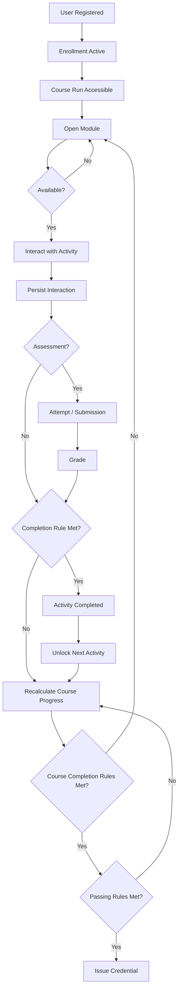

---

# 53. Minimal “Good LMS” Architecture

Jika tidak ingin over-engineering, baseline yang menurut dokumen ini cukup sehat adalah:

```text
User
Role / Permission
Course
CourseRun
Enrollment
Group
CourseSection
LearningItem
AvailabilityRule
CompletionRule
ActivityCompletion
Assignment
Submission
Quiz
Question
QuizAttempt
GradeItem
Grade
CourseProgress
CourseCompletion
FileAsset
CalendarEvent
Notification
DomainEvent
AuditLog
```

Tidak semua harus menjadi microservice atau bahkan tabel sendiri. Yang penting **semantics dan ownership-nya tidak bercampur**.

---

# 54. Recommended Modular Monolith Dependency Map

```text
identity
  ↑
  ├── authorization
  └── enrollment
          ↑
course ───┘
  ↑
content
  ↑
availability ← completion
  ↑              ↑
assessment ──────┤
  ↑              │
submission       │
quiz             │
  ↓              │
gradebook ───────┘

calendar      ← course/activity events
notification  ← domain events
analytics     ← domain events
files         ← referenced by content/submission/etc.
```

Circular compile-time dependency harus diminimalkan. Bila dua domain perlu bereaksi terhadap satu sama lain, gunakan application orchestration atau event contract.

---

# 55. What Moodle Specifically Teaches Us

## 55.1 Contextual access is first-class

Moodle role/capability bekerja terhadap context tree. Lesson:

> Permission pada LMS tidak cukup dimodelkan sebagai role global.

## 55.2 Enrolment is not authorization

Moodle `user_enrolments` menyimpan enrollment lifecycle, sedangkan `role_assignments` menentukan role pada context.

Lesson:

> Participation dan authority adalah konsep yang saling berhubungan tetapi berbeda.

## 55.3 Activity is extensible

Course dapat mengandung berbagai activity/resource melalui module abstraction.

Lesson:

> Course structure sebaiknya tidak hard-code satu jenis content saja.

## 55.4 Availability is centralized

Moodle dapat membatasi activity/section menggunakan date, group, completion, grade, dan condition lainnya.

Lesson:

> Access prerequisite harus menjadi reusable policy layer, bukan if-statement tersebar di setiap controller.

## 55.5 Completion is explicit

Moodle activity dapat mendukung manual completion, view completion, grade completion, dan custom rules.

Lesson:

> “Progress” harus berasal dari declared completion semantics.

## 55.6 Gradebook is central

Activity mengirim grades ke central gradebook.

Lesson:

> Final course grading tidak boleh menjadi tanggung jawab tiap activity secara terpisah.

## 55.7 Events form integration boundaries

Moodle merekomendasikan Events API untuk komunikasi antar-plugin dan logging.

Lesson:

> Side effects sebaiknya observe domain events daripada menempel ke core transaction secara acak.

## 55.8 Files belong to context

Moodle file areas mengaitkan file dengan context/component/item dan serving tetap melakukan access control.

Lesson:

> File bukan sekadar URL string.

---

# 56. What Canvas Reinforces

Canvas memperkuat beberapa pola:

1. Enrollment adalah object tersendiri dan dapat scoped pada section.
2. User dapat memiliki lebih dari satu enrollment/context.
3. Module mengorganisasi learning content dan dapat memiliki prerequisites/requirements.
4. Submission terikat assignment + eligible enrollment.
5. Instructor visibility/grading dapat dibatasi ke section.

Lesson:

> Participation, content sequencing, assessment transaction, dan grading scope merupakan domain yang berbeda.

---

# 57. What Open edX Reinforces

Open edX memperkuat:

1. Hierarchical course structure.
2. Reusable/extensible learning block abstraction.
3. Separation antara content state dan learner state.
4. Grade aggregation berjenjang.
5. Async recalculation untuk expensive derived work.
6. Content versioning untuk live course editing.
7. Course rerun tidak membawa learner enrollment/progress/grades.

Lesson:

> LMS yang matang memperlakukan content dan learner transaction sebagai data dengan lifecycle yang berbeda.

---

# 58. Recommended Comparison Method for Internal LMS

Untuk setiap module internal, isi matrix berikut.

| Domain | Entity internal | Benchmark entity | Source of truth internal | Expected source of truth | Mismatch? |
|---|---|---|---|---|---|
| Enrollment | | Enrollment | | | |
| Permission | | RoleAssignment/Capability | | | |
| Group | | Group/GroupMember | | | |
| Content | | Section/LearningItem | | | |
| Availability | | AvailabilityRule | | | |
| Assignment | | Assignment | | | |
| Submission | | Submission | | | |
| Quiz | | Quiz/Attempt | | | |
| Grade | | GradeItem/Grade | | | |
| Completion | | ActivityCompletion | | | |
| Course Progress | | CourseProgress | | | |
| Calendar | | CalendarEvent projection | | | |
| Files | | FileAsset | | | |
| Notification | | Notification | | | |
| Audit | | AuditLog | | | |

---

# 59. Business Flow Comparison Template

Gunakan template ini untuk satu flow.

## Flow Name

`Contoh: Student submits assignment`

### Actor

- Student
- System
- Instructor

### Preconditions — Internal LMS

```text
...
```

### Preconditions — Benchmark

```text
Authenticated
Active enrollment
Activity available
Submission window valid
Attempt/resubmission policy allows action
```

### Internal Flow

```text
1.
2.
3.
```

### Benchmark Flow

```text
1. Authenticate
2. Authorize/context check
3. Enrollment eligibility
4. Availability/deadline validation
5. Persist canonical submission
6. Record revision
7. Emit event
8. Evaluate completion
9. Schedule notification/analytics
```

### Difference

```text
...
```

### Risk

```text
P0 / P1 / P2 / P3
```

### Proposed Fix

```text
...
```

### Migration Impact

```text
Database:
API:
Frontend:
Historical data:
Background jobs:
```

---

# 60. Dependency Audit Template

Untuk setiap entity internal:

```text
ENTITY: __________________

Owns:
- ...

Strong dependencies:
- ...

Reads from:
- ...

Writes to:
- ...

Emits events:
- ...

Consumes events:
- ...

Derived fields:
- ...

State machine:
- ...

Can be deleted?
- ...

Historical retention:
- ...

Authorization context:
- ...
```

### Red flags

- entity menulis ke terlalu banyak domain,
- entity bergantung dua arah dengan entity lain,
- derived field tidak diketahui asalnya,
- status tidak mempunyai state transition,
- deletion behavior implicit,
- authorization tidak punya context.

---

# 61. Data Flow Audit Template

```text
INPUT
  ↓
Validation
  ↓
Authorization
  ↓
Canonical Write
  ↓
Derived Update
  ↓
Side Effects
  ↓
Read Projection
```

Untuk setiap tahap tanyakan:

### Input

- Siapa actor?
- Apa command-nya?
- Apakah request dapat di-retry?

### Validation

- Business precondition apa?
- State transition valid?

### Authorization

- Capability apa?
- Context apa?
- Group/section scope apa?

### Canonical Write

- Record mana yang merupakan source of truth?
- Apa transaction boundary?

### Derived Update

- Apa yang dihitung ulang?
- Bisa direbuild?

### Side Effects

- Notification?
- Analytics?
- Webhook?
- Calendar?

### Read Projection

- Data UI berasal dari canonical query atau cache?
- Cache invalidation mechanism apa?

---

# 62. Suggested Refactoring Priority

Jika LMS internal saat ini buggy, jangan langsung rewrite seluruh LMS.

Prioritas yang lebih aman:

## Phase 1 — Establish invariants

Fix:

- authorization,
- enrollment uniqueness,
- grade ownership,
- completion semantics,
- destructive cascade.

## Phase 2 — Establish state machines

Formalize:

- enrollment,
- submission,
- quiz attempt,
- course run.

## Phase 3 — Centralize derived systems

- gradebook,
- progress,
- completion,
- availability.

## Phase 4 — Decouple side effects

- notifications,
- calendar projection,
- analytics,
- integrations.

## Phase 5 — Historical integrity

- revisions,
- snapshots,
- grade history,
- audit logs,
- course versions.

---

# 63. Decision Rules — When Simplicity Is Acceptable

Tidak semua LMS membutuhkan Moodle-level abstraction.

## Global role masih acceptable jika

- user benar-benar hanya dapat mempunyai satu role,
- tidak ada multi-course role overlap,
- tidak ada group-scoped instructor,
- requirement tersebut dipastikan tidak akan berubah.

## Course tanpa CourseRun masih acceptable jika

- course tidak pernah dijalankan berulang sebagai batch,
- tidak ada per-period enrollment,
- tidak ada rerun/version requirement.

## Single submission row masih acceptable jika

- resubmission tidak didukung,
- historical revision tidak required.

## No event bus masih acceptable jika

- modular monolith kecil,
- side effects dapat dijalankan melalui internal application event/outbox sederhana.

Intinya:

> Sederhana itu baik selama semantics tidak dicampur.

---

# 64. Fast Diagnostic Questions

Jika ingin menemukan akar masalah dengan cepat, jawab 20 pertanyaan berikut untuk LMS internal:

1. Apa entity canonical yang mengatakan user mengikuti course?
2. Apa bedanya role dan enrollment di sistem?
3. Bisa user menjadi mentor di course A dan student di course B?
4. Apa yang membuat activity dianggap completed?
5. Apa bedanya completed dan passed?
6. Dari mana course progress dihitung?
7. Apakah progress bisa direbuild dari data lain?
8. Apa entity canonical untuk nilai?
9. Apa yang terjadi ketika nilai diubah manual?
10. Apakah grade history tersedia?
11. Apa yang terjadi jika assignment dihapus setelah ada submission?
12. Apa yang terjadi jika question diedit setelah quiz attempt?
13. Apa yang terjadi ketika learner suspended?
14. Apa yang terjadi ketika learner re-enrolled?
15. Bagaimana group membatasi instructor?
16. Apakah backend melakukan availability check?
17. Deadline canonical tersimpan di mana?
18. Jika email gagal, apakah submission tetap sukses?
19. Apakah course baru/batch baru membawa learner state lama?
20. Dapatkah tim menjelaskan perubahan data menggunakan audit/event log?

Jika 5–8 dari pertanyaan tersebut tidak memiliki jawaban yang jelas, kemungkinan problem utama bukan sekadar bug implementasi tetapi **domain model/business-flow ambiguity**.

---

# 65. Gold Standard Mental Model

Gunakan model ini ketika menilai feature baru:

```text
WHO?
User + Enrollment + Contextual Permission

WHERE?
CourseRun + Section + LearningItem

CAN THEY ACCESS IT?
Availability Rules

WHAT DID THEY DO?
Submission / Attempt / Interaction

WHAT WAS THE RESULT?
Raw Assessment Result

WHAT IS THE ACADEMIC VALUE?
Gradebook

DID IT SATISFY REQUIREMENTS?
Completion

WHAT CHANGED BECAUSE OF IT?
Progress + Availability Projection

WHO NEEDS TO KNOW?
Events + Notifications

HOW DO WE PROVE IT LATER?
History + Audit + Analytics
```

Jika sebuah feature tidak dapat dipetakan dengan jelas ke pertanyaan-pertanyaan tersebut, biasanya domain boundary-nya belum cukup jelas.

---

# 66. Recommended “Reference Architecture” Summary

```text
┌─────────────────────────────────────────────────────────────┐
│                    IDENTITY & ACCESS                        │
│ User · Context · Role · Capability · RoleAssignment        │
└───────────────────────────┬─────────────────────────────────┘
                            │
┌───────────────────────────▼─────────────────────────────────┐
│                   PARTICIPATION                             │
│ Enrollment · Cohort · Group · GroupMember                  │
└───────────────────────────┬─────────────────────────────────┘
                            │
┌───────────────────────────▼─────────────────────────────────┐
│                 COURSE DELIVERY                             │
│ CourseDefinition · CourseVersion · CourseRun               │
│ CourseSection · LearningItem                               │
└───────────────────────────┬─────────────────────────────────┘
                            │
          ┌─────────────────┼──────────────────┐
          │                 │                  │
┌─────────▼────────┐ ┌──────▼──────────┐ ┌─────▼────────────┐
│ ACCESS POLICY    │ │ LEARNING        │ │ ASSESSMENT       │
│ AvailabilityRule│ │ CompletionRule  │ │ Assignment       │
│ prerequisite    │ │ ActivityState   │ │ Quiz             │
└──────────────────┘ └──────┬──────────┘ │ Attempts         │
                             │            │ Submissions      │
                             │            └──────┬───────────┘
                             │                   │
                             └─────────┬─────────┘
                                       │
                             ┌─────────▼─────────┐
                             │    GRADEBOOK      │
                             │ GradeItem · Grade │
                             │ Policy · History  │
                             └─────────┬─────────┘
                                       │
                             ┌─────────▼─────────┐
                             │ COMPLETION        │
                             │ CourseProgress    │
                             │ CourseCompletion  │
                             └───────────────────┘

Cross-cutting:
Files · Calendar · Notification · Events · Audit · Analytics · Integration
```

---

# 67. Final Benchmark Rules

Untuk audit cepat, anggap LMS yang sehat memenuhi rule berikut:

1. **User identity stabil.**
2. **Enrollment merupakan participation entity.**
3. **Role/capability dievaluasi berdasarkan context.**
4. **Course delivery memiliki lifecycle.**
5. **Course structure terpisah dari learner state.**
6. **Availability merupakan policy, bukan UI condition.**
7. **Submission dan attempt menyimpan historical interaction.**
8. **Gradebook menjadi central academic aggregation boundary.**
9. **Completion explicit dan berbeda dari grade.**
10. **Progress adalah derived data yang dapat direbuild.**
11. **Groups membatasi visibility/action dengan backend enforcement.**
12. **Calendar adalah projection dari canonical schedule.**
13. **File access mengikuti entity context.**
14. **Notifications adalah side effect, bukan bagian canonical transaction.**
15. **Events/audit memungkinkan sistem menjelaskan apa yang terjadi.**
16. **Course copy/rerun tidak mencampur learner transactional state.**
17. **Editing active content memiliki version/migration policy.**
18. **State transitions explicit dan testable.**
19. **Retry/idempotency diperhitungkan.**
20. **Derived aggregate tidak menjadi source of truth tunggal.**

---

# 68. References

Dokumen ini menggunakan dokumentasi resmi berikut sebagai benchmark utama.

## Moodle

- Moodle Developer Documentation 5.2 — Introduction  
  https://moodledev.io/docs/5.2
- Moodle 5.2 Release Information  
  https://moodledev.io/general/releases/5.2
- Moodle Core APIs 5.2  
  https://moodledev.io/docs/5.2/apis/core
- Access API / contextual roles and capabilities  
  https://moodledev.io/docs/5.2/apis/subsystems/access
- Roles API  
  https://moodledev.io/docs/5.2/apis/subsystems/roles
- Enrolment API  
  https://moodledev.io/docs/5.2/apis/subsystems/enrol
- Availability API 5.2  
  https://moodledev.io/docs/5.2/apis/subsystems/availability
- Activity Completion API  
  https://moodledev.io/docs/5.2/apis/core/activitycompletion
- File API  
  https://moodledev.io/docs/5.2/apis/subsystems/files
- File API Internals  
  https://moodledev.io/docs/5.2/apis/subsystems/files/internals
- Calendar API 5.2  
  https://moodledev.io/docs/5.2/apis/core/calendar
- Message API 5.2  
  https://moodledev.io/docs/5.2/apis/core/message
- Questions API 5.2  
  https://moodledev.io/docs/5.2/apis/subsystems/question
- Backup API 5.2  
  https://moodledev.io/docs/5.2/apis/subsystems/backup
- Moodle Gradebook PHP documentation  
  https://phpdoc.moodledev.io/main/da/d09/group__core__grades.html
- Moodle Groups and Cohorts user documentation  
  https://docs.moodle.org/404/en/Groups_and_cohorts

## Canvas LMS

- Canvas Courses API  
  https://developerdocs.instructure.com/services/canvas/resources/courses
- Canvas Enrollments API  
  https://developerdocs.instructure.com/services/canvas/resources/enrollments
- Canvas Modules API  
  https://developerdocs.instructure.com/services/canvas/resources/modules
- Canvas Submissions API  
  https://developerdocs.instructure.com/services/canvas/resources/submissions

## Open edX

- Open edX Platform Architecture  
  https://docs.openedx.org/en/latest/developers/references/developer_guide/architecture.html
- Open edX Grades Background  
  https://docs.openedx.org/projects/edx-platform/en/latest/references/docs/lms/djangoapps/grades/docs/background.html
- Split Mongo Modulestore / Course Structures & Versioning  
  https://docs.openedx.org/projects/edx-platform/en/latest/references/docs/xmodule/modulestore/docs/split-mongo.html
- Course Enrollment Requirements  
  https://docs.openedx.org/en/ulmo/educators/references/student_management/enrollment_requirements.html
- Course Reruns  
  https://docs.openedx.org/en/latest/educators/references/course_development/course_reruns.html

---

# 69. Scope Caveat

Arsitektur actual Moodle, Canvas, dan Open edX jauh lebih kompleks daripada logical model di dokumen ini. Nama entity dalam dokumen ini sengaja dinormalisasi agar mudah dibandingkan dengan LMS custom.

Dokumen ini sebaiknya digunakan sebagai:

```text
behavioral reference
+ domain modeling checklist
+ data integrity checklist
+ business flow benchmark
```

bukan sebagai kewajiban menyalin physical database schema platform tertentu.

---

**End of document.**
